# ToolLife Policy, explained from the start

This is the one document to read to understand our AI in Manufacturing project: what problem it solves, what data it uses, what we built, what the results are, and what they do and do not prove. It assumes school-level maths and science and nothing about machining or machine learning. Every technical word is explained the first time it appears, and there is a word list at the end.

Read it top to bottom once. The physics of cutting, with photos and plots, is on its own page: [How a cutter dies](https://aadityakshatriya.github.io/AI-in-manufacturing/physics.html).

---

## 1. The whole project in one paragraph

A CNC milling machine cuts steel with a small spinning tool called a cutter. The cutter wears a little on every cut and eventually breaks. Change it too early and you waste money; change it too late and it snaps in the middle of a part. We built a system that reads the machine's motor current and vibration after every cut, estimates how many more cuts the cutter can survive and how likely it is to break soon, and then decides: **keep going** or **change the cutter now**. We tested every part on cutters the system had never seen.

**What we found, in short:** the signals carry wear on every machine we checked. The settings of the cut already explain most of a cutter's life; the sensors add most near the end of life and when something unusual happens. Thirty other models tested the same way did no better than ours beyond luck, and the biggest limit is that only 13 cutters were run until they broke.

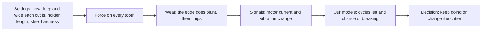

The left half is physics we cannot see directly. The right half is what we built.

---

## 2. The physics in five minutes

### The machine and the cutter

A **CNC machine** (Computer Numerical Control) is a machine tool moved by a computer program. Ours does **milling**: a cutting tool spins fast and is pushed along a path, shaving metal off a steel block. The cutting tool is an **end mill**, a 10 mm carbide rod with four spiral cutting edges called **teeth**. It is held in a **holder** that fits into the machine's spinning shaft, the **spindle**.

The cutter spins at 3,200 turns a minute, which is 53 turns a second. With four teeth, the steel is hit 213 times a second. Each tooth shaves a chip about 0.05 mm thick, thinner than a human hair.

### One cycle

The steel block is cut away ring by ring. The cutter travels once around the outside of the block, removing a ring of steel; that one lap is **one cycle**, about 31 seconds of actual cutting (each recording, including moving between rings, lasts one to two minutes). Then it moves in and does the next ring. A cutter does cycle after cycle until it breaks. All its cycles from new to broken are its **lifecycle**.

### How a cutter wears

Every tooth hit is a small hammer blow at several hundred degrees. Over hundreds of thousands of hits:

- the face below the edge rubs flat (**flank wear**), so the edge rubs instead of slicing and the force goes up;
- small pieces break off the edge (**chipping**);
- finally a tooth, or the whole cutter, snaps (**fracture**). Every cutter in our main data ended this way.

Wear follows three stages: a short break-in, a long slow middle, then runaway wear at the end, because a blunt edge pushes harder, runs hotter and wears faster.

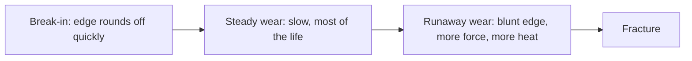

### What decides how long a cutter lives

The settings change the force on every tooth, and so the life. In our data:

| Setting | What it physically does | What happened to our cutters |
|---|---|---|
| Sideways bite (radial depth): 4.5 or 8 mm of the 10 mm width | A wider bite keeps each tooth in the steel longer and puts more teeth in at once, so more force | At 8 mm, cutters lived 30–54 cycles; at 4.5 mm, 60–150 |
| Holder length: 80 or 160 mm | A cutter sticking further out bends like a diving board; twice as long is about 5–8 times floppier, and it starts shaking on its own (chatter) | Both cutters on the long holder died almost at once, at cycles 1 and 15 |
| Steel hardness: 35–42 on the Rockwell C scale | Harder steel needs more force and wears the edge faster | With the same settings, harder blocks gave shorter lives |
| Depth (axial depth): 5 or 10 mm | More of the cutter's height is cutting | Surprisingly little effect on its own |

The spin speed and feed were the same for every cutter, so our data cannot show how speed changes life.

---

## 3. What we predict: remaining useful life

The cutter's **remaining useful life (RUL)** is the number of cycles it can still do before it breaks. A cutter that breaks during cycle 50:

| Cycle just finished | Cycles left (RUL) |
|---:|---:|
| 1 | 49 |
| 25 | 25 |
| 45 | 5 |
| 49 | 1 |
| 50 | broke |

Because every cutter in the experiment was run until it broke, we know the true RUL for every recorded cycle. That is what lets a model learn.

**Important:** nobody measured the wear itself. The dataset tells us *when* each cutter broke, not how worn it was along the way. So our models never "see" wear. They learn the link between what the signals looked like and how close the cutter was to breaking.

After every cycle, our main model gives a **risk curve**: the chance of breaking on each of the next cycles. From that one curve we read:

- **cycles left**: a low, a middle and a high estimate;
- **the chance of breaking within the next 1, 3 or 5 cycles**, which is what the decision needs.

---

## 4. What the machine feels: the signals

Nobody can watch a cutter spinning 53 times a second inside a spray of chips. The machine was fitted with two kinds of sensors.

**Motor current** is an electricity meter on each motor. The spindle motor's current shows the twisting effort of cutting. The table motors push the steel into the cutter, so their current shows how hard the steel pushes back. A blunt edge rubs instead of slicing, which pushes back on the table more than it adds to the twisting, so **the table motor's current rises fastest as a cutter wears**. These meters update only 5 times a second, so they show load, not individual tooth hits.

**Vibration** sensors (accelerometers) take 25,000 readings a second: fast enough to hear every tooth hit. A chipped tooth makes one of the four hits different, which adds a beat that repeats once per turn.

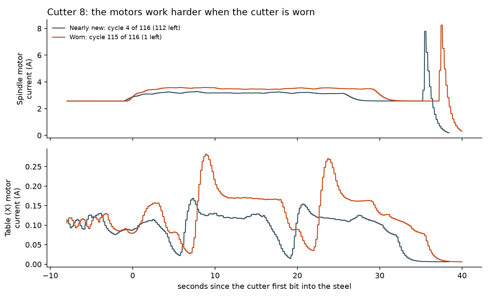

What we measured across all 13 normal cutters, each compared with its own first cycles:

- table motor current rose in **all 13**: over the last 10% of life it was 1.3 to 2.7 times its value when new;
- vibration rose too, and the once-per-turn beat at least doubled over the last 10% of life in 10 of 13 cutters;
- the signals stay flat for the first third to half of life, then bend upwards: the runaway stage of wear, showing up in the electricity and the vibration.

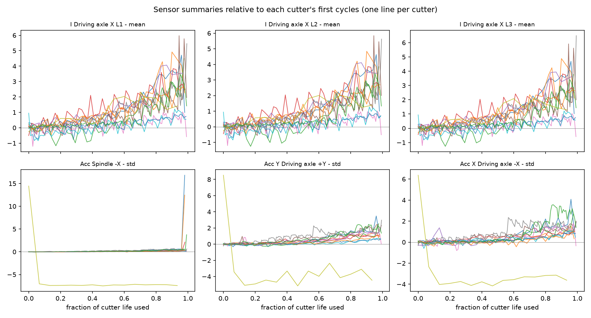

**Is the rise wear, or just where the cutter is in the block?** Inside each layer the rings get smaller towards the middle, so a signal could change with ring position rather than with wear. For each cutter we removed the straight-line effect of ring number from both the signal and the fraction of life used, and correlated what was left. The table current still tracked life strongly (average 0.94 on a scale where 1 is perfect; above 0.5 in 12 of 13 cutters), and so did spindle current (0.79) and table vibration (0.84). The rise is wear, not position (`scripts/19_position_check.py`).

---

## 5. The data, and where it came from

### Our main dataset

Recorded at Rzeszów University of Technology, Poland, and published in 2025 (Piecuch & Żabiński, *Scientific Data*, [paper](https://www.nature.com/articles/s41597-025-04923-y), [files](https://doi.org/10.6084/m9.figshare.28589216), free to use under CC BY 4.0).

- 14 cutters, each run from new until it broke, on a Haas VF-1 milling machine cutting hardened steel
- 968 recorded cycles
- 20 sensor channels: 8 vibration (25,000 readings a second) and 12 motor currents
- a 24 GB download that unpacks to 112 GB of raw recordings, plus a small table of 120 summary numbers per cycle

One cutter broke on its very first cycle, so it has no wear history; we keep it aside. That leaves **13 cutter lives**. 968 rows sounds like a lot, but it is really 13 life stories, because cycles of the same cutter are near-copies of each other.

### Four more datasets from other machines

Thirteen lives is not much, so we added four public datasets in which cutters were also used until the end of their life:

| Dataset | Cutter lives | How a life ends | Signals we used | Source |
|---|---:|---|---|---|
| NASA Ames milling | 15 | worn to 0.3 mm | spindle current, vibration | NASA Prognostics Data Repository |
| Hannover (LUH), 3 machines | 9 | worn to 0.15 mm | spindle torque (it has no vibration sensor) | Denkena et al., Data in Brief 2023 |
| MSTW EndMill 2026 | 25 | worn to 0.3 mm | spindle current, vibration | Sayyad et al., Figshare 2026 |
| VMC 650 production shop, India | 24 | the operator decided | spindle current, vibration | Rizwan, Zenodo 2026 |

With ours, that is **86 cutter lives on about 7 machines**. Seven MSTW recordings were published damaged, and we skip them.

Each dataset measures things differently, so we put them on one **common footing**:

- every signal is divided by the same cutter's value when it was new ("how much has it changed since new"), which cancels most differences between machines and sensors;
- age is measured as the **fraction of life used**: 0 for a new cutter, 1 at the end of its life, however that dataset defines the end.

The spindle load rises with wear on other machines too:

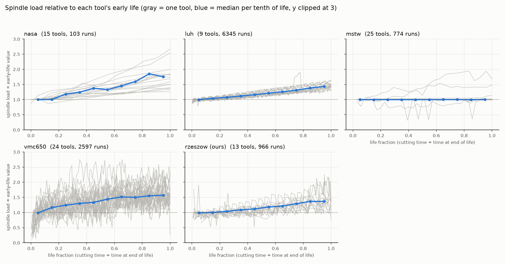

---

## 6. How we test fairly

A **machine learning model** learns a pattern from examples instead of being told the rule. **Training** is showing it examples with known answers; **testing** is checking it on examples it has never seen.

The trap with our data: cycle 40 and cycle 41 of the same cutter look almost the same. If we shuffled all the rows and split them randomly, the model would train on cycle 40 and be "tested" on cycle 41: it would effectively see the answer, and the score would look much better than it really is. This mistake is called **data leakage**, and many published tool-wear results suffer from it.

Our rule: **hide one whole cutter**. Train on the other 12, predict the hidden one, and repeat until every cutter has been hidden once. Every number in this document comes from a cutter the model never saw. Each cutter counts equally in the averages. The formal name is *leave-one-group-out cross-validation*.

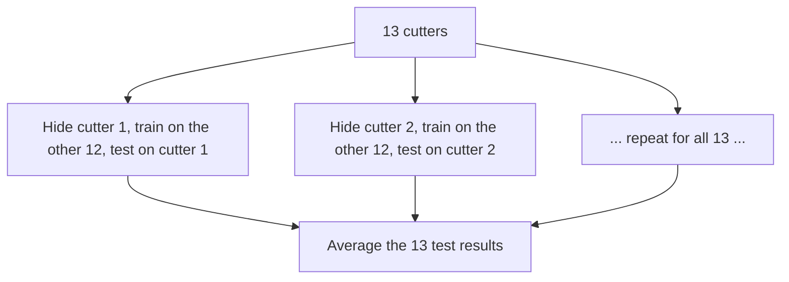

With only 13 cutters, differences of a few cycles between models are within the noise. To check, we resample the 13 cutters at random 5,000 times (a **paired bootstrap**: both models are always judged on the same resampled cutters) and see whether the gap between two models could be zero. We say so wherever it matters.

### Three mistakes we found in our own work, and fixed

Reviewing everything before this presentation, we found three problems. All results in this document are after the fixes.

1. **"Compared with when the cutter was new" peeked at the future.** We measured "new" as the first 10% of each cutter's life, but on a real machine you do not know how long the cutter will live, so you cannot know where its first 10% ends. Now "new" is the first three cycles seen so far. (The leak did not flatter us: with it, the main model was slightly worse, 21.3 cycles of error against 20.5 for a one-seed check.) The same mistake was hiding in how one other dataset (VMC 650) measured its idle current, and in how long recordings from another (LUH) were thinned; both fixed.
2. **The autoencoders that scored the training cutters had heard the hidden cutter.** Now, in each test, every health score the model sees (for training cutters and the hidden one) comes from an autoencoder that never heard either (15 autoencoders in all). This leak did flatter us: the TCN on the health score went from 22.6 cycles of error to 24.4 once it was fixed.
3. **A divide-by-zero on cutter 10.** It is the only cutter on the long holder. When it was hidden, "holder length" never varied in training, and scaling it divided by almost zero, so the network saw a huge number. Its score had been arbitrary; now an input that never varies in training is set to zero.

---

## 7. The models

### Yardsticks

Simple methods the real models must beat:

- **Change every N cycles**, with N tuned on the training cutters. Roughly what workshops do today.
- **Settings and age only**: a **survival model** (a Weibull model, the standard statistics model for how long things last) that knows the cutter's settings and how many cycles it has done, and no sensor data. If sensors cannot beat this, they add nothing.
- **LightGBM**: a standard model made of many small decision trees, given the 120 summary numbers per cycle that the dataset's authors released.

### Model 1: a CNN autoencoder that learned healthy cutting

An **autoencoder** is a network trained to **squeeze its input into a few numbers and then rebuild the input from those numbers**. It has two halves:

- the **encoder** squeezes: it takes 0.16 seconds of vibration from five table sensors (5 × 4,096 readings) and passes it through 6 **convolution** layers, each of which slides small learned pattern detectors (filters) along the signal and halves its length. The result is squeezed into **64 numbers**, a fingerprint of how that cut sounded;
- the **decoder** is the mirror image: it rebuilds the 5 × 4,096 readings from those 64 numbers.

It is trained with no labels at all: the only goal is to rebuild its input well. It has about **4 million** learned numbers. The useful trick: we trained it **only on the healthy first 30% of the training cutters' lives**. So it learns what healthy cutting sounds like. When a cutter wears, its sound drifts away from what the network learned, and the rebuild gets worse. The size of the rebuild error is a **health score**.

To keep it honest, we trained five autoencoders, each without a different group of cutters, and every cutter is scored by an autoencoder that never heard it.

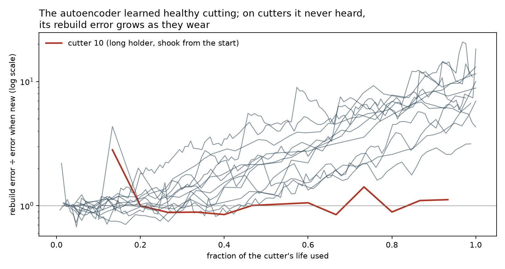

**Result:** on cutters it never heard, the health score rose steadily with wear in 12 of 13 cutters, reaching several times its starting level. The exception is cutter 10 on the long holder, which shook violently from its first cycle, so its sound was never "healthy" to begin with.

**Did it need 4 million learned numbers?** No. We built four simpler health scores the same way (learned only from healthy cutting of other cutters) and scored all five with the standard yardsticks for a health indicator: does it only go up (**monotonicity**), do all cutters follow a similar path (**trendability**), and does it end at a similar level when cutters fail (**prognosability**); 1 is best for each.

| Health score | Only goes up | Similar path across cutters (worst pair) | Similar level at failure | Rises in |
|---|---:|---:|---:|---:|
| PCA on the raw vibration (a straight-line autoencoder) | 0.57 | 0.62 | 0.69 | 12 of 13 |
| PCA on the vibration spectrum | 0.41 | 0.01 | 0.70 | 12 of 13 |
| **Distance from healthy, on our physics features** (Mahalanobis) | **0.58** | **0.74** | **0.81** | **13 of 13** |
| Our CNN autoencoder (4 million numbers) | 0.48 | 0.47 | 0.70 | 12 of 13 |
| Table motor current alone, no model | 0.51 | 0.51 | 0.68 | 13 of 13 |

**PCA** (principal component analysis) is the straight-line version of an autoencoder: it squeezes the signal into 64 numbers using only weighted sums. It did as well as our 4-million-number network, slightly better. So most of the wear signal is simple: the cut gets louder and its energy shifts, which a straight-line model already captures. The best health score was the simplest idea of all: how far today's physics features are from the cloud of healthy cycles. The rebuild-error scores miss cutter 10, because they compare it with *other* cutters' healthy sound; the table current and the distance score catch it, because they compare it with its own start.

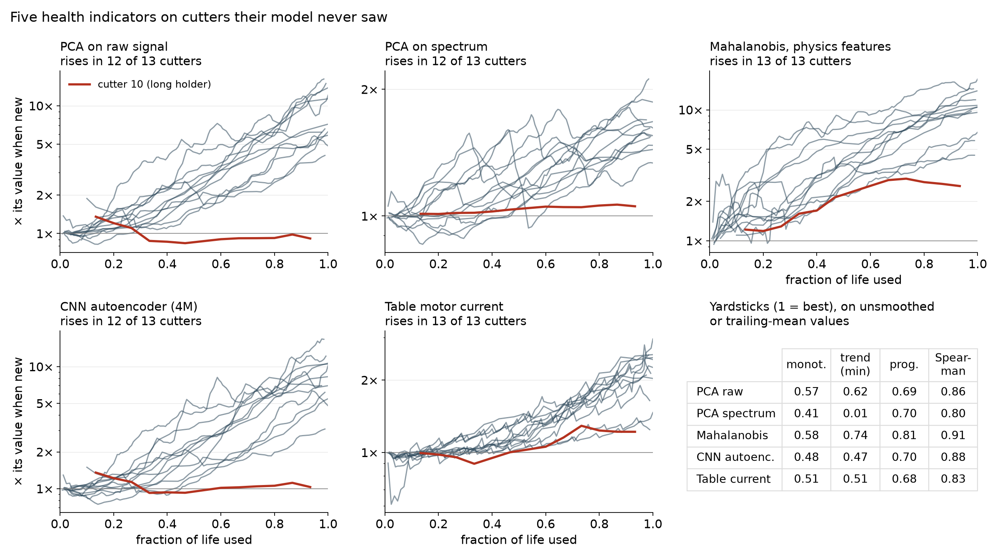

### Model 2: a TCN that reads the cutter's history and predicts

A **TCN** (temporal convolutional network) is a network that reads a sequence in order, here the sequence of a cutter's cycles. It is built from 1-D convolutions along the cycles that are:

- **causal**: each prediction uses only this cycle and earlier ones, never later ones, just as on a real machine;
- **dilated**: each layer looks further back than the last (gaps of 1, 2, 4, then 8 cycles), so after 4 layers (each with two convolutions) it takes in about the last 60 cycles.

After every cycle, it takes about 30 numbers for that cycle: physics features from the motors and vibration (table and spindle current while cutting, energy spent per mm³ of steel, vibration levels at the tooth rhythm and the once-per-turn rhythm, each relative to when the cutter was new), the settings, and the cutter's age. Its output is the risk curve described in section 3. It has about 110,000 learned numbers, deliberately small because only 12 cutters are available to learn from each time. We train 5 copies with different random starts and average them.

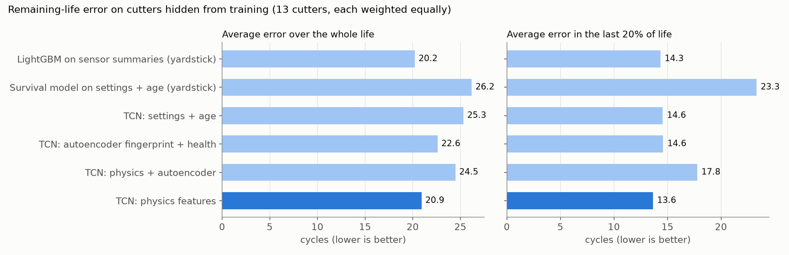

**Results** (average error in cycles left, on the 13 hidden cutters; every model scored on exactly the same cycles; lower is better):

| Model | Whole life | Last 20% of life | Over-estimate in last 20% |
|---|---:|---:|---:|
| **TCN on physics features (our main model, chosen before any comparison)** | **21.9** | **15.9** | **12.0** |
| LightGBM on the 120 released summaries | 21.6 | 15.8 | 14.1 |
| LightGBM on the TCN's physics features | 26.7 | 18.1 | 16.5 |
| TCN on the autoencoder's health score + settings + age | 24.4 | 14.2 | 10.1 |
| TCN on physics features + the autoencoder's health score | 23.8 | 18.7 | 14.8 |
| Survival model on settings + age (no sensors) | 26.3 | 23.9 | 22.0 |
| TCN on age only (no sensors, no settings) | 27.9 | 23.4 | 22.4 |

The TCN trained with one random start instead of five scores between 21.7 and 24.1, so differences of about 2 cycles are just luck. With 13 cutters, the paired bootstrap (section 6) is what decides whether a gap is real.

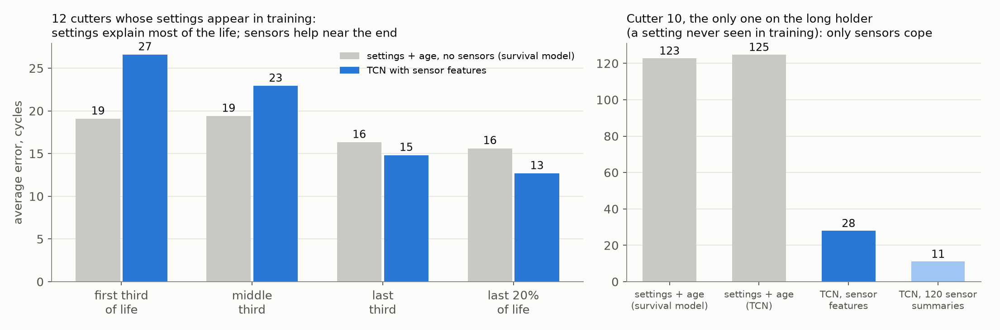

What this means:

- **Settings explain most of a cutter's life.** On the 12 cutters whose settings also appear among the training cutters, the survival model that knows only the settings and the age is off by 18 cycles over the whole life, *better* than the TCN's 21. Early in life there is no wear yet for the sensors to see, and the TCN guesses worse than the settings do.
- **Sensors help near the end, where decisions are made**: in the last 20% of life the TCN is off by 13 cycles on those 12 cutters, against 16 for the settings model.
- **Sensors are essential when something happens that the settings cannot predict.** Cutter 10 is the only cutter on the long holder. When it is hidden, no training cutter used that holder, so the settings models predict a normal life: they are off by about 123 cycles. The TCN sees the cutter shaking and is off by 28. A real workshop will always meet holders, materials and settings it has no history for; that is the case for sensors.
- **Same model, with and without sensors:** the TCN on age alone is off by 27.9; with the sensor features, 21.9. The 6-cycle gain is real (95% bootstrap interval 2.6 to 9.5 cycles; better on 10 of 13 cutters).
- **The autoencoder's health score did not add to the physics features.** Adding it made the TCN slightly worse (23.8 against 21.9; 95% interval of the gap 0.1 to 4.5 cycles, physics alone better on 8 of 13 cutters). On its own with settings and age, it was worse over the whole life (24.4) but the best TCN input in the last 20% (14.2 against 15.9), a gap that could be luck (interval −6.0 to +10.5). The health-score table above explains why: the autoencoder's score is a noisier wear signal than simple features.
- **TCN vs LightGBM: a tie.** On the 120 summaries LightGBM matches our TCN (21.6 vs 21.9); given the TCN's own features, LightGBM is worse (26.7). Each model does best on the inputs it suits, and the two best combinations are level.
- **How good is 21.9 cycles?** It is good on short-lived cutters and poor on the longest-lived ones (cutters 7, 9 and 105, which lived 125–150 cycles), because almost no training cutter lived that long. The model is also poor on cutters unlike the others, such as cutter 102.
- **The ranges.** The model's own low-to-high range (10% to 90%) is too confident: it contains the true value only 13% of the time. We widen it by the worst miss seen on the other cutters, a conformal-style correction; the widened range then contains the truth 97% of the time, and stays fully inside for the whole life of 12 of 13 cutters, but it is about 115 cycles wide. That is honest but too wide to act on, which is why the decisions use the risk curve itself, not this range. (A formal conformal guarantee does not quite apply, because the margins come from simpler models trained inside each test.) We also tried two ways of making the risk curves less confident; both made the middle estimate worse, so we did not use them.

### Every other model we tried

To answer "did you just pick a model you liked?", we ran **30 other models** (and later two more, for the pretraining test in the transfer section) through exactly the same test: the same 13 hidden cutters, the same cycles, the same scoring. The TCN on physics features was fixed as our main model **before** this comparison, and we did not switch to whichever came out best, because picking the best of 30 on the test cutters would itself be a kind of leak: with this many tries, one will look better by luck.

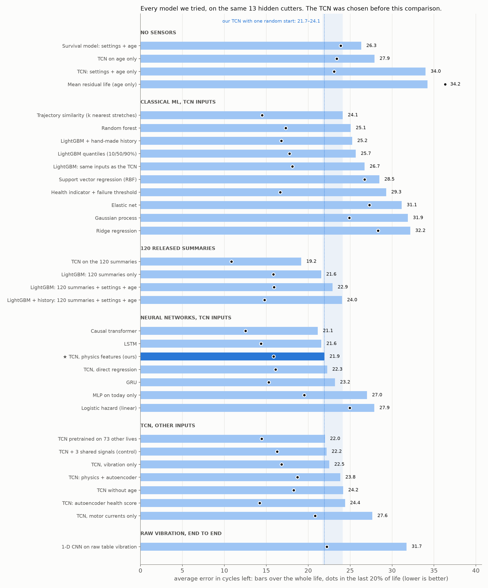

| Family | Model | Whole life | Last 20% | What it assumes about how a cutter dies |
|---|---|---:|---:|---|
| No sensors | Survival model on settings + age | 26.3 | 23.9 | Settings fix how long a cutter lasts; nothing else matters |
| | Average remaining life at this age | 34.2 | 36.3 | All cutters are alike; only age matters |
| Classical | Health indicator + threshold | 29.3 | 16.7 | The table current climbs with wear and the cutter dies when it crosses a fixed level |
| | Trajectory similarity (nearest past cutters) | 24.1 | 14.5 | A cutter dies like the past cutters whose history looked most like it |
| | Ridge / elastic net (straight-line models) | 32.2 / 31.1 | 28.3 / 27.3 | Remaining life is a weighted sum of today's readings |
| | Support vector regression / Gaussian process | 28.5 / 31.9 | 26.7 / 24.9 | Remaining life varies smoothly with today's readings |
| | Random forest / LightGBM | 25.1 / 26.7 | 17.3 / 18.1 | Wear is a set of thresholds on today's readings |
| | LightGBM + hand-made history (recent averages and slopes) | 25.2 | 16.8 | As above, plus how fast the readings are changing |
| Neural, same inputs as the TCN | Linear risk model (no history) | 27.9 | 25.0 | Today's readings set the risk; the past does not matter |
| | Small network on today only (no history) | 27.0 | 19.5 | Same, but allowing curved relationships |
| | GRU / LSTM (recurrent networks) | 23.2 / 21.6 | 15.3 / 14.4 | A running memory of the whole past tracks accumulated damage |
| | Transformer | 21.1 | 12.5 | The model can look back at any particular past cycle (for example, when a chip first appeared) |
| | TCN predicting cycles left directly, no risk curve | 22.3 | 16.1 | Same memory, asked for one number instead of a curve |
| Which inputs | TCN on vibration only / motor currents only | 22.5 / 27.6 | 16.8 / 20.8 | Shaking (vibration) vs force (current) carries the wear signal |
| | TCN without the age input | 24.2 | 18.3 | The signals alone know how worn the cutter is |
| | TCN on the 120 released summaries | **19.2** | **10.8** | More, rawer statistics of every sensor, instead of our 29 physics features |
| Transfer | TCN pretrained on 73 lives from the four other datasets, then trained on ours (control: same inputs, no pretraining) | 22.0 (22.2) | 14.5 (16.3) | How load and vibration change towards the end of a life carries over between machines (section 7, transfer) |
| Raw signal | 1-D CNN trained end to end on raw vibration | 31.7 | 22.2 | The network finds its own features in the raw sound (tested with 5 groups of cutters, not one at a time) |

What the zoo tells us:

- **The architecture hardly matters.** TCN, LSTM, GRU and transformer are all within about a cycle of each other, inside the single-start spread of 21.7 to 24.1, and every bootstrap interval of their differences includes zero. The transformer was best in the last 20% (12.5), but with 13 cutters that gap could be luck (interval −0.7 to 8.3 cycles).
- **What the model is given matters more.** The same TCN on the dataset's 120 released summaries scored best of all, 19.2. Its 2.8-cycle edge over our physics features is within the noise (interval −1.5 to 7.3), but it suggests our 29 hand-picked features leave some information out. We report it rather than switch to it.
- **Memory matters, mainly for the unusual cutter.** The neural models without history (the linear risk model and the network on today only) are 5 to 6 cycles worse overall, and almost all of that is cutter 10: on the other 12 cutters they are level with the TCN (19.5 and 20.7 against 21.4).
- **Straight-line models are clearly worse** (ridge, elastic net, SVR, Gaussian process: 28 to 32). The link between the signals and life is not a straight line.
- **The classic prognostics method, a threshold on a health indicator, is useless early and decent late** (41 cycles off in the first third of life, 17 in the last third): it only knows anything once the current has started climbing towards the failure level.
- **Vibration alone is about as good as everything together** (22.5); motor currents alone are worse (27.6), and again almost all of that is cutter 10, whose problem was shaking.
- **The model does not just count cycles**: on age alone it is clearly worse (27.9), and without age, a little worse (24.2).
- **Training a CNN directly on the raw vibration did not beat hand-made features** with 10 to 11 training cutters. Its error matched "settings + age only"; it found wear in the sound but not better than our features.

**Would more cutters help? Yes, clearly.** We retrained the TCN on a random 4, 6 or 9 of the 12 training cutters (three different draws each) and tested on the same hidden cutters:

| Training cutters | Whole life | Last 20% |
|---:|---:|---:|
| 4 | 34.8 | 26.5 |
| 6 | 34.4 | 25.6 |
| 9 | 29.3 (27.9 to 30.4 across draws) | 21.4 |
| 12 | 21.8 | 16.0 |

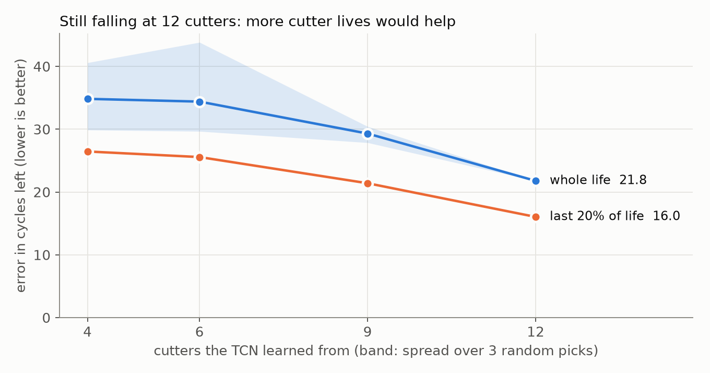

The error is still falling steeply at 12, with no sign of flattening. So the limit of this project is the number of cutter lives, not the model: every extra cutter run to failure would make the predictions better. This is also why the architecture hardly matters: with 12 examples to learn from, no model can learn much more than the others. (`scripts/24_learning_curve.py`, two random starts per model.)

Three real cutters, replayed cycle by cycle:

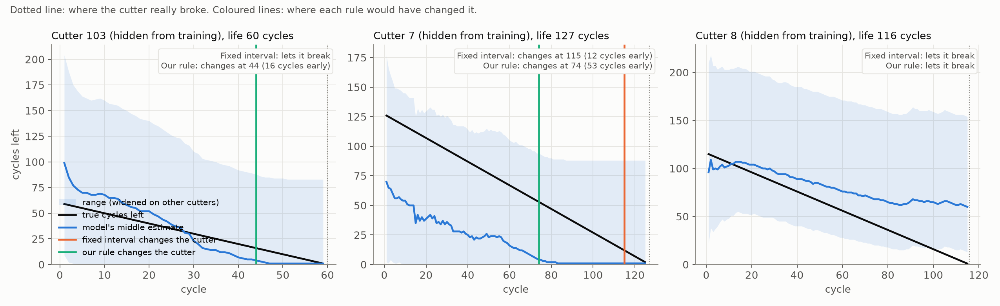

### Experiment: does what other machines teach transfer to ours?

We trained a small TCN on only the inputs every dataset has: spindle load and vibration, each relative to when the cutter was new. Its job is to estimate the fraction of life used. On our 13 cutters:

| Trained on | Error in fraction of life | How well its estimate rises with wear (median over cutters, 1 = perfectly) |
|---|---:|---:|
| Our cutters only | 0.172 | 0.99 |
| **The four other datasets only, never our machine** | **0.182** | **0.78** |
| Ours + the other four | 0.153 | 0.98 |

Guessing 0.5 every time would score 0.25. **A model that never saw our machine still tracked wear on our cutters**, with an error close to that of a model trained on our own data (the 0.01 difference is within the noise: 95% interval −0.04 to +0.06), though it ranked the cycles less cleanly. Adding the other machines to ours gave the lowest error, but with 13 cutters that improvement is not yet certain (interval −0.04 to +0.01).

Hiding each whole dataset in turn, the estimate still rose with wear on every unseen machine (median 0.70 to 1.00), but its absolute scale was off on two of them: on NASA and the VMC 650 shop it was worse than guessing (0.44 and 0.40), mainly because "end of life" means different things there (a wear limit, or the operator's call) than in ours (breakage).

The raw signals agree: on every machine at least one of the two rose with wear. Spindle load rose clearly on NASA and Hannover (rank correlation with life 0.97 each), less on the VMC shop (0.57) and ours (0.72), and hardly on MSTW (0.14), where vibration carried the wear instead (0.96). On NASA, vibration even fell slightly (−0.25).

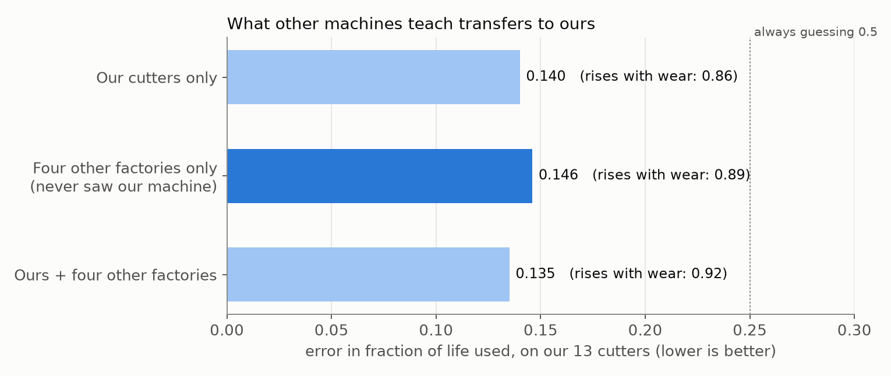

**Pretraining our main model on the other machines.** We then used those 73 other lives to give the main TCN a head start (`scripts/26_pretrain_transfer.py`). First it learned to estimate the fraction of life used from the other four datasets' spindle load and vibration alone, without ever seeing one of our cutters. Then it was trained on our 12 training cutters with its normal inputs plus those two shared signals, and tested on the hidden one, as always. To check that any gain comes from the pretraining and not from the two added signals, we also trained the same model from scratch.

- Before any training on our data, the pretrained network already tracked life used on our cutters with an error of 0.17 (always guessing 0.5 scores 0.25).
- After training on ours, its error over the whole life was unchanged: 22.0 cycles, against 21.9 for the main TCN and 22.2 from scratch.
- In the last 20% of life it was better: 14.5 cycles, against 15.9 and 16.3, and better than the main TCN on 9 of 13 cutters. But the 95% interval of that 1.4-cycle gain runs from −1.2 to 4.1 cycles, so with 13 cutters it is a hint, not a result.

Two cautions: in the other datasets a life ends at a wear limit or the operator's call, not at breakage, and one "run" is a different amount of cutting in each dataset. So the head start teaches the general shape of a cutter's last stretch, not our cutters' exact timing.

---

## 8. From prediction to decision

### Costs

The dataset contains no money, so we priced an Indian job shop from supplier listings and machine-hour rates (`research/next-phase/costs.md`):

| Item | Cost |
|---|---:|
| 10 mm carbide end mill | ₹3,000 |
| Machine and operator time | ₹800 an hour |
| A planned cutter change | ₹3,133 |
| A breakage (cutter, lost time, damaged part, holder damage) | ₹6,530 |

A breakage costs about twice a planned change here, because the cutter is thrown away either way. Since costs differ between shops, we also tested 24 cost settings, with breakage from 1.5 to 30 times a planned change.

### The decision rule

After each cycle: **change the cutter when the expected cost of the risk of breaking is bigger than what it costs to change it now**. The expected cost of risk is the chance of breaking × what a breakage costs. For one cutter, the best possible rule given the risk curve can be calculated exactly (by **dynamic programming**, which works backwards over every possible future).

### Results: replaying 13 real cutters

For each hidden cutter, we replay its real life cycle by cycle. The rule only ever sees the model's predictions up to that moment, and because we know when that cutter really broke, the outcome is exact. Only the costs are assumed.

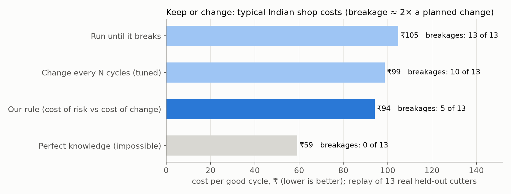

The rule is the same for every model, so the only thing that changes between the bars is whose risk curves it is given.

At typical Indian costs (breakage about twice a planned change):

- **Changing every N cycles** let **10 of 13** cutters break. **Our rule on the TCN's risk curves** let **5** break and was **6% cheaper** (₹93 against ₹99 per good cycle). With only 13 cutters that saving is not yet certain: the 95% interval runs from 10% dearer to 21% cheaper.
- **Same network, with and without sensors:** the TCN that knows only settings and age makes the rule cost ₹111. With the sensor features it costs ₹93: **16% cheaper** (95% interval 2% to 29%), and cheaper in **all 24** cost settings. This is the clearest money value of the sensors that we can show.
- **But a simple survival model on settings and age is about as good** (₹97, 7 breakages), and across the 24 cost settings it is cheaper than the TCN in 20, by more when breakage is very expensive. The reason is that the decision needs **honest probabilities**, not just a good middle estimate. The survival model is a statistics model built to give calibrated chances of failure; the TCN's risk curves are too confident (section 7: its own range holds the truth only 13% of the time). When a breakage costs 10 or 30 times a planned change, a too-confident curve leads to the wrong call more often.
- **We tried calibrating the TCN's risk curves, and it made the decisions worse.** We rescaled each curve's log-odds by one number (a "temperature") or by two (a scale and a shift), fitted for each hidden cutter on the other 12 cutters only, by the same likelihood the TCN was trained with (`scripts/25_calibrate_hazard.py`). The two-number version made the curves far more honest: the chance-of-breaking-within-5-cycles error halved (Brier score 0.178 to 0.085), and the 10%–90% range held the truth 68% of the time instead of 13%. But it did so by nearly flattening every curve into "about 2–4% chance of breaking each cycle", which keeps the honesty and throws away the timing. Its rule beat every N cycles in only 11 of the 24 cost settings (19 before calibration). The one-number version was worse still: when a breakage costs 10 times a change, it changed every cutter after one cycle. At typical Indian costs all three versions are within the noise (₹89 to ₹93). So simple calibration does not close the gap to the survival model; a predictor that is both sharp and honest would need more cutters or a different training target.

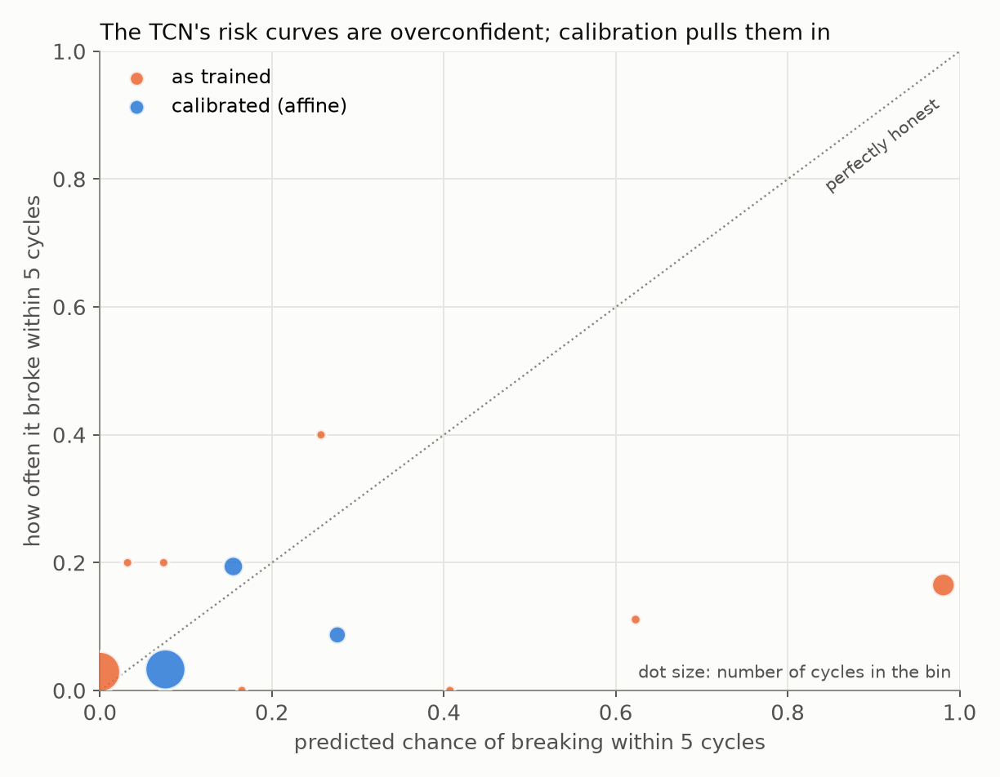

- **Perfect knowledge** of the breaking point would cost ₹59, **40% less** than every N cycles. That gap is the value of better, and better-calibrated, prediction.

Across all 24 cost settings, our rule on the TCN's curves was cheaper than every N cycles in 19.

**One version of the rule we dropped.** We also tried tuning the rule's one number (the price of a good cycle) by searching for the value that worked best on the training cutters. With only 12 training cutters, the search was unstable: the chosen value ranged from 17 to 9,500 between tests, and on two cutters it told the machine to change a brand-new cutter after one cycle. The plain rule sets that number by a standard calculation instead of a search: the price of a good cycle is whatever the rule itself achieves on the training cutters at the given costs, repeated until it stops changing. It is stable, so that is the one we use for every model.

---

## 9. Reinforcement learning

**Reinforcement learning (RL)** trains a decision-maker by trial and error: it acts, receives a score (here, profit in rupees), and slowly learns which actions score best. We used two standard methods: **PPO** (proximal policy optimisation) and **DQN** (deep Q-network).

### The check: one cutter

For a single cutter with keep-or-change, the exact best rule can be calculated, so RL is not needed there. We used it as a test of our RL setup, in two worlds:

- **A simulated world where cutters break exactly as the risk curve predicts.** Here the exact rule is truly the best possible, so RL should approach it. PPO came within **2%** of it on held-out cutters (the best of three training settings, on one split of the cutters); DQN was **12%** short.
- **Replays of real cutters**, where the curve is only an estimate. Here PPO was **30%** and DQN **18%** below the exact rule computed from the curves. RL learns from the simulator it is given; when the simulator is imperfect, so is what it learns.

### The workshop

RL only makes sense when decisions interact. We built a small simulated workshop:

- 3 machines, each replaying a real recorded cutter life that the prediction model never trained on;
- one setter, who can change only one cutter at a time;
- actions for each machine: **run**, **slow down 20%**, or **change the cutter**;
- reward: profit in rupees.

The workshop uses risk curves from the LightGBM survival model (it was built before the TCN was final), and splits the cutters into four groups, so each test group has only three or four cutters that the machines replay again and again.

Slowing down extends cutter life, which we model with **Taylor's tool-life law**, a long-established rule that tool life grows as cutting speed drops. Our data cannot measure this (every cutter ran at one speed), so the strength of the effect, the Taylor exponent n, is varied, and results are shown for several values. One more caution: Taylor's law describes gradual wear, and our cutters ended by fracture, so the benefit of slowing down here is an assumption on top of an assumption.

**Result: PPO and DQN did not beat well-tuned rules.** On held-out cutters (profit per 1,000 cycles):

| Policy | Slowing helps a lot (n = 0.25) | Slowing helps less (n = 0.4) |
|---|---:|---:|
| Rule: change when the risk curve says so, slow down when Taylor's law says it pays | **₹1.78 lakh** | ₹0.90 lakh |
| Exact single-cutter rule, slowing down when Taylor's law says it pays | ₹1.73 lakh | **₹0.98 lakh** |
| Exact single-cutter rule at normal speed | ₹0.98 lakh | **₹0.98 lakh** |
| PPO | ₹1.03 lakh | ₹0.89 lakh |
| DQN | ₹1.07 lakh | ₹0.87 lakh |

The agents learned to slow the machines down about 60% of the time, which roughly halved breakages compared with the normal-speed rule. But they kept slowing down even when it did not pay (at n = 0.4 the best rules never slow down), and DQN also memorised its training cutters (₹1.54 lakh on them vs ₹0.87 lakh on new ones). We set the success test before running it, and RL failed it. For this problem, a clear rule is the better choice, and that is a useful finding.

---

## 10. What we can and cannot claim

**We can claim:**

- motor current and vibration carry real information about wear, on every machine we checked; on ours, the table current rose in all 13 cutters, and the rise is wear, not position in the block;
- the same network does clearly better with sensors than without: 6 cycles less error (interval 2.6 to 9.5), and a 16% cheaper decision rule (interval 2% to 29%, cheaper in all 24 cost settings);
- sensors matter most where the settings cannot help: the one cutter on an unseen holder (28 cycles off against 123) and the last part of life;
- a model trained only on other factories' machines tracked wear on ours nearly as well as our own data did (the difference is within the noise);
- every number comes from cutters the model never saw, and we found and fixed three leaks before reporting;
- the limit of this project is the number of cutter lives: the error was still falling steeply at 12 training cutters.

**We cannot claim:**

- that the TCN beats LightGBM, or that any architecture beats another: 30 models were tested and the good ones are within the noise of 13 cutters;
- that sensors beat the settings for ordinary cutters over the whole life: on the 12 cutters with familiar settings, the settings-only survival model was more accurate overall (18 against 21 cycles), and its risk curves gave decisions as good as or better than the TCN's;
- that our risk curves are calibrated: the TCN's own 10%–90% range holds the truth only 13% of the time, the widened range is too wide to act on, and calibrating the curves made them honest but too flat to time decisions;
- that the system saves a factory a particular percentage: the costs are assumed and 13 cutters cannot prove a few percent;
- that reinforcement learning beats simple rules here: it did not;
- that we predict physical wear: we predict cycles left before breakage;
- that slowing down extends life by any particular amount: that is modelled with Taylor's law, not measured;
- that the system is connected to a machine: it works on recorded data.

---

## 11. Questions a reviewer might ask

**Why not shuffle all the rows and split them randomly, like most papers?** Cycle 40 and cycle 41 of one cutter are near-copies, so a random split lets the model see the answer. We hide whole cutters (section 6).

**Is the signal rise really wear, or just where the cutter is in the steel block?** We removed the effect of ring position from both the signal and the life used; the table current still tracked life at 0.94 on average (section 4).

**How do you know your testing does not leak?** We looked for leaks and found three, all fixed (section 6). Every normalisation uses only cycles seen so far; every autoencoder score comes from a network that never heard the hidden cutter or the training cutter it is scoring; the decision rule's one number is set on predictions for the training cutters from models that never saw the hidden cutter.

**Why a 4-million-number autoencoder, if PCA does as well?** We did not know until we tested it, and we report it: PCA matched it, and a simple distance-from-healthy score on our physics features beat both. Adding the autoencoder's score to the TCN made it slightly worse. The autoencoder does show that wear can be heard without labels, but it is not needed for prediction.

**Why a TCN, and not an LSTM or a transformer?** We chose the TCN before comparing: it only looks backwards (like a real machine), trains stably on tiny data, and reads about the last 60 cycles. Then we tested LSTM, GRU and a transformer the same way: all within about a cycle of the TCN, inside the luck of the random start. With 12 training cutters, the architecture is not what limits us.

**The TCN on the 120 released summaries scored best. Why not use it?** Because we would be picking the winner on the test cutters. With 30 models tried, one will look best by luck; its edge (2.8 cycles) is within the noise. It is a strong hint for future work, and we report it as that.

**Is your main model just the luckiest of 30?** It cannot be, because it was fixed before the other 30 were run, and it is not the best of them: it sits in the middle of the good group. The single-start spread (21.7 to 24.1 cycles) shows how much luck alone moves a score.

**If the settings-only model is better on 12 cutters, why use sensors at all?** Settings tell you the expected life before the first cut, which is a lot. Sensors add what settings cannot know: how this particular cutter is actually doing, which matters near the end (13 vs 16 cycles off in the last 20%) and when something unusual happens (cutter 10: 28 vs 123). A workshop always meets new holders, materials and settings.

**Why not combine the two?** We tried a 50/50 average of the TCN and the settings-only model. It helps on the 12 ordinary cutters (17.7 whole life, 12.7 in the last 20%) but hurts cutter 10 (75 cycles off), so overall it is not better (22.1). Knowing when to trust the settings needs more cutters with unusual settings than we have.

**Is 22 cycles of error good?** It depends on the cutter: 4 to 9 cycles on short-lived cutters, 30 to 55 on the longest-lived ones, which have almost no similar cutter to learn from. That is why the decision uses the risk curve near the end of life, where the model is most accurate, not a single number.

**Would more data help?** Yes: the learning curve (section 7) is still falling steeply at 12 cutters.

**Why not use the other datasets to train the main model?** Their lives end differently (wear limit or operator's call, not breakage), and their sensors and cut sizes differ, so they cannot simply be added. We did use them as a head start: pretraining the TCN on their 73 lives, then training it on ours, left the whole-life error unchanged (22.0) and cut the last-20% error from 15.9 to 14.5 cycles, better on 9 of 13 cutters, but within the noise of 13 cutters (section 7). It is the most promising lead we have, and confirming it needs more of our own cutters.

**Why did the end-to-end CNN on raw vibration lose?** It has to learn its own features from 10 or 11 cutter lives. Our physics features already encode what to listen for (tooth rhythm, once-per-turn beat, load), which is knowledge the network would need many more cutters to discover.

**Your risk curves are overconfident. Why not calibrate them?** We did (section 8). Rescaling the curves by one or two numbers fitted on the other cutters made them honest but flat, and flat curves cannot tell the rule *when* to change, so the decisions got worse in most cost settings. We report it as a negative result rather than tune more ways until one wins.

**Why use reinforcement learning if the exact best rule can be calculated?** For one cutter it can, so we used that as a check of our RL setup. RL is only needed when decisions interact (one setter, three machines, slowing down). There, RL did not beat good rules, and we say so.

**Did you need a GPU?** No. The models are small; everything ran on a laptop and one 16-core cloud machine.

---

## 12. Where everything is

| What | Where |
|---|---|
| Plan and agreed scope | `PLAN.md` |
| Physics, with photos | `docs/physics.html` (on the website) |
| Research reports (data, physics, costs, models, RL) | `research/next-phase/` |
| Code | `src/toollife/` (library) and `scripts/` (numbered steps) |
| Results tables | `results/models/`, `results/decisions/`, `results/cross_dataset/`, `results/rl/` |
| Figures | `results/figures/` |
| Review 2 video script | `research/review-2-video-script.md` |

The data itself is not in the repository; `scripts/00_download.py` downloads it again.

---

## 13. Word list

- **CNC (Computer Numerical Control):** a machine tool moved by a computer program.
- **Milling:** cutting metal with a spinning tool that moves along a path.
- **Cutter, tooth, holder, spindle:** the cutting tool; one of its four cutting edges; what grips it; the spinning shaft.
- **Cycle / lifecycle:** one lap of cutting around the steel block / all of one cutter's cycles until it breaks.
- **Flank wear, chipping, fracture:** the edge rubbing flat; small pieces breaking off; the cutter snapping.
- **Chatter:** shaking that feeds on itself when a tool is too floppy.
- **Remaining useful life (RUL):** cycles a cutter can still do before breaking.
- **Risk curve:** the chance of breaking on each of the next cycles.
- **Motor current / vibration:** how hard a motor is working / how much the machine shakes.
- **Feature:** one input number given to a model.
- **Training / testing:** learning from examples with answers / checking on examples never seen.
- **Data leakage:** a model accidentally seeing information it would not have in real use, which makes scores look better than they are.
- **Hide one cutter (leave-one-group-out cross-validation):** train on all cutters but one, test on that one, repeat for each.
- **LightGBM:** a model made of many small decision trees, each fixing the previous ones' mistakes.
- **Survival model (Weibull):** the standard statistics model for how long things last; here it uses only the settings and the age.
- **Paired bootstrap:** resampling the 13 cutters thousands of times, judging two models on the same resample each time, to see whether the gap between them could be zero.
- **PCA (principal component analysis):** squeezing many numbers into a few using only weighted sums; the straight-line version of an autoencoder.
- **Mahalanobis distance:** how far a point is from a cloud of points, measured in units of the cloud's own spread in each direction.
- **Monotonicity, trendability, prognosability:** whether a health score only goes up; whether all cutters follow a similar path; whether it ends at a similar level when they fail.
- **LSTM, GRU:** recurrent networks that carry a running memory along a sequence.
- **Transformer:** a network that can look directly at any earlier step of a sequence (attention).
- **Learning curve:** a model's test error plotted against how much data it learned from.
- **Convolution / filter:** sliding a small learned pattern detector along a signal / that detector.
- **CNN (convolutional neural network):** a network built from convolutions.
- **Autoencoder:** a network that squeezes its input into a few numbers and rebuilds it; here, trained on healthy cutting so that its rebuild error is a health score.
- **TCN (temporal convolutional network):** a network of causal, dilated convolutions that reads a sequence in order.
- **Causal / dilated:** using only the past / looking further back in each layer.
- **Conformal calibration:** widening a range by the worst miss seen on other examples, so it covers the truth as often as it claims.
- **Overfitting / memorising:** learning the training examples instead of a general pattern.
- **Dynamic programming:** calculating the best decision exactly by working backwards over every possible future.
- **Reinforcement learning (RL), PPO, DQN:** learning decisions by trial and error with a score; two standard methods for it.
- **Taylor's tool-life law:** cutter life grows as cutting speed drops, by an amount set by the exponent n.
