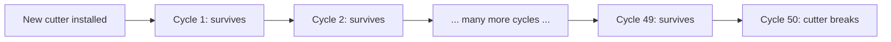
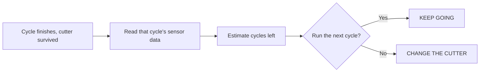
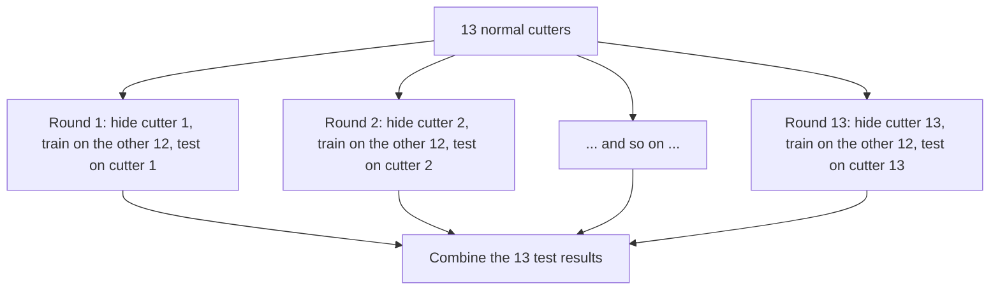
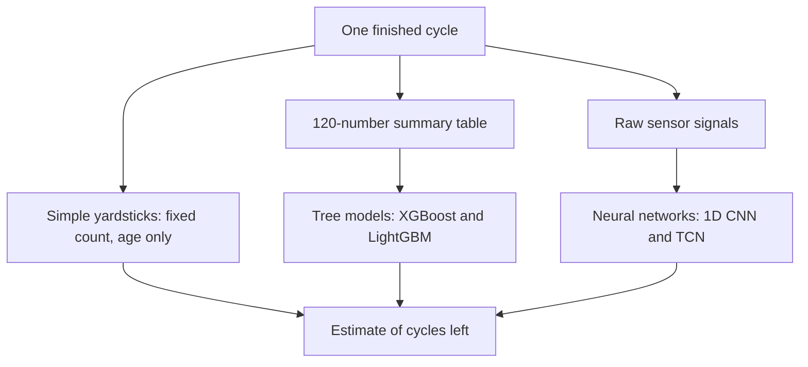
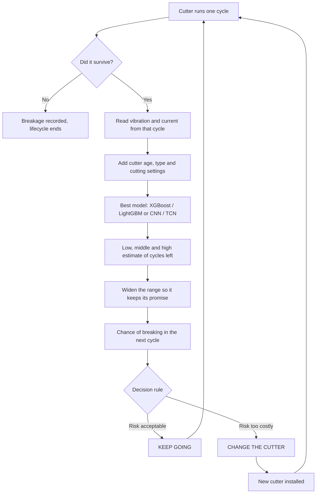

# ToolLife Policy, explained from the start

This is the one document to read if you want to understand our AI in Manufacturing project. It assumes you know school-level maths and science, and nothing about machine learning or machining. Every technical word is explained the first time it appears, and there is a word list at the end if you forget one.

Read it top to bottom once. Each part builds on the one before it.

---

## 1. The whole project in one paragraph

Factories cut metal using machines that hold a small spinning cutting tool. That tool wears down every time it cuts, and eventually it breaks. If you change it too early, you throw away a tool that still had life in it. If you change it too late, it breaks in the middle of a cut, which can ruin the part and stop the machine. Our project listens to the machine while it cuts (how much it shakes, and how much electricity its motors draw), estimates how many more cuts the tool can survive, and then recommends one of two things before the next cut: **keep going** or **change the tool now**.

That is all ToolLife Policy is. Everything below explains how we do it and how we prove it works.

---

## 2. The factory problem

### The machine

A **CNC machine** is a machine tool controlled by a computer program. CNC stands for *Computer Numerical Control*: the program tells the machine exactly where to move, how fast, and how deep to cut.

Our machine does **milling**. In milling, a small cutting tool spins very fast and is pushed into a block of metal. Its sharp edges shave material off the block, the way a drill bit removes wood, except milling can cut sideways along a path, not only straight down.

There are three objects to keep apart in your head:

```text
CNC milling machine          the big machine that moves everything
      │
      ├── holds the workpiece   a block of steel clamped to the table
      │
      └── spins the cutter      a small cutting tool, about 10 mm wide
                 ↓
          shaves steel off the block
```

- The **workpiece** is the block of metal being shaped.
- The **cutter** (also called the cutting tool, or just the tool) is the small spinning part that does the cutting. This is the thing that wears out.

### Why the cutter wears out

Every time the cutter's edges hit steel, they rub, heat up, and get pushed hard. Tiny bits of the edge wear away or chip off. This gradual damage is called **tool wear**. After enough cutting, an edge snaps or the whole cutter breaks.

### The two bad choices

The factory has to decide when to swap in a new cutter. Both mistakes cost money:

- **Change too early:** you throw away a cutter that could have kept working, and you stop the machine for a swap you did not need.
- **Change too late:** the cutter breaks mid-cut. The part you were making may be ruined, the machine stops unexpectedly, and someone has to clean up and restart.

Think of your phone battery before a trip. Knowing it is at 30% is useful, but it does not tell you what to do. For a ten-minute ride, 30% is fine. For a six-hour journey, you charge it first. Our project works the same way: it estimates the cutter's health, and then turns that into a decision.

### What most workshops do today

Most workshops change the cutter after a fixed number of uses, or when an operator notices something wrong. The fixed-number rule is simple, but cutters do not all last the same amount of time. In the data we use, ordinary cutters lasted anywhere from about 14 to 149 cuts, and one broke on its very first cut. A single fixed number cannot be right for all of them. Set it low and you waste most cutters. Set it high and some break before you reach it.

That spread is the reason AI is useful here. The signals coming off the machine carry clues about how worn this particular cutter is, and those clues are too noisy and complicated to read by eye. A model can learn to read them.

---

## 3. A few words we need before going further

**One cut (one cycle).** In our data, the machine runs the same programmed path once around the edge of the steel block. That one trip is called one **milling cycle**. During one cycle the cutter spins thousands of times. One cycle is not the whole life of the cutter, and it is not one finished product.

**The life of a cutter (a lifecycle).** A new cutter is installed and runs cycle after cycle until it breaks. That whole sequence, from first cycle to the breaking cycle, is one **lifecycle**.



**Sensor.** A device that measures something physical and turns it into numbers. We use two kinds:

- **Vibration sensors** (accelerometers) measure how much the machine and spindle shake. A worn or chipped cutter cuts less smoothly, so the shaking changes.
- **Current sensors** measure how much electricity the motors draw. A blunt cutter needs more effort to cut, so the motors pull a different amount of current.

**Signal.** The stream of numbers a sensor produces over time. If you plotted it, it would look like a wiggly line, similar to a sound recording.

**Channel.** One sensor's stream. Our data has 20 channels: 8 vibration and 12 current.

**Sampling rate.** How many readings a sensor takes per second. Our vibration sensors take 25,000 readings per second (written 25 kHz). Our current sensors take 500 per second (0.5 kHz). Vibration is recorded faster because shaking changes very quickly.

None of this needs a camera. We have no photos or videos of the cutter. The project works entirely by "feeling" and "listening to" the machine through these sensors.

---

## 4. Our data

### Where it comes from

We are not running our own machine. We use a public dataset published in April 2025 in the journal *Scientific Data* by Grzegorz Piecuch and Tomasz Żabiński at Rzeszów University of Technology in Poland. Anyone can download and use it (licence CC BY 4.0).

- Paper: https://www.nature.com/articles/s41597-025-04923-y
- Files: https://doi.org/10.6084/m9.figshare.28589216

### What the researchers did

They took a Haas VF-1 CNC milling machine and a block of hardened steel (a steel grade called 42CrMo4). They installed a new cutter and ran it cycle after cycle until it broke, recording all 20 sensors during every cycle. Then they did the same with the next cutter, and the next, for 14 cutters in total.

- **14 cutters**, of two different types (from two manufacturers)
- **968 recorded cycles** across all 14 cutters
- **20 sensor channels** recorded during every cycle
- For every cycle, the exact number of cycles that cutter had left before it broke

The cutters did not all work under identical conditions. Some cut deeper than others (the vertical cut depth was 5 or 10 mm, the sideways cut depth 4.5 or 8 mm), the steel blocks were slightly different in hardness, and the tool holder was 80 or 160 mm long. Spinning speed (3,200 revolutions per minute), feed speed (640 mm per minute) and cutter width (10 mm) were the same for every cutter. All of this is recorded alongside each cycle and can be given to our models.

### The odd cutter

One of the 14 cutters broke during its very first cycle. It gives us no history of slowly wearing out. So we use the other **13 cutters** for building and testing, and keep the odd one aside as a separate "surprise failure" case. Our system makes its decision after each finished cycle, so it honestly could not have saved a cutter that broke on cycle one, and we will say that plainly.

An important consequence: 968 rows sounds like a lot, but it is really **13 life stories**. Rows from the same cutter are closely related, so we cannot treat them as 968 independent examples. This shapes how we test (section 6).

### Two versions of the same data

**The raw signals (about 25 GB).** The complete wiggly-line recordings from every sensor in every cycle. Think of this as the full audio recording of a song.

**The summary table (1.8 MB).** The researchers also boiled each channel down to six numbers per cycle:

- smallest reading
- largest reading
- average reading
- **standard deviation**: how spread out the readings are around the average
- **skewness**: how lopsided the readings are (more big readings on one side than the other)
- **kurtosis**: how spiky the signal is (a few very extreme readings give high kurtosis)

That gives 20 channels × 6 numbers = **120 numbers per cycle**. Think of this as a short written description of the song instead of the recording. Each number given to a model as input is called a **feature**.

So one row of the summary table means: "Cutter 3, cycle 40, here are its 120 sensor summaries, here are its cutting settings, and it had 12 cycles left before breaking."

---

## 5. What we ask the computer to predict

The question we want answered after every cycle is: **how many more cycles can this cutter survive?**

That number is called the cutter's **Remaining Useful Life**, shortened to **RUL**. We measure it in cycles.

Here is a cutter that breaks during cycle 50:

| Cycle just finished | What happened | Cycles left (RUL) |
|---:|---|---:|
| 1 | survived | 49 |
| 25 | survived | 25 |
| 45 | survived | 5 |
| 49 | survived | 1 |
| 50 | broke | 0 |

Because the researchers ran every cutter until it broke, we know the true RUL for every row. That is what makes this dataset good for learning.

The system makes one prediction after each successful cycle, and the decision it feeds is about the very next cycle:



---

## 6. How a computer learns from examples, and how we test it fairly

### Learning from examples

A **machine learning model** is a program that learns a pattern from examples instead of being told the rule. We show it many rows where we already know the answer ("these sensor readings, 12 cycles left") and it adjusts itself until its guesses match the answers as closely as possible. This is called **training**. Learning from examples that come with the correct answer is called **supervised learning**. Because our answer is a number rather than a category, it is also called **regression**.

After training, we give the model rows it has never seen and check how close its guesses are. This is called **testing**.

### Why testing must be fair

Imagine studying for an exam using last year's paper, and then the exam is the same paper. You would score well without learning anything. The same thing happens with models. If a model is tested on rows it already saw during training, or on rows that are nearly copies of them, its score looks great and means nothing. This mistake is called **data leakage**.

Our data has a specific trap. Cycle 40 and cycle 41 of the same cutter look very similar. If we shuffled all 968 rows and split them randomly, the model would train on cycle 40 and be tested on cycle 41, effectively seeing the answer. It might learn to recognise that particular cutter instead of learning what wear looks like in general.

### Our fix: hide a whole cutter

We always test on a cutter the model has never seen at all:

1. Pick one cutter and hide every one of its cycles.
2. Train the model on the other 12 cutters only.
3. Test it on the hidden cutter.
4. Repeat 13 times, so every cutter gets one turn as the hidden one.



Each round starts from scratch with a brand-new model. We never carry a model from one round into the next, because the previous round's model has already seen the cutter that is now supposed to be hidden.

The formal name for this is **leave-one-group-out cross-validation**. For us the group is one cutter, so we call it **leave-one-cutter-out testing**. (Ordinary "leave-one-out" means hiding a single row, which is not what we do.)

A few more rules keep the test honest:

- The model never sees the answer column, the cutter's ID number, or the file name (which reveals the cutter).
- The model only ever uses the current cycle and earlier ones, never future cycles.
- Anything we tune or adjust is done using the 12 training cutters only.

### Choosing the best model fairly

Every model we try takes the same 13 tests. We then compare them cutter by cutter, giving each cutter equal weight, so one long-lived cutter cannot dominate the score. We do not just crown whichever model scored best on average. A model that is slightly better on average but sometimes says "10 cycles left" when only 1 is left is dangerous, and we would reject it. If two models are nearly tied, we pick the simpler one.

Once we have picked the winner, we train one final copy of it on all 13 cutters for the demo. The scores we report still come from the 13 fair test rounds, never from the final copy.

---

## 7. The models we will build

We build up from very simple to more complex. The simple ones are not decoration. They are the yardsticks that prove whether the complex ones are worth anything.



### Step 1: simple yardsticks

**Fixed count.** "Always change the cutter after N cycles," with N chosen as well as possible from the training cutters. This is roughly what workshops do today. Our whole system has to beat it.

**Age only.** A model that only knows how many cycles the cutter has already done, plus its cutting settings, and no sensor data at all. This matters more than it sounds. A model could look clever just by learning "cycle 100 is usually closer to breaking than cycle 10." If our sensor-based models cannot beat this age-only model, the sensors are not telling us anything useful, and we have to say so.

### Step 2: tree models on the summary table

A **decision tree** predicts by asking a chain of yes/no questions:

```text
Is the vibration spikiness high?
├── No → Has the cutter done more than 80 cycles?
│        ├── No  → about 50 cycles left
│        └── Yes → about 20 cycles left
└── Yes → about 6 cycles left
```

One tree on its own is rough and unreliable. So we build many small trees one after another, where each new tree focuses on fixing the mistakes the earlier trees still make. Picture a row of students marking an exam, where each one only corrects what the previous ones got wrong. This technique is called **gradient boosting**.

**XGBoost** and **LightGBM** are two popular, well-tested programs that do gradient boosting. They differ in how they grow the trees internally. We try both on the 120-number summary table and compare them. They are fast, they work well on small tables like ours, and we can see which features they rely on.

To see why a tree model made a particular prediction, we use **SHAP**, a standard method that shows how much each input pushed the prediction up or down. For example: "high vibration spread lowered the estimate by 8 cycles; the cutter's age lowered it by 4." SHAP explains what the model learned. It does not prove that a reading physically caused the cutter to break.

### Step 3: neural networks on the raw signals

The six summary numbers throw information away. Two signals can have the same average and spread but look completely different: one smooth and steady, the other full of sudden knocks. To use that extra detail, we feed the raw signals to a neural network.

A **neural network** is a model made of layers of simple calculations, with millions of adjustable numbers inside. During training it nudges those numbers, a little at a time, to reduce its error.

A **CNN** (Convolutional Neural Network) is a kind of neural network that is good at finding small patterns that can show up anywhere in a long signal. It works by sliding a small learned pattern-detector, called a **filter**, along the signal, like sliding a stencil along a strip of material to look for one crack shape. One filter might learn to react to sharp knocks, another to steady rattling. We never tell it what to look for; it learns whichever patterns help predict cycles left. Stacking several layers lets later layers combine short patterns into longer behaviours, the way letters build words and words build sentences.

Ours is a **1D CNN** because the filter slides along one direction, time. (Image CNNs slide in two directions, across height and width.)

Why not an ordinary neural network? An ordinary one would give a separate weight to every single moment in the signal, which means millions of numbers to learn. It also would not realise that the same knock at second 2.1 and at second 2.3 is the same thing. A CNN reuses the same small filter everywhere, so it needs far fewer numbers and recognises a pattern wherever it appears.

A **TCN** (Temporal Convolutional Network) is a CNN designed for time signals. Each deeper layer looks at points spaced further apart (gap 1, then 2, then 4, then 8), so it can take in a long stretch of the signal without becoming huge.

Vibration (25,000 readings per second) and current (500 per second) are recorded at very different speeds, so each gets its own branch of the network. The two branches' outputs are joined together with the cutter's age and settings before the final estimate.

### The honest expectation

With only 13 cutter life stories, the neural networks may not beat the tree models. A big network can memorise the training cutters instead of learning general wear patterns. If XGBoost wins, the project still succeeds: we use XGBoost and report the comparison truthfully. The question we are answering is whether the raw signals contain useful detail that the summary table loses.

---

## 8. A range, not a single number

Suppose two models both say "6 cycles left." One means "between 5 and 7." The other means "anywhere between 1 and 15." The second is far more dangerous to trust, but a single number hides that difference.

So every model gives three numbers instead of one:

- a **low estimate** (careful, pessimistic)
- a **middle estimate** (the best single guess)
- a **high estimate** (optimistic)

For example: "between 2 and 12 cycles left, most likely 6." Each of these three is called a **quantile**: the low one is roughly "only 10% chance of fewer cycles than this," and the high one "only 10% chance of more."

### Making the range honest

A model can claim "the true answer is inside my range 90% of the time" and actually be right only 60% of the time. Its ranges are too narrow; it is overconfident. We correct this with a method called **conformal calibration**. It does not retrain or change the model. It is a simple, automatic widening step added after the model:

1. Using only the 12 training cutters, take turns hiding one of them, train on the rest, and predict the hidden one. This gives us ranges made on cutters the model had not seen.
2. For each of those predictions, measure how far the true answer fell outside the range. If it was inside, the miss is 0. If the range said 4–10 and the truth was 12, the miss is 2.
3. Sort all those misses and pick the one that would have been enough to cover the truth 90% of the time. Call it **q**. Say q = 3.
4. From then on, widen every range by q on each side. A raw range of 5–13 becomes 2–16.

The model is the same; we have only learned how much to widen its ranges so they keep their promise. The 90% target is our choice, not something learned. We will also try 80% and 95% to show the trade-off: wider ranges are safer but make us change cutters earlier. Each model gets its own q, because each one is overconfident by a different amount. With only 13 cutters this correction will be approximate, and we will report how often the ranges actually contained the truth.

We also turn the estimates into plain chances, such as "a 12% chance this cutter breaks during the next cycle," and check those too: across all the cycles we labelled 10%, about 10% should actually have broken.

---

## 9. Turning the estimate into a decision

The model answers "how healthy is the cutter?" A separate step, the **decision rule** (sometimes called the policy), answers "so what do we do?" We will build and compare four rules, from simplest to most advanced.

### Rule 1: simple safety rule

```text
If the low estimate of cycles left is more than 5 → KEEP GOING
Otherwise                                         → CHANGE THE CUTTER
```

Using the low estimate instead of the middle one makes this cautious. If the model says "most likely 9, but could be as few as 2," this rule changes the cutter. The weakness is that "5" is arbitrary and ignores what a breakage actually costs.

### Rule 2: compare the costs

We compare what each choice is expected to cost.

- Cost of changing now = price of a new cutter + the time to swap it.
- Expected cost of keeping going = chance of breaking during the next cycle × cost of a breakage.

The dataset contains no money at all, so **all costs are assumed**. We use simple units instead of rupees: a planned change costs 1 unit, and a surprise breakage costs, say, 10 units.

```text
Chance of breaking next cycle = 15%
Keep going: 0.15 × 10 = 1.5 units expected
Change now:             1.0 unit
Decision: CHANGE THE CUTTER

Chance of breaking next cycle = 5%
Keep going: 0.05 × 10 = 0.5 units expected
Change now:             1.0 unit
Decision: KEEP GOING
```

We add a safety limit on top: never keep going if the chance of breaking is above a set level, no matter what the costs say. And because we do not know a real factory's costs, we repeat everything for many cost settings (a breakage costing 5, 10 or 20 times a planned change, and so on) and only claim a result if it holds across most of them.

Every decision this rule makes can be explained in one sentence: "We changed the cutter because the chance of it breaking was 15%, which made carrying on more expensive than a planned swap."

### Rule 3: look a few cycles ahead

Rule 2 only looks one cycle ahead. Rule 3 compares whole plans over the next several cycles ("change now," "one more cycle then change," "two more then change," and so on), picks the cheapest plan, carries out only its first step, and then re-plans after the next cycle with fresh sensor data. This is called **Model Predictive Control (MPC)**, the same plan-act-re-plan idea used in many control systems. It needs no extra training; it reuses our model's estimates.

### Rule 4 (optional extra): a decision-maker trained by practice

**Reinforcement learning (RL)** trains a decision-maker by trial and error. It tries actions, receives a score (a reward for completed cycles, a penalty for breakages and swaps), and slowly learns which choices score best. A standard version for two-choice problems is the **Deep Q-Network (DQN)**.

RL is an **optional extra**, not the core of the project, for two plain reasons:

1. The data has no costs, so any score we give the RL agent is our assumption.
2. In the experiment every cutter was simply run until it broke. The data never shows what happens after a "change it now" decision, so RL cannot learn from these rows directly.

The only honest way to do RL here is to build a **simulated factory**: a program that creates many pretend cutters whose lifespans resemble the real ones, lets the agent choose, and charges our assumed costs. The agent then learns our simulator and our assumptions, not new facts about real cutters. With only two choices, rules 2 and 3 may do just as well. If the RL agent beats them in the simulator, we report it as a simulator result under stated costs. If not, we report that the simpler rule was better, which is also a useful finding.

---

## 10. How we test the decisions

For each hidden cutter, we replay its real life cycle by cycle. After each cycle, the model gives its estimate and each rule chooses. Because we know when that cutter actually broke, we can see exactly what would have happened:

- Did the rule let the cutter break?
- If it changed the cutter early, how many good cycles did it throw away?
- What share of the cutter's real life did it use?
- What was the total cost, under each cost setting?

We compare every rule against the best possible fixed-count rule, and against a "perfect" rule that magically knows the breaking point. Nobody can actually have the perfect rule; it just shows how much room is left.

The replay of real cutters is our main evidence. Longer-term results, where a cutter is replaced and the next one starts, need the simulated factory, and we will always label those as simulated.

### What counts as success

We set these targets before seeing any results, so we cannot move the goalposts later:

- The sensor-based model beats the age-only model by at least 10%. If it does not, we say the sensors did not add enough.
- A range that promises 90% contains the true answer between 85% and 95% of the time on hidden cutters.
- Our best decision rule costs at least 10% less than the best fixed-count rule, without more breakages.
- That holds across most (at least 70%) of the cost settings we try, not just one hand-picked setting.

---

## 11. The whole system on one page



In words: after each cycle, read the sensors, estimate how many cycles are left as a range, make the range honest, turn it into a chance of breaking, weigh that against the cost of a swap, and decide.

---

## 12. What we will show in the demo

A web dashboard that replays a real hidden cutter, one cycle at a time, showing:

- the latest vibration and current signals
- the estimated cycles left, with its range
- the chance of breaking in the next cycle
- the recommendation (KEEP GOING or CHANGE THE CUTTER) and a one-line reason
- what the fixed-count rule and the other rules would have done at the same moment
- the cycle where the cutter really broke, which the model was never shown in advance

Sliders for the assumed costs will show how the right decision changes even when the cutter itself has not changed.

---

## 13. Where we are, and the next 10 days

**Done so far (August to September 2026):** we compared many possible manufacturing AI projects, the team chose this one, we found and checked the dataset, wrote the full plan, and presented it at Review 1. No code has been written yet.

**For the next review** we only need to show what we built, not explain the problem again. The plan for the next 10 days:

| Days | What gets built | What we can show |
|---|---|---|
| 1–2 | Download the data, check it, plot every cutter's life story. Build the fixed-count and age-only yardsticks. | Plots of 13 cutter lifecycles; the yardstick scores. |
| 3–4 | Fair 13-round testing. XGBoost and LightGBM on the summary table, with low/middle/high estimates and the honest widening step. | First real accuracy table; SHAP chart of which sensors matter. |
| 5 | Decision rules 1 and 2, and the cutter-by-cutter replay. | "Our rule vs fixed count" on real cutters: breakages, wasted cycles, cost. |
| 6–7 | Raw signals: cut out the active cutting part of each recording, train the CNN and TCN. | Tree models vs neural networks, same 13 tests. |
| 8 | Rule 3 (look ahead), cost settings sweep, final comparison tables. | One results table that answers the main question. |
| 9 | The replay dashboard. | Live demo. |
| 10 | Slides and practice for the review. | The review presentation. |

How the team helps: read this document, agree on the cost settings we test, look at the plots and results as they come in and question anything that looks too good, and prepare the presentation. The coding, training and dashboard are done with Codex in this repository.

**Space and computing power are not a problem for this project.** The raw signals are about 25 GB and the neural networks train best on a GPU. Aditya is arranging storage and compute. Do not shrink or skip any part of the plan because of data size or hardware.

### Optional extras after the core works

- **Rule 4, reinforcement learning**, in the simulated factory, as described in section 9.
- **Fewer sensors.** Check how well the system works with only the spindle current sensor, which is much cheaper to fit in a real factory than 20 sensors.
- **Other machines.** Test whether our approach still works on other public milling datasets recorded on different machines: PHM 2010 milling challenge, NASA Milling Wear, and QIT-CEMC. Their labels mean slightly different things (some measure wear under a microscope instead of counting cycles to breakage), so we test on them separately and never mix their rows into ours.
- **Slowing down instead of changing.** A third choice, "keep going but cut gentler." Only if we can find evidence for how much that actually extends tool life; our main dataset cannot tell us.
- **Real costs.** If anyone can get rough costs from a real machine shop (cutter price, swap time, cost of a ruined part), they drop straight into the same calculation.

---

## 14. Things we must never claim

These came up during Review 1 preparation. Saying any of them can get us caught out by anyone who opens the dataset paper.

- "The dataset has temperature." It has vibration and electrical current only.
- "We reduce downtime by 30%" or any other number we have not measured. Say we will measure it.
- "The system is connected to CNC controllers." It is a decision-support dashboard. Live machine connection would be future work.
- "Our software extends tool life." It helps use more of the life the cutter already has.
- "We test on 14 cutters." We test on 13; the 14th broke on its first cycle and is a separate case.
- "Our testing guarantees zero leakage." Say hiding whole cutters prevents the main source of leakage.
- "XGBoost and LightGBM form an ensemble." We compare them; we combine them only if that proves better.
- "Deep learning will definitely win." It may not, and that is fine.
- "RL found the best real-factory policy." At most, it found a good policy inside our simulator under assumed costs.
- "We predict exact physical wear." We predict cycles left before breakage.

---

## 15. Word list

- **CNC (Computer Numerical Control):** a machine tool whose movements are controlled by a computer program.
- **Milling:** cutting metal with a spinning tool that moves along a path.
- **Cutter / tool:** the small spinning cutting part that wears out.
- **Workpiece:** the block of metal being cut.
- **Cycle:** one run of the cutting path around the steel block.
- **Lifecycle:** all the cycles of one cutter, from new until it breaks.
- **Tool wear:** gradual damage to the cutter's edges.
- **Sensor / channel / signal:** a measuring device / one sensor's stream / the stream of numbers over time.
- **Sampling rate:** readings per second (25 kHz = 25,000 per second).
- **Feature:** one input number given to a model.
- **RUL (Remaining Useful Life):** how many more cycles the cutter can survive.
- **Machine learning model:** a program that learns a pattern from examples.
- **Training / testing:** learning from examples with known answers / checking on examples never seen.
- **Supervised learning / regression:** learning from examples with correct answers / predicting a number.
- **Data leakage:** the model accidentally seeing information it would not have in real use, which makes test scores look better than they are.
- **Leave-one-cutter-out testing (leave-one-group-out cross-validation):** hide one whole cutter, train on the rest, test on the hidden one, repeat for every cutter.
- **Baseline / yardstick:** a simple method our system must beat.
- **Decision tree:** a model that predicts using a chain of yes/no questions.
- **Gradient boosting:** building many small trees one after another, each fixing earlier mistakes.
- **XGBoost, LightGBM:** two popular gradient-boosting programs.
- **SHAP:** a method that shows how much each input pushed a prediction up or down.
- **Neural network:** a model made of layers of simple calculations with many adjustable numbers.
- **CNN (Convolutional Neural Network):** a neural network that slides small learned pattern-detectors (filters) along the data.
- **1D CNN:** a CNN that slides along one direction, time.
- **TCN (Temporal Convolutional Network):** a CNN for time signals whose deeper layers look further back.
- **Overfitting:** memorising the training examples instead of learning a general pattern.
- **Quantile:** a point in a range of possible answers (low, middle, high estimate).
- **Coverage:** how often the true answer actually falls inside the predicted range.
- **Conformal calibration:** widening a model's ranges by a measured amount so they keep their stated coverage.
- **Decision rule / policy:** the step that turns an estimate into KEEP GOING or CHANGE THE CUTTER.
- **Expected cost:** chance of something happening × what it would cost.
- **MPC (Model Predictive Control):** plan several steps ahead, do the first step, re-plan.
- **RL (Reinforcement Learning):** learning to make decisions by trial and error with rewards and penalties.
- **DQN (Deep Q-Network):** a standard RL method for problems with a few possible actions.
- **Simulated factory (simulator):** a program that imitates the production process so a decision rule can practise in it.

---

## 16. Where everything is in this repository

**Read these:**

- `PROJECT_EXPLAINED.md` — this document.
- `research/proposals/toollife-policy.md` — the full technical proposal. Where it differs from this document (it talks about "the next job" with deadlines and part values), this document is the current plan: decisions are made one cycle at a time, costs are assumed, and RL is optional.
- `research/review-1-video-script.md` — the Review 1 video script.
- `research/review-1-viva-preparation.md` — Review 1 question practice, per speaker.
- `research/aditya-complete-project-guide.md` — a longer, more technical walkthrough of the same project.

**History of how we chose this project (you do not need to read these):** we started by scanning a very wide range of manufacturing problems, narrowed them to a list of 100 ideas, then 15 detailed ones, and the team voted for number 8, which became ToolLife Policy. Those files are `research/research-method.md`, `research/class-landscape.md`, `research/core-problems.md`, `research/evidence-base.md`, `research/shortlist.md`, `research/additional-projects-detailed.md`, `research/recommendation.md` (which recommends a welding project we did not pick), and the 1,000-row and 100-row spreadsheets.
