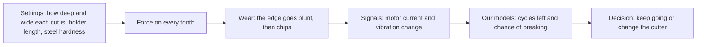
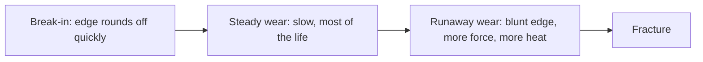
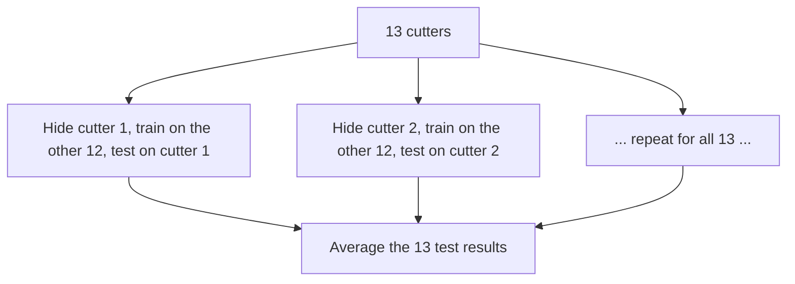

# ToolLife Policy, explained from the start

This is the one document to read to understand our AI in Manufacturing project: what problem it solves, what data it uses, what we built, what the results are, and what they do and do not prove. It assumes school-level maths and science and nothing about machining or machine learning. Every technical word is explained the first time it appears, and there is a word list at the end.

Read it top to bottom once. The physics of cutting, with photos and plots, is on its own page: [How a cutter dies](https://aadityakshatriya.github.io/AI-in-manufacturing/physics.html).

---

## 1. The whole project in one paragraph

A CNC milling machine cuts steel with a small spinning tool called a cutter. The cutter wears a little on every cut and eventually breaks. Change it too early and you waste money; change it too late and it snaps in the middle of a part. We built a system that reads the machine's motor current and vibration after every cut, estimates how many more cuts the cutter can survive and how likely it is to break soon, and then decides: **keep going** or **change the cutter now**. We tested every part on cutters the system had never seen.

The left half is physics we cannot see directly. The right half is what we built.

---

## 2. The physics in five minutes

### The machine and the cutter

A **CNC machine** (Computer Numerical Control) is a machine tool moved by a computer program. Ours does **milling**: a cutting tool spins fast and is pushed along a path, shaving metal off a steel block. The cutting tool is an **end mill**, a 10 mm carbide rod with four spiral cutting edges called **teeth**. It is held in a **holder** that fits into the machine's spinning shaft, the **spindle**.

The cutter spins at 3,200 turns a minute, which is 53 turns a second. With four teeth, the steel is hit 213 times a second. Each tooth shaves a chip about 0.05 mm thick, thinner than a human hair.

### One cycle

The steel block is cut away ring by ring. The cutter travels once around the outside of the block, removing a ring of steel; that one lap is **one cycle**, about 31 seconds of cutting. Then it moves in and does the next ring. A cutter does cycle after cycle until it breaks. All its cycles from new to broken are its **lifecycle**.

### How a cutter wears

Every tooth hit is a small hammer blow at several hundred degrees. Over hundreds of thousands of hits:

- the face below the edge rubs flat (**flank wear**), so the edge rubs instead of slicing and the force goes up;
- small pieces break off the edge (**chipping**);
- finally a tooth, or the whole cutter, snaps (**fracture**). Every cutter in our main data ended this way.

Wear follows three stages: a short break-in, a long slow middle, then runaway wear at the end, because a blunt edge pushes harder, runs hotter and wears faster.

### What decides how long a cutter lives

The settings change the force on every tooth, and so the life. In our data:

| Setting | What it physically does | What happened to our cutters |
|---|---|---|
| Sideways bite (radial depth): 4.5 or 8 mm of the 10 mm width | A wider bite keeps each tooth in the steel longer and puts more teeth in at once, so more force | At 8 mm, cutters lived 30–54 cycles; at 4.5 mm, 60–150 |
| Holder length: 80 or 160 mm | A cutter sticking further out bends like a diving board; twice as long is about 5–8 times floppier, and it starts shaking on its own (chatter) | Both cutters on the long holder died almost at once, at cycles 1 and 15 |
| Steel hardness: 35–42 on the Rockwell C scale | Harder steel needs more force and wears the edge faster | With the same settings, harder blocks gave shorter lives |
| Depth (axial depth): 5 or 10 mm | More of the cutter's height is cutting | Surprisingly little effect on its own |

The spin speed and feed were the same for every cutter, so our data cannot show how speed changes life.

---

## 3. What we predict: remaining useful life

The cutter's **remaining useful life (RUL)** is the number of cycles it can still do before it breaks. A cutter that breaks during cycle 50:

| Cycle just finished | Cycles left (RUL) |
|---:|---:|
| 1 | 49 |
| 25 | 25 |
| 45 | 5 |
| 49 | 1 |
| 50 | broke |

Because every cutter in the experiment was run until it broke, we know the true RUL for every recorded cycle. That is what lets a model learn.

**Important:** nobody measured the wear itself. The dataset tells us *when* each cutter broke, not how worn it was along the way. So our models never "see" wear. They learn the link between what the signals looked like and how close the cutter was to breaking.

After every cycle, our main model gives a **risk curve**: the chance of breaking on each of the next cycles. From that one curve we read:

- **cycles left**: a low, a middle and a high estimate;
- **the chance of breaking within the next 1, 3 or 5 cycles**, which is what the decision needs.

---

## 4. What the machine feels: the signals

Nobody can watch a cutter spinning 53 times a second inside a spray of chips. The machine was fitted with two kinds of sensors.

**Motor current** is an electricity meter on each motor. The spindle motor's current shows the twisting effort of cutting. The table motors push the steel into the cutter, so their current shows how hard the steel pushes back. A blunt edge rubs instead of slicing, which pushes back on the table more than it adds to the twisting, so **the table motor's current rises fastest as a cutter wears**. These meters update only 5 times a second, so they show load, not individual tooth hits.

**Vibration** sensors (accelerometers) take 25,000 readings a second: fast enough to hear every tooth hit. A chipped tooth makes one of the four hits different, which adds a beat that repeats once per turn.

What we measured across all 13 normal cutters, each compared with its own first cycles:

- table motor current rose in **all 13**, by 1.4 to 2.7 times by the end of life;
- vibration rose too, and the once-per-turn beat grew 2 to 13 times near the end in 6 of 7 cutters we checked;
- the signals stay flat for the first third to half of life, then bend upwards: the runaway stage of wear, showing up in the electricity and the vibration.

---

## 5. The data, and where it came from

### Our main dataset

Recorded at Rzeszów University of Technology, Poland, and published in 2025 (Piecuch & Żabiński, *Scientific Data*, [paper](https://www.nature.com/articles/s41597-025-04923-y), [files](https://doi.org/10.6084/m9.figshare.28589216), free to use under CC BY 4.0).

- 14 cutters, each run from new until it broke, on a Haas VF-1 milling machine cutting hardened steel
- 968 recorded cycles
- 20 sensor channels: 8 vibration (25,000 readings a second) and 12 motor currents
- 112 GB of raw recordings, plus a small table of 120 summary numbers per cycle

One cutter broke on its very first cycle, so it has no wear history; we keep it aside. That leaves **13 cutter lives**. 968 rows sounds like a lot, but it is really 13 life stories, because cycles of the same cutter are near-copies of each other.

### Four more datasets from other machines

Thirteen lives is not much, so we added four public datasets in which cutters were also used until the end of their life:

| Dataset | Cutter lives | How a life ends | Signals we used | Source |
|---|---:|---|---|---|
| NASA Ames milling | 15 | worn to 0.3 mm | spindle current, vibration | NASA Prognostics Data Repository |
| Hannover (LUH), 3 machines | 9 | worn to 0.15 mm | spindle torque (it has no vibration sensor) | Denkena et al., Data in Brief 2023 |
| MSTW EndMill 2026 | 25 | worn to 0.3 mm | spindle current, vibration | Sayyad et al., Figshare 2026 |
| VMC 650 production shop, India | 24 | the operator decided | spindle current, vibration | Rizwan, Zenodo 2026 |

With ours, that is **86 cutter lives on about 7 machines**. Seven MSTW recordings were published damaged, and we skip them.

Each dataset measures things differently, so we put them on one **common footing**:

- every signal is divided by the same cutter's value when it was new ("how much has it changed since new"), which cancels most differences between machines and sensors;
- age is measured as the **fraction of life used**: 0 for a new cutter, 1 at the end of its life, however that dataset defines the end.

The spindle load rises with wear on other machines too:

---

## 6. How we test fairly

A **machine learning model** learns a pattern from examples instead of being told the rule. **Training** is showing it examples with known answers; **testing** is checking it on examples it has never seen.

The trap with our data: cycle 40 and cycle 41 of the same cutter look almost the same. If we shuffled all the rows and split them randomly, the model would train on cycle 40 and be "tested" on cycle 41: it would effectively see the answer, and the score would look much better than it really is. This mistake is called **data leakage**, and many published tool-wear results suffer from it.

Our rule: **hide one whole cutter**. Train on the other 12, predict the hidden one, and repeat until every cutter has been hidden once. Every number in this document comes from a cutter the model never saw. Each cutter counts equally in the averages. The formal name is *leave-one-group-out cross-validation*.

With only 13 cutters, differences of a few cycles between models are within the noise. We say so wherever it matters.

---

## 7. The models

### Yardsticks

Simple methods the real models must beat:

- **Change every N cycles**, with N tuned on the training cutters. Roughly what workshops do today.
- **Settings and age only**: a survival model that knows the cutter's settings and how many cycles it has done, and no sensor data. If sensors cannot beat this, they add nothing.
- **LightGBM**: a standard model made of many small decision trees, given the 120 summary numbers per cycle.

### Model 1: a CNN autoencoder that learned healthy cutting

An **autoencoder** is a network trained to **squeeze its input into a few numbers and then rebuild the input from those numbers**. It has two halves:

- the **encoder** squeezes: it takes 0.16 seconds of vibration from five table sensors (5 × 4,096 readings) and passes it through 6 **convolution** layers, each of which slides small learned pattern detectors (filters) along the signal and halves its length. The result is squeezed into **64 numbers**, a fingerprint of how that cut sounded;
- the **decoder** is the mirror image: it rebuilds the 5 × 4,096 readings from those 64 numbers.

It is trained with no labels at all: the only goal is to rebuild its input well. It has about **4 million** learned numbers. The useful trick: we trained it **only on the healthy first 30% of the training cutters' lives**. So it learns what healthy cutting sounds like. When a cutter wears, its sound drifts away from what the network learned, and the rebuild gets worse. The size of the rebuild error is a **health score**.

To keep it honest, we trained five autoencoders, each without a different group of cutters, and every cutter is scored by an autoencoder that never heard it.

**Result:** on cutters it never heard, the health score rose steadily with wear in 12 of 13 cutters, reaching 3 to 17 times its starting level. The exception is cutter 10 on the long holder, which shook violently from its first cycle, so its sound was never "healthy" to begin with.

### Model 2: a TCN that reads the cutter's history and predicts

A **TCN** (temporal convolutional network) is a network that reads a sequence in order, here the sequence of a cutter's cycles. It is built from 1-D convolutions along the cycles that are:

- **causal**: each prediction uses only this cycle and earlier ones, never later ones, just as on a real machine;
- **dilated**: each layer looks further back than the last (gaps of 1, 2, 4, then 8 cycles), so after 4 layers it takes in about the last 31 cycles.

After every cycle, it takes about 30 numbers for that cycle: physics features from the motors and vibration (table and spindle current while cutting, energy spent per mm³ of steel, vibration levels at the tooth rhythm and the once-per-turn rhythm, each relative to when the cutter was new), the settings, and the cutter's age. Its output is the risk curve described in section 3. It has about 100,000 learned numbers, deliberately small because only 12 cutters are available to learn from each time. We train 5 copies with different random starts and average them.

**Results** (average error in cycles; lower is better):

| Model | Whole life | Last 20% of life | Over-estimate in last 20% |
|---|---:|---:|---:|
| **TCN on physics features** | **20.9** | **13.6** | **9.7** |
| LightGBM on the 120 summaries | 20.2 | 14.3 | 12.8 |
| TCN on autoencoder fingerprint + health score | 22.6 | 14.6 | 10.9 |
| TCN on physics + autoencoder | 24.5 | 17.8 | 14.0 |
| TCN on settings + age only | 25.3 | 14.6 | 9.3 |
| Survival model on settings + age | 26.2 | 23.3 | 21.4 |

What this means:

- The sensors add real information beyond the settings and age.
- The TCN on physics features is level with LightGBM overall and better near the end of life, where decisions are made; it also over-estimates the cycles left less often there, which is the dangerous mistake.
- The autoencoder's outputs carry wear information on their own (22.6 vs 25.3 for settings + age), but **adding them on top of the physics features made the TCN worse**. With 12 training cutters, more inputs mean more room to memorise the training cutters.
- **How good is 20.9 cycles?** On average the error is about 27% of a cutter's life (median 21%). It is good on short-lived cutters (8–17%) and poor on the longest-lived ones (35–45%), because almost no training cutter lived as long as cutters 7, 9 and 105.
- **The ranges.** The model's own low-to-high range is too confident: it contains the true value only 12% of the time. We widen it by the worst miss seen on the other cutters (**conformal calibration**); the widened range then contains the truth 95% of the time, but it is about 116 cycles wide. That width is the honest answer with 13 cutters. We tried two ways of making the risk curves less confident (blurring them by an amount chosen on the training cutters); both made the middle estimate worse, so we did not use them.

Three real cutters, replayed cycle by cycle:

### Experiment: does what other machines teach transfer to ours?

We trained a small TCN on only the inputs every dataset has: spindle load and vibration, each relative to when the cutter was new. Its job is to estimate the fraction of life used. On our 13 cutters:

| Trained on | Error in fraction of life | How well its estimate rises with wear (0 to 1) |
|---|---:|---:|
| Our cutters only | 0.140 | 0.86 |
| **The four other datasets only, never our machine** | **0.146** | **0.89** |
| Ours + the other four | 0.135 | 0.92 |

Guessing 0.5 every time would score 0.25. **A model that never saw our machine tracked wear on our cutters as well as one trained on our own data**, and combining both was best. Hiding each whole dataset in turn, the estimate still rose with wear on every unseen machine (0.72–0.91), though its absolute scale was off on some, mainly because "end of life" means different things in different datasets.

---

## 8. From prediction to decision

### Costs

The dataset contains no money, so we priced an Indian job shop from supplier listings and machine-hour rates (`research/next-phase/costs.md`):

| Item | Cost |
|---|---:|
| 10 mm carbide end mill | ₹3,000 |
| Machine and operator time | ₹800 an hour |
| A planned cutter change | ₹3,133 |
| A breakage (cutter, lost time, damaged part, holder damage) | ₹6,530 |

A breakage costs about twice a planned change here, because the cutter is thrown away either way. Since costs differ between shops, we also tested 24 cost settings, with breakage from 1.5 to 30 times a planned change.

### The decision rule

After each cycle: **change the cutter when the expected cost of the risk of breaking is bigger than what it costs to change it now**. The expected cost of risk is the chance of breaking × what a breakage costs. For one cutter, the best possible rule given the risk curve can be calculated exactly (by **dynamic programming**, which works backwards over every possible future).

### Results: replaying 13 real cutters

For each hidden cutter, we replay its real life cycle by cycle. The rule only ever sees the model's predictions up to that moment, and because we know when that cutter really broke, the outcome is exact. Only the costs are assumed.

At typical Indian costs:

- changing every N cycles let **10 of 13** cutters break; our rule let **5** break and was **about 5% cheaper**. With only 13 cutters, that saving is not yet statistically certain;
- perfect knowledge of the breaking point would save **40%**. That gap is the value of better prediction.

Across the 24 cost settings, the tuned rule on the TCN's risk curves was cheaper than "every N cycles" in 19.

---

## 9. Reinforcement learning

**Reinforcement learning (RL)** trains a decision-maker by trial and error: it acts, receives a score (here, profit in rupees), and slowly learns which actions score best. We used two standard methods: **PPO** (proximal policy optimisation) and **DQN** (deep Q-network).

### The check: one cutter

For a single cutter with keep-or-change, the exact best rule can be calculated, so RL is not needed there. We used it as a test: if RL cannot match the exact answer, something is wrong. **PPO came within 1% of the exact answer.** DQN stayed about 10% short.

### The workshop

RL only makes sense when decisions interact. We built a small simulated workshop:

- 3 machines, each replaying a real recorded cutter life that the prediction model never trained on;
- one setter, who can change only one cutter at a time;
- actions for each machine: **run**, **slow down 20%**, or **change the cutter**;
- reward: profit in rupees.

Slowing down extends cutter life, which we model with **Taylor's tool-life law**, a long-established rule that tool life grows as cutting speed drops. Our data cannot measure this (every cutter ran at one speed), so the strength of the effect, the Taylor exponent n, is varied, and results are shown for several values.

**Result: PPO and DQN did not beat well-tuned rules.** On held-out cutters (profit per 1,000 cycles):

| Policy | Slowing helps a lot (n = 0.25) | Slowing helps less (n = 0.4) |
|---|---:|---:|
| Rule that slows down when Taylor's law says it pays | ₹1.73 lakh | ₹0.98 lakh |
| Rule at normal speed | ₹0.98 lakh | ₹0.98 lakh |
| PPO | ₹1.03 lakh | ₹0.89 lakh |
| DQN | ₹1.07 lakh | ₹0.87 lakh |

The agents learned to slow the machines down about 60% of the time, which roughly halved breakages compared with the normal-speed rule. But they kept slowing down even when it did not pay, and DQN also memorised its training cutters (₹1.54 lakh on them vs ₹0.87 lakh on new ones). We set the success test before running it, and RL failed it. For this problem, a clear rule is the better choice, and that is a useful finding.

---

## 10. What we can and cannot claim

**We can claim:**

- motor current and vibration carry real information about wear, on every machine we checked;
- a model trained on other factories' machines tracked wear on ours as well as our own data did;
- our predictions are level with a strong baseline overall and better near the end of life, tested honestly on unseen cutters;
- a rule driven by these predictions halved breakages in a replay of 13 real cutters.

**We cannot claim:**

- that the system saves a factory a particular percentage: the costs are assumed and 13 cutters cannot prove a few percent;
- that we predict physical wear: we predict cycles left before breakage;
- that slowing down extends life by any particular amount: that is modelled with Taylor's law, not measured;
- that the system is connected to a machine: it works on recorded data.

---

## 11. Where everything is

| What | Where |
|---|---|
| Plan and agreed scope | `PLAN.md` |
| Physics, with photos | `docs/physics.html` (on the website) |
| Research reports (data, physics, costs, models, RL) | `research/next-phase/` |
| Code | `src/toollife/` (library) and `scripts/` (numbered steps) |
| Results tables | `results/models/`, `results/decisions/`, `results/cross_dataset/`, `results/rl/` |
| Figures | `results/figures/` |
| Review 2 video script | `research/review-2-video-script.md` |

The data itself is not in the repository; `scripts/00_download.py` downloads it again.

---

## 12. Word list

- **CNC (Computer Numerical Control):** a machine tool moved by a computer program.
- **Milling:** cutting metal with a spinning tool that moves along a path.
- **Cutter, tooth, holder, spindle:** the cutting tool; one of its four cutting edges; what grips it; the spinning shaft.
- **Cycle / lifecycle:** one lap of cutting around the steel block / all of one cutter's cycles until it breaks.
- **Flank wear, chipping, fracture:** the edge rubbing flat; small pieces breaking off; the cutter snapping.
- **Chatter:** shaking that feeds on itself when a tool is too floppy.
- **Remaining useful life (RUL):** cycles a cutter can still do before breaking.
- **Risk curve:** the chance of breaking on each of the next cycles.
- **Motor current / vibration:** how hard a motor is working / how much the machine shakes.
- **Feature:** one input number given to a model.
- **Training / testing:** learning from examples with answers / checking on examples never seen.
- **Data leakage:** a model accidentally seeing information it would not have in real use, which makes scores look better than they are.
- **Hide one cutter (leave-one-group-out cross-validation):** train on all cutters but one, test on that one, repeat for each.
- **LightGBM:** a model made of many small decision trees, each fixing the previous ones' mistakes.
- **Convolution / filter:** sliding a small learned pattern detector along a signal / that detector.
- **CNN (convolutional neural network):** a network built from convolutions.
- **Autoencoder:** a network that squeezes its input into a few numbers and rebuilds it; here, trained on healthy cutting so that its rebuild error is a health score.
- **TCN (temporal convolutional network):** a network of causal, dilated convolutions that reads a sequence in order.
- **Causal / dilated:** using only the past / looking further back in each layer.
- **Conformal calibration:** widening a range by the worst miss seen on other examples, so it covers the truth as often as it claims.
- **Overfitting / memorising:** learning the training examples instead of a general pattern.
- **Dynamic programming:** calculating the best decision exactly by working backwards over every possible future.
- **Reinforcement learning (RL), PPO, DQN:** learning decisions by trial and error with a score; two standard methods for it.
- **Taylor's tool-life law:** cutter life grows as cutting speed drops, by an amount set by the exponent n.
