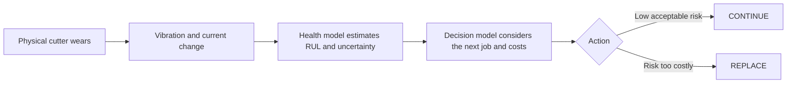
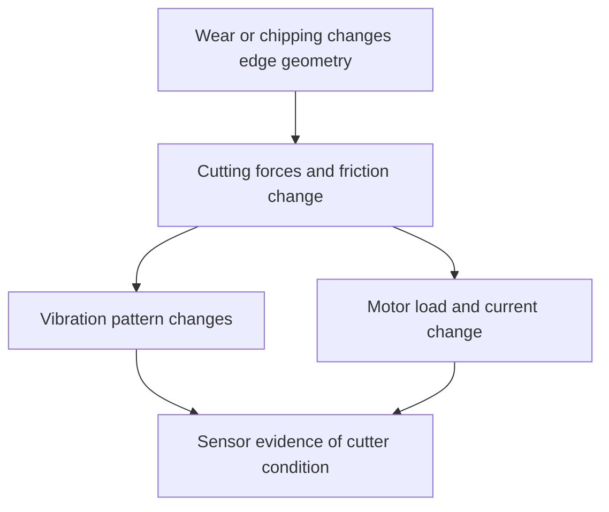
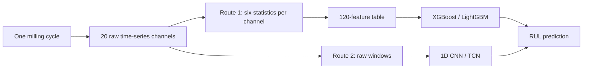
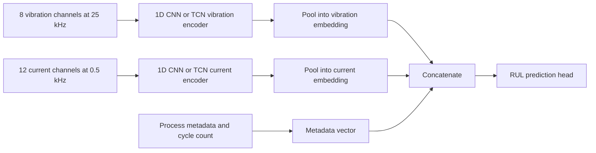
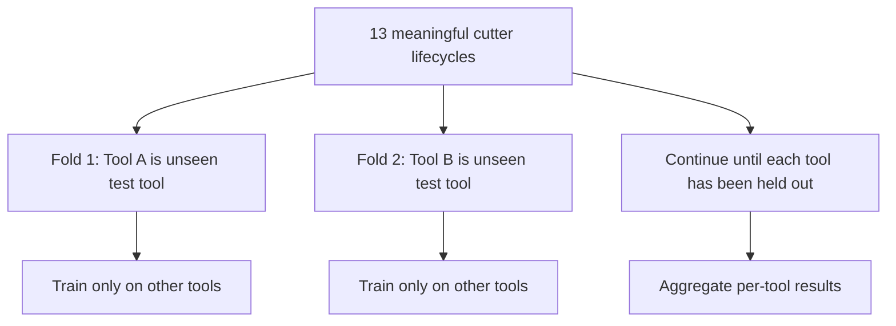
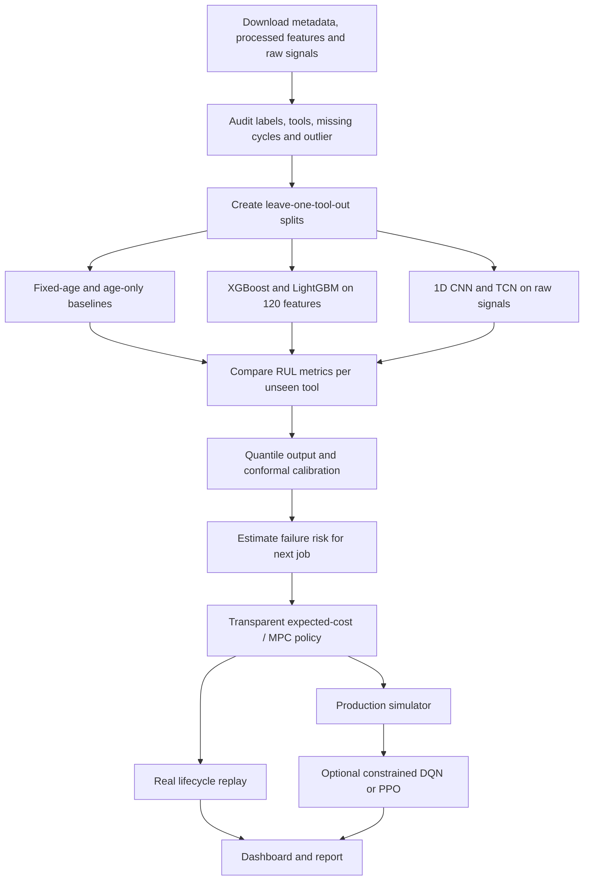

# Aditya's complete guide to ToolLife Policy

This guide starts with the physical machining problem and builds the project one
idea at a time. Every technical term is defined when it first appears. The special
focus is the machine-learning architecture, uncertainty and replacement policy.

## 1. Begin with the factory decision, not the model

Imagine a **CNC milling machine**. “CNC” means *Computer Numerical Control*: a
computer follows a programmed path and controls the motion of the machine. In
**milling**, a rotating cutting tool removes material from a workpiece. A
**workpiece** is simply the block or component being machined.

The cutter has several sharp **cutting edges**. Each edge repeatedly enters and
leaves the workpiece. That repeated contact produces mechanical force, friction
and heat. Gradually, the edge loses material or chips. This deterioration is
called **tool wear**. Eventually, an edge or the whole cutter can break; that is
the **failure event** used by our primary dataset.

The factory must choose when to replace the cutter:

- Replace it very early and the machine is safe, but usable cutter life, money and
  changeover time are wasted.
- Continue for too long and the cutter may fail during a part, causing scrap,
  unplanned downtime and schedule delay.

This is like deciding whether to replace a phone battery before a long trip. Its
current charge matters, but so does the trip: a doubtful battery might be
acceptable for a ten-minute journey and unacceptable for a six-hour journey. In
our project, the “battery condition” is cutter health and the “trip” is the next
machining job.

The project therefore asks:

> Given everything observed about the cutter so far, is it safer and cheaper to
> use it for the next job or replace it now?

That question has two connected layers:

1. **Prognosis:** predict what is likely to happen to the cutter in the future.
   “Prognosis” means forecasting future health, rather than merely detecting the
   current condition.
2. **Decision policy:** choose an action using that forecast and the consequences
   of being wrong. A **policy** is a rule or learned strategy that maps the current
   situation to an action.



## 2. What problem are we actually solving?

The broad field is **predictive maintenance**. Maintenance means keeping equipment
able to perform its intended function. Three common strategies are:

- **Reactive maintenance:** act after failure. Analogy: repair the phone only
  after it stops working.
- **Preventive maintenance:** act on a fixed time or usage schedule. Analogy:
  replace the phone battery every two years regardless of its condition.
- **Predictive maintenance:** use measured condition to predict when intervention
  will be needed. Analogy: use battery-health data and the coming trip length.

Our component is not the whole machine; it is the milling cutter. Our core output
is not a vague “healthy/unhealthy” label. It is:

1. a prediction of **Remaining Useful Life**, abbreviated **RUL**; and
2. a recommendation to **CONTINUE** or **REPLACE** before the next job.

RUL means the amount of useful operation predicted to remain before failure. In
this dataset it is measured in milling cycles. If the cutter will fail at cycle
80 and it has just completed cycle 60, the true RUL at that point is 20 cycles.

```text
True RUL after the current cycle = observed failure cycle − current cycle
```

The data do not provide a continuous microscope measurement of flank-wear width
for every cycle. Therefore, be precise: the primary supervised target is
**cycles to failure**, not physical wear in micrometres. “Predicting tool wear” is
acceptable as loose motivation, but “predicting RUL and failure risk” is the
technically correct description of our implementation.

## 3. Why fixed replacement is insufficient

A **fixed-age policy** replaces every cutter after the same number of cycles. Here,
“age” means completed cycles, not calendar age. It is simple and therefore an
important **baseline**. A baseline is a simpler reference method that the proposed
system must beat.

Suppose previous cutters failed after 40, 80 and 120 cycles. Replacing all cutters
at 35 cycles is cautious, but wastes most of the second and third cutters. Replacing
at 100 cycles uses more life, but would have failed on the first two. The primary
dataset actually contains large tool-to-tool lifetime variation, so this is not a
made-up issue.

The next-job context also matters. Failure halfway through a cheap test piece does
not have the same consequence as failure halfway through a long, high-value part.
That is why our project is **production-aware**: it combines predicted cutter
health with job duration, part value, planned change time and breakdown cost.

## 4. How cutter wear becomes data

We do not repeatedly stop the machine and place the cutter under a microscope.
Instead, we use **indirect sensing**: infer cutter health from quantities measured
during machining.

### Vibration

**Vibration** is mechanical oscillation—small repeated movement of the spindle,
tool, axes or worktable. A healthy cutter tends to produce a comparatively regular
response. Wear changes edge geometry and friction; chipping creates imbalance and
impacts. These changes can alter vibration amplitude and frequency content.

- **Amplitude** means the size or strength of an oscillation.
- **Frequency** means how many oscillations occur per second and is measured in
  hertz, abbreviated Hz.

An **accelerometer** is a sensor that measures acceleration caused by vibration.
The dataset has eight accelerometer channels.

### Electrical current

**Electrical current** is the flow of electric charge. A motor draws current to
produce torque. **Torque** means rotational turning effort. If cutting becomes
harder because of increased friction or damaged geometry, the spindle or axis
motors may need more torque, which can change their current signals.

Current is an indirect and sometimes less sensitive indication of wear, but it is
attractive because it can be measured without placing an expensive force sensor in
the cutting zone. The dataset has twelve current channels from the spindle and
machine axes.

The sensor logic is therefore:



Neither signal is a perfect health meter. Hardness, depth of cut, sensor position
and ordinary machine vibration also affect them. This is the reason for combining
sensor data with **process metadata**. Metadata means descriptive information
about how the measurement was produced—for example cutter type, material hardness
and depth of cut.

## 5. The primary dataset, from the ground up

The primary source is the 2025 peer-reviewed data descriptor
[A new open dataset from a milling process—data for classification and estimation
of tool life](https://www.nature.com/articles/s41597-025-04923-y). The files are in
the [official Figshare release](https://doi.org/10.6084/m9.figshare.28589216) under
a CC BY 4.0 licence. “CC BY” means the data may be reused if the creators are
credited.

### Physical experiment

- **Machine:** Haas VF-1, a three-axis CNC milling machine. “Three-axis” means the
  tool/worktable motion is controlled along X, Y and Z directions.
- **Material:** 42CrMo4 steel. This is a chromium-molybdenum alloy steel used where
  strength and toughness matter. The name identifies its alloy family; we do not
  need to derive the metallurgy for this project.
- **Hardness:** 35.33–41.67 HRC. HRC is the Rockwell C hardness scale, a measure of
  resistance to indentation. Higher hardness generally makes machining more
  demanding, although hardness is not the only factor affecting wear.
- **Cutters:** fourteen cutters belonging to two types/manufacturers.
- **Cycles:** 968 recorded milling cycles. One cycle is one execution of the
  defined milling path, not necessarily one finished commercial part.
- **Endpoint:** the cutters were followed until complete breakage or breakage of a
  cutting edge.

One cutter failed in its first cycle. That gives no normal degradation history, so
the paper treats it as an outlier and recommends thirteen ordinary tool groups.
We retain it as a **stress case**, meaning an intentionally difficult example used
to examine failure behaviour, but we do not pretend it is a usable lifecycle for
ordinary training.

### Sensor channels and sampling

A **channel** is one recorded measurement stream. The raw files contain:

- 8 vibration channels sampled at 25 kHz;
- 12 current channels sampled at 0.5 kHz.

**Sampling rate** is how many measurements a sensor records each second.

- 25 kHz means 25,000 vibration measurements per second.
- 0.5 kHz means 500 current measurements per second.

Vibration is sampled much faster because rapid mechanical oscillations contain
high-frequency information. Current changes more slowly and therefore uses a lower
rate.

The raw archive is about 25.35 GB in decimal units, or 23.60 GiB in binary units.
GB and GiB are slightly different conventions for measuring digital storage; for
speech, “about 23.6 gigabytes” is sufficient.

### Cutting-condition metadata

- **ADOC**, axial depth of cut: how deeply the cutter engages along its axis. The
  dataset uses 5 or 10 mm.
- **RDOC**, radial depth of cut: how much of the cutter engages sideways. The
  dataset uses 4.5 or 8 mm.
- **Spindle speed:** 3,200 rpm. RPM means revolutions per minute.
- **Feed rate:** 640 mm/min. Feed rate is the speed at which the cutter advances
  relative to the workpiece.
- **Tool diameter:** 10 mm.

Spindle speed, feed and diameter are constant in the primary dataset. This matters:
we cannot honestly learn the causal effect of changing speed or feed from this
dataset. Consequently, “derating”—deliberately reducing cutting aggressiveness—is
only a stretch action supported by an external dataset or explicit simulator
assumption. It is not part of the defensible core.

### What one processed row means

The processed table is a **matrix**, meaning a rectangular arrangement of rows and
columns.

- One **row** represents one milling cycle.
- A **column** represents one recorded property.
- A **feature** is a column used as an input to a model.
- A **target** or **label** is the answer the model learns to predict.

For each of 20 channels, the authors calculated six statistics:

1. **Minimum:** smallest recorded value.
2. **Maximum:** largest recorded value.
3. **Mean:** arithmetic average.
4. **Standard deviation:** typical spread around the mean. A larger value means
   the signal varies more.
5. **Skewness:** asymmetry of the value distribution. Positive and negative tails
   are not equally shaped when skewness is nonzero.
6. **Kurtosis:** sensitivity to unusually extreme values or heavy tails. Sudden
   impacts can increase it.

Therefore:

```text
20 sensor channels × 6 statistics per channel = 120 sensor features
```

The 120 sensor features are combined with process information, completed-cycle
count and the target to form a final 968 × 131 table.

### Raw data versus processed data

Think of an entire song and a small summary describing the song:

- The **raw signal** is the full audio waveform. It preserves local patterns but
  is large and difficult to model.
- The **processed features** are summaries such as average loudness and largest
  peak. They are small and interpretable but may discard useful timing patterns.

Our two modelling routes mirror this distinction.



## 6. The learning problem

This is primarily **supervised regression**.

- **Supervised learning** means examples contain inputs and known correct answers.
  Here, signals and metadata are inputs; known cycles-to-failure is the answer.
- **Regression** means predicting a numerical quantity. RUL is a number of cycles.

It is not primarily **anomaly detection**. Anomaly detection learns what normal
data look like and flags unusual examples, often without exact failure labels. It
can be useful for the unpredictable first-cycle failure or as an extra health
indicator, but our dataset already supplies RUL labels, so supervised regression
is the main route.

The desired mapping is:

```text
sensor evidence + process conditions + completed cycles
                          ↓
              remaining cycles before failure
```

## 7. Before AI: establish honest baselines

A complex model is meaningless unless it beats simple alternatives.

### Fixed-age baseline

Replace after a constant number of cycles selected only from training tools.

### Age-only baseline

Predict RUL using completed cycles and process metadata but no vibration/current.
This is crucial because cycle count is already correlated with remaining life.

### Sensor-only model

Use signals and process information without cycle count. This tests whether the
sensors genuinely contain transferable health evidence.

### Full model

Use sensors, process metadata and legitimately known completed cycles. This is the
most realistic deployment model.

If the full model performs well but the sensor-only model does not beat the
age-only model, we have learned that most apparent intelligence came from counting
cycles. That is an important scientific finding, not something to hide.

## 8. Route 1: XGBoost and LightGBM

### Start with one decision tree

A **decision tree** predicts by asking a sequence of yes/no questions. For example:

```text
Is spindle-current standard deviation > threshold?
├── No: Is completed cycle count > threshold?
│   ├── No  → predict 55 cycles remaining
│   └── Yes → predict 25 cycles remaining
└── Yes: Is vibration kurtosis > threshold?
    ├── No  → predict 18 cycles remaining
    └── Yes → predict 5 cycles remaining
```

A single tree is understandable but unstable: a small change in data can change
its branches.

### Ensemble

An **ensemble** combines several models, like asking a panel rather than one
person. XGBoost and LightGBM each create an ensemble of decision trees.

### Boosting

**Boosting** builds trees sequentially. The first tree makes rough predictions.
The next tree focuses on the remaining errors. Later trees repeatedly correct the
current ensemble.

Analogy: one student answers an exam, a second studies the first student's
mistakes, and a third studies what the first two still get wrong.

### Gradient

In machine learning, a **loss function** is a numerical measure of prediction
error. A **gradient** indicates the direction in which model parameters should
change to reduce that loss. Gradient boosting fits each new tree to move
predictions in an error-reducing direction.

You do not need to derive calculus during the viva. The safe explanation is:

> XGBoost and LightGBM build many small trees in sequence; every new tree focuses
> on correcting the errors left by the existing trees.

### XGBoost

**XGBoost**, short for *Extreme Gradient Boosting*, is an efficient,
regularized tree-boosting implementation. **Regularization** means discouraging an
overly complicated model so it generalizes better rather than memorizing training
data.

The [original XGBoost paper](https://arxiv.org/abs/1603.02754) emphasizes scalable
tree boosting, sparsity handling and systems optimizations.

### LightGBM

**LightGBM**, short for *Light Gradient Boosting Machine*, is another efficient
gradient-boosted-tree implementation. It uses histogram-based splitting and other
techniques to make training efficient on high-dimensional or large data. A
**histogram** here means continuous feature values are grouped into bins before
choosing splits.

The [original LightGBM paper](https://proceedings.neurips.cc/paper/2017/hash/6449f44a102fde848669bdd9eb6b76fa-Abstract.html)
describes its efficiency techniques.

### Are XGBoost and LightGBM automatically an ensemble together?

No. Each is already an ensemble internally. Our first experiment will **compare**
them under identical validation. We may later average or stack their predictions;
only then would we have an XGBoost-plus-LightGBM ensemble.

- **Averaging:** take the mean of their predictions.
- **Stacking:** train a second model to combine their predictions.

We should combine them only if validation shows a reliable gain. Saying “ensemble”
before testing is an unnecessary promise.

### Why tree boosting fits this dataset

- The processed data are tabular: one row per cycle and named columns.
- There are only 968 rows, so a compact tree model may generalize better than a
  large neural network.
- Trees naturally represent nonlinear interactions, such as high vibration being
  concerning only under a particular depth of cut.
- Feature importance and SHAP explanations are available.

**SHAP** is a family of explanation methods that assigns each feature a
contribution to a particular prediction. Analogy: it attempts to divide the final
prediction among the evidence that pushed it higher or lower. SHAP does not prove
causality; it explains the fitted model's use of inputs.

## 9. Route 2: 1D CNN and TCN on raw signals

### Why use raw signals?

Min, max and average cannot describe the ordering of events. Two signals can have
the same mean and standard deviation but completely different shapes. Raw-signal
models test whether those shapes carry wear information.

### Neural network

A **neural network** is a parameterized function composed of layers. During
training, it adjusts numerical **weights**—learned strengths of connections—to
reduce prediction loss.

### Convolution

A **convolution** slides a small learned pattern detector along the input.

- The detector is called a **filter** or **kernel**.
- The sequence of responses is a **feature map**.

Analogy: move a small stencil across a long strip of vibration data. One stencil
might respond strongly to a sharp impact; another to a repeated oscillation.

### Why one-dimensional?

An image CNN slides in two spatial dimensions: horizontal and vertical. Our signal
is ordered along one main dimension—time—so the filter slides in one dimension.
That makes it a **1D CNN**.

### Pooling

**Pooling** compresses many local responses into a smaller summary. For example,
global average pooling takes the average response of each learned filter over the
cycle. It reduces model size and allows a final prediction head to use the most
important detected patterns.

### Receptive field

A model's **receptive field** is how much of the input can influence one internal
output. A shallow CNN sees short local patterns. Deeper layers increase the amount
of history it can connect.

### Temporal Convolutional Network

A **Temporal Convolutional Network**, or **TCN**, is a convolutional architecture
designed for sequences. The influential [TCN evaluation paper](https://arxiv.org/abs/1803.01271)
showed that convolutional sequence models are strong alternatives to recurrent
networks.

A TCN commonly uses:

- **Causal convolution:** output at time *t* uses only time *t* and earlier, never
  future values. This prevents future information from leaking into an online
  prediction.
- **Dilated convolution:** the filter skips across inputs at increasing gaps. One
  layer may use neighbouring points, another every second point, another every
  fourth point. This produces a long receptive field efficiently.
- **Residual connection:** a shortcut adds a layer's input to its output, helping
  information and gradients pass through deeper networks.

Analogy for dilation: instead of reading every word of a long document, first read
adjacent words, then sample every second, fourth and eighth word to obtain wider
context without an enormous filter.

### CNN versus TCN

- A basic 1D CNN is the simpler raw-signal baseline and is good at local patterns.
- A TCN deliberately captures longer sequence structure while respecting causal
  order.
- We compare them; TCN is not automatically superior.

### Two-tower model

A **two-tower architecture** means two separate encoders process different input
groups before their summaries are joined.

We propose:

- vibration tower for eight 25 kHz channels;
- current tower for twelve 0.5 kHz channels.

An **encoder** is the part of a network that converts a large input into a compact
learned representation, also called an **embedding**. An embedding is simply a
vector—a list of numbers—that summarizes information useful for prediction.

Why separate towers? Vibration and current have different sampling rates and
physical meanings. Forcing both through the exact same early processing would be
awkward. After pooling, their embeddings can be concatenated. **Concatenation**
means joining two lists of numbers end to end.



The **prediction head** is the final small network that maps the joined embedding
to RUL outputs.

## 10. Point prediction is not enough

Suppose two models both predict 20 cycles remaining:

- Model A believes the plausible range is 18–22.
- Model B believes the plausible range is 3–45.

The central prediction is identical, but using the cutter for a ten-cycle
high-value job is clearly more questionable under Model B. This is **uncertainty
quantification**, meaning estimating not only an answer but how uncertain that
answer is.

### Quantiles

A **quantile** is a position in a predicted distribution.

- 10th percentile or lower quantile: a cautious lower estimate.
- 50th percentile: the median; half the predicted outcomes are lower and half
  higher.
- 90th percentile or upper quantile: an optimistic upper estimate.

We can train models with **quantile loss**, which penalizes underprediction and
overprediction differently so the requested percentile is learned. For a lower
quantile, values below the true result and above it receive asymmetric penalties.

### Calibration

A model is **calibrated** when its stated uncertainty matches observed outcomes.
If we produce a nominal 90% interval, approximately 90% of unseen true RUL values
should fall inside it under the required assumptions.

### Conformal prediction

**Conformal prediction** is a model-agnostic calibration method. “Model-agnostic”
means it can wrap around different underlying models. It measures prediction
errors on separate calibration data and enlarges or adjusts future intervals using
those errors. The [JMLR tutorial](https://www.jmlr.org/papers/v9/shafer08a.html)
explains the underlying coverage idea.

Analogy: after a weather forecaster gives temperature ranges for several previous
days, observe how often the true temperature fell outside. Widen future ranges by
enough to achieve the desired historical coverage.

Because we have only thirteen meaningful tool lifecycles, tool-group conformal
calibration will be statistically coarse. We must reserve whole tools for
calibration, report actual coverage and interval width, and avoid claiming a
perfect guarantee under distribution shift.

## 11. Turning RUL into a decision

The health model and decision model have different jobs:

- Health model: “Here is the estimated distribution of cycles remaining.”
- Decision model: “Given the next job and the costs, what should we do?”

This separation is important. A neural network should not secretly invent what a
scrapped part costs.

### State, action and policy

- **State:** information available when deciding—RUL distribution, completed
  cycles, job duration, part value and due-date slack.
- **Action:** an allowed choice—initially CONTINUE or REPLACE.
- **Policy:** mapping from state to action.

### Expected cost

**Expected cost** is a probability-weighted average of possible costs. If the next
job has a 10% failure probability and failure costs 20 normalized units, the
failure contribution is 0.10 × 20 = 2 expected units.

A simplified one-step comparison is:

```text
Cost(REPLACE) = new tool cost + planned changeover cost

Expected Cost(CONTINUE)
  = probability of failure during next job
    × (scrap cost + unplanned downtime + recovery/delay cost)
```

The policy chooses the lower-cost action while obeying a maximum acceptable
failure-risk constraint.

**Normalized cost** means costs are expressed relative to a reference, such as one
new tool costing 1 unit. This avoids pretending we possess real factory rupee
values. We test many ratios in a **sensitivity analysis**, meaning we vary
assumptions to see whether the conclusion remains stable.

### Dynamic programming

A one-step rule looks only at the next job. **Dynamic programming** breaks a
multi-step decision problem into smaller future decisions. It can compare replacing
now against continuing through several queued jobs, including how today's action
changes tomorrow's state.

Analogy: choosing a chess move by considering not only its immediate reward but the
best response and later positions.

### Model-predictive control

**Model-Predictive Control**, or **MPC**, repeatedly plans over a short future
horizon, performs the first action, observes the new state and plans again.

- **Model:** simulator used to predict future consequences.
- **Horizon:** number of future jobs considered.
- **Control:** action selection.

MPC is attractive because it is transparent and naturally incorporates constraints.

## 12. Where reinforcement learning fits

**Reinforcement learning**, or **RL**, trains an agent by letting it interact with
an environment and receive rewards or costs.

- **Agent:** decision-maker.
- **Environment:** simulated production system.
- **Reward:** numerical feedback; because our objective is cost minimization, we
  can use negative cost as reward.
- **Episode:** one simulated production run from start to finish.

Our mapping is:

```text
Agent       = replacement policy
State       = RUL distribution + next jobs + costs
Actions     = CONTINUE or REPLACE
Environment = tool-degradation and production simulator
Reward      = negative tool, scrap, downtime and delay cost
```

### DQN

A **Deep Q-Network**, or **DQN**, learns a value called Q(state, action): the
predicted long-term reward of taking an action in a state and then continuing
intelligently. Because CONTINUE/REPLACE is a small discrete action set, DQN is a
possible option.

### PPO

**Proximal Policy Optimization**, or **PPO**, directly updates a parameterized
policy while restricting each update from changing behaviour too drastically. The
[original PPO paper](https://arxiv.org/abs/1707.06347) presents it as a relatively
simple, general policy-gradient method.

### Constrained RL

**Constrained RL** optimizes reward while enforcing or penalizing violations of a
condition, such as a maximum failure rate. In our project a safety shield can
override any action whose predicted risk exceeds a hard limit. A **safety shield**
is an explicit rule around the learned policy.

### Why RL is optional

RL needs a simulator because deliberately breaking real cutters thousands of times
is unsafe and expensive. If the simulator is wrong, the RL policy can exploit its
mistakes. Therefore:

1. build a transparent expected-cost/MPC policy first;
2. validate the simulator;
3. train DQN or PPO only as a controlled comparison;
4. keep RL only if it improves long-term cost without violating risk constraints.

Using RL is not automatically more advanced scientifically. Beating a transparent
policy under one convenient simulator is not proof of factory superiority.

## 13. The production simulator

A **simulator** is software that imitates selected behaviour of a real system. It
is not a perfect digital copy. Our simulator will generate:

- a sequence of cutter lifecycles based on observed training tools;
- queued jobs with required numbers of cycles;
- part values and due-date pressure;
- planned replacement and unplanned failure costs;
- sensor noise, missing channels and unfamiliar conditions for stress testing.

A **digital twin** is a broader digital representation connected to or reflecting
a physical system. Since our initial simulator is not live-connected to a factory,
“production simulator” or “offline digital-twin prototype” is more precise than
claiming a deployed digital twin.

The simulator supports repeated decisions after replacement. Real recorded data
only show what happened to one physical tool on its observed path; they do not show
the counterfactual future after an earlier replacement. **Counterfactual** means
what would have happened under an action that was not actually taken.

We therefore separate two evaluations:

1. **Real lifecycle replay:** play a held-out cutter's recorded cycles in order
   until the policy replaces it or it fails. This provides data-grounded stopping
   evidence.
2. **Long-horizon simulation:** evaluate many replacements, jobs and costs. This
   provides simulated economic evidence and must be labelled accordingly.

## 14. Validation without fooling ourselves

### Generalization

**Generalization** means performing well on genuinely unseen cases, not memorizing
training examples.

### Data leakage

**Data leakage** occurs when training accidentally receives information that would
not be available during real prediction. In this dataset, random row splitting is
dangerous because neighbouring cycles from the same cutter are closely related.

Analogy: test a student using questions copied from the practice paper and then
claim they can solve new problems.

### Leave-one-tool-out cross-validation

**Cross-validation** repeatedly creates training and testing splits to estimate
generalization. In **leave-one-tool-out** cross-validation, every cycle from one
cutter is kept together as the test set; other cutters form the training data.



Within each outer fold we also need whole-tool validation/calibration groups:

- **Training set:** fits model parameters.
- **Validation set:** selects architecture and **hyperparameters**. Hyperparameters
  are settings chosen by us, such as tree depth, learning rate or number of CNN
  filters.
- **Calibration set:** adjusts uncertainty intervals.
- **Test set:** touched only for final evaluation in that fold.

With so few tools, exact allocation will be a compromise. We can use nested grouped
cross-validation or rotate calibration tools. The non-negotiable rule is that one
physical cutter cannot appear in both training and testing.

Other leakage controls:

- remove filename and tool identifier from model inputs;
- remove `CycleToFailure` and its normalized version from inputs;
- fit normalization, feature selection and imputation only on training tools;
- use only current and past cycles in any history window.

**Normalization** rescales features to comparable numerical ranges. **Imputation**
fills missing values according to a rule learned without test data.

## 15. Metrics and what each one means

No single metric tells the whole story.

### MAE

**Mean Absolute Error**, or **MAE**, averages the absolute difference between
predicted and true RUL.

```text
MAE = average of |predicted RUL − true RUL|
```

If errors are 2, 3 and 7 cycles, MAE is (2 + 3 + 7) / 3 = 4 cycles. It is easy to
interpret.

### RMSE

**Root Mean Squared Error**, or **RMSE**, squares errors before averaging and then
takes the square root. Squaring makes large mistakes count disproportionately.

Use MAE for typical error and RMSE to reveal occasional severe error.

### Interval coverage

**Coverage** is the fraction of true values inside the predicted interval. If a 90%
interval contains only 60% of unseen outcomes, the uncertainty is overconfident.
Coverage must be reported together with interval width; an infinitely wide interval
has excellent coverage but no practical value.

### Brier score

The **Brier score** evaluates a predicted event probability. For each example it
squares the difference between predicted probability and the actual binary outcome
(failure or no failure), then averages. Lower is better.

If the model predicts 0.9 probability of failure and failure occurs, the error is
(0.9 − 1)² = 0.01. If no failure occurs, it is (0.9 − 0)² = 0.81.

### Tool-life utilization

The fraction of observed useful life consumed before replacement. Replacing a
100-cycle cutter at cycle 60 gives 60% utilization. High utilization is desirable
only if failure risk remains controlled.

### Failure rate

Fraction of evaluation episodes in which the tool fails before planned replacement.

### Total normalized cost

Sum of tool, planned change, scrap, unplanned downtime and delay components,
expressed in relative cost units.

### Regret versus oracle

An **oracle** is an unrealistic benchmark that knows the true future failure time.
**Regret** is the extra cost incurred by our policy compared with that oracle. We
cannot equal the oracle in general; it shows how much room remains for improvement.

## 16. What success should mean

The honest aim is not “30% less downtime”—we have not measured that. The aim is:

> On held-out cutter lifecycles, produce useful RUL uncertainty and achieve lower
> expected replacement cost than the best fixed-age policy at the same or lower
> failure rate across a reasonable range of cost assumptions.

Possible pre-declared targets are:

- sensor-based model improves MAE or failure-probability score over age-only by at
  least 10%;
- nominal 90% intervals obtain roughly 85–95% empirical coverage;
- policy reduces normalized cost by at least 10% versus the best fixed-age
  baseline in the central simulator setting without increasing failures;
- improvement remains across most, not one hand-picked, cost scenarios.

These are success criteria, not current results.

## 17. What is actually novel about our course project?

Do not claim that XGBoost, CNNs, TCNs, RUL or tool monitoring are new. They are not.

Our contribution is the complete, carefully validated chain:

1. compare age-only, sensor-only and full information;
2. compare engineered-feature models with raw-signal models;
3. predict uncertainty, not only a point;
4. turn uncertainty into a production-aware action;
5. evaluate on unseen complete cutter lifecycles;
6. distinguish real replay evidence from simulated economic evidence;
7. compare a transparent constrained policy with optional RL;
8. explain every recommendation in an operator-facing demo.

The novelty is systems integration and evaluation discipline, not a new neural
network theorem.

## 18. Limitations you should volunteer rather than hide

1. **Only thirteen meaningful degradation histories.** There are 968 rows but only
   thirteen ordinary independent cutter lifecycles. Deep models can overfit.
2. **One machine and one material family.** Generalization to another factory is
   not proven.
3. **Actual production costs are absent.** Economic claims come from normalized
   sensitivity analysis unless a partner supplies costs.
4. **No feed/speed intervention evidence within a lifecycle.** Derating is not a
   core learned action.
5. **Twenty sensor channels may be expensive.** We should test current-only,
   vibration-only and reduced-sensor configurations.
6. **Unexpected first-cycle failure may be inherently unpredictable.** The correct
   model response may be high uncertainty or abstention, not confident detection.
7. **RL inherits simulator errors.** A learned policy is only as trustworthy as the
   environment used for training.

An **ablation study** removes one input or component at a time to measure its value.
Our sensor-only, current-only, vibration-only and no-calibration comparisons are
ablations.

**Abstention** means the model refuses to make an automated decision when evidence
is too unfamiliar or uncertain and requests inspection/human review.

## 19. The exact end-to-end implementation plan



## 20. Your part of the presentation, understood rather than memorized

Your spoken section currently covers two routes. The fully correct mental model is:

### Sentence 1: feature route

> We first compare XGBoost and LightGBM on 120 statistical features extracted from
> the twenty sensor channels.

Meaning: six summaries from each sensor make a compact tabular input. Boosted trees
provide a strong, fast and relatively explainable baseline.

### Sentence 2: raw route

> We then compare a 1D CNN and a TCN on raw vibration and current signals.

Meaning: these models learn local and longer-term time patterns that min/max/mean
statistics may discard.

### Sentence 3: uncertainty

> Rather than outputting one RUL value, the chosen model will produce lower,
> median and upper estimates and we will calibrate those intervals on held-out
> tools.

Meaning: the model admits uncertainty, which the decision layer needs.

### Sentence 4: decision

> A constrained expected-cost policy will combine predicted failure risk with the
> next job's duration and consequences to choose CONTINUE or REPLACE.

Meaning: the model predicts; the policy decides.

### Sentence 5: optional RL

> Once the transparent policy and simulator work, we may compare them with DQN or
> PPO reinforcement learning under the same cost and safety constraints.

Meaning: RL is a benchmark for sequential decisions, not decorative jargon.

## 21. Your strongest 60-second answer

If the reviewer asks, “Explain your complete method,” say:

> We separate the project into health prediction and replacement decision. For
> health prediction, we first establish fixed-age and age-only baselines. Then we
> compare XGBoost and LightGBM using the released 120 statistical sensor features.
> In parallel, a 1D CNN and a TCN learn directly from raw vibration and current
> waveforms. We test entire unseen cutters using leave-one-tool-out validation, so
> neighbouring cycles from the same tool cannot leak across the split. The chosen
> model predicts lower, median and upper remaining useful life, and conformal
> calibration adjusts the uncertainty interval using held-out tool errors. Finally,
> a constrained expected-cost policy combines the probability of failure during
> the next job with replacement, scrap and downtime costs to choose continue or
> replace. RL is optional and will be compared only after the transparent policy
> and simulator are validated.

## 22. Questions the reviewer is most likely to ask you

### Why use XGBoost and LightGBM if you already have a CNN?

Because the processed dataset has only 968 cycles and thirteen meaningful
lifecycles. Boosted trees are strong on small tabular data and give a necessary
baseline. The CNN/TCN tests whether raw waveform order adds useful information.

### What is the difference between a 1D CNN and a TCN?

A 1D CNN learns local filters along time. A TCN is a sequence-oriented CNN that
uses causal convolutions to avoid future information and dilated convolutions to
capture longer history efficiently.

### Why not use an LSTM?

An **LSTM**, or Long Short-Term Memory network, is a recurrent model that processes
sequence steps one after another and uses gates to retain or forget information.
It is a valid baseline, but TCNs train in parallel and offer an explicit receptive
field. We can add a small LSTM comparison if needed; it is not necessary to make
the project complete.

### What is the loss function?

For median/lower/upper RUL we can use quantile loss. For a point baseline we can
use absolute-error or squared-error loss. The exact choice will be selected using
grouped validation, not the test tool.

### How do you avoid overfitting?

Use compact models, regularization, early stopping, whole-tool validation,
sensor/feature ablations and no test-tool tuning. **Early stopping** ends training
when validation performance stops improving.

### What does calibrated uncertainty mean?

If we claim a 90% prediction interval, its long-run observed coverage should be
close to 90% on unseen tools. We use held-out errors to adjust interval width and
report both coverage and width.

### Why is the decision policy separate?

Sensor data can predict risk, but they do not define how expensive a tool, part or
hour of downtime is. Keeping costs explicit makes the decision auditable and lets
the same health model serve different factories.

### Why use RL?

Only because replacement decisions are sequential: continuing now changes later
health and options. But RL is optional because a transparent dynamic policy may be
more reliable and explainable. RL must beat it under identical constraints.

### What exactly is the model output?

The health model outputs an RUL interval or distribution and a probability of
failure within the next job horizon. The final system outputs CONTINUE or REPLACE,
plus the estimated costs and explanation.

### What if sensors do not beat the age-only baseline?

Then the data do not demonstrate transferable sensor value. We report that result
honestly and use the best calibrated baseline in the policy. The comparison itself
is part of the research question.

## 23. Phrases to avoid

- “We guarantee zero leakage.”
- “The model will definitely prevent unexpected breakage.”
- “We stream temperature data.”
- “We already reduce downtime by 30%.”
- “The software extends the physical life of the tool.”
- “RL automatically finds the best real-factory policy.”
- “Deep learning will obviously outperform XGBoost.”
- “The dataset is huge because it has 968 rows.”
- “Our novelty is using CNN.”

Replace them with:

- “We use grouped evaluation and fold-local preprocessing to control leakage.”
- “We measure failure risk and uncertainty on unseen cutters.”
- “The primary signals are vibration and electrical current.”
- “We will compare expected downtime and cost against fixed-age baselines.”
- “We aim to use more of the available safe life.”
- “RL is an optional simulator-based comparison.”
- “We will deploy whichever calibrated model generalizes best.”
- “The raw archive is large, but the number of independent lifecycles is small.”
- “Our contribution is the prediction-to-decision pipeline and its evaluation.”

## 24. A compact memory map

Remember five words:

> **Wear → Signals → RUL → Risk → Decision**

Expand them as follows:

1. Wear changes the physical cutting interaction.
2. Vibration and current provide indirect evidence.
3. XGBoost/LightGBM or CNN/TCN estimate remaining cycles.
4. Quantiles and calibration describe uncertainty/failure risk.
5. A constrained cost policy chooses CONTINUE or REPLACE.

If you lose your place during questioning, return to that chain.

## 25. Source map

- Dataset and exact experimental details: [Scientific Data, 2025](https://www.nature.com/articles/s41597-025-04923-y)
- Dataset files: [Figshare](https://doi.org/10.6084/m9.figshare.28589216)
- Milling sensor-monitoring review: [Measurement, 2022](https://doi.org/10.1016/j.measurement.2022.111503)
- Replacement-cost trade-off: [European Journal of Operational Research, 2010](https://doi.org/10.1016/j.ejor.2010.03.023)
- XGBoost: [Chen and Guestrin, 2016](https://arxiv.org/abs/1603.02754)
- LightGBM: [Ke et al., 2017](https://proceedings.neurips.cc/paper/2017/hash/6449f44a102fde848669bdd9eb6b76fa-Abstract.html)
- TCN: [Bai, Kolter and Koltun, 2018](https://arxiv.org/abs/1803.01271)
- Conformal prediction: [Shafer and Vovk, 2008](https://www.jmlr.org/papers/v9/shafer08a.html)
- Grouped cross-validation: [scikit-learn documentation](https://scikit-learn.org/stable/modules/cross_validation.html)
- PPO: [Schulman et al., 2017](https://arxiv.org/abs/1707.06347)
- Manufacturing maintenance evidence: [NIST](https://www.nist.gov/publications/maintenance-costs-and-advanced-maintenance-techniques-manufacturing-machinery-survey)

