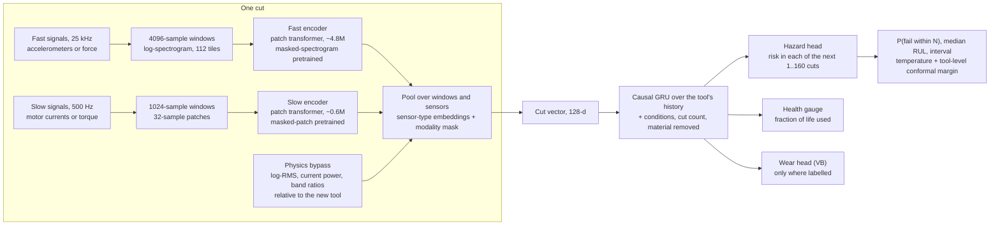

# Model design for the next phase: cutter remaining life and failure risk from raw signals

*Written 27 October 2026. This is the research-backed design for the modelling part of ToolLife Policy. It answers seven research questions (Sections 2–6 and 8), then gives one concrete plan we can build in two days on A100/H100-class GPUs (Sections 7, 9–11). The only thing actually run so far is a small check on `metadata.xlsx` (Section 1.3). Every other number comes from the cited sources.*

**Source tags.**
- **[R]** The number or claim was read in the source itself (paper text, abstract, model card or repository) during this review.
- **[S]** Secondary or not independently verified. Treat it as indicative.
- **[C]** Our own calculation.
- **[J]** Our judgement or inference, not a published result.

---

## 0. The plan on one page

**What we build.** The model is small, about 6 million parameters, and reads two kinds of signal:
- A **fast stream** of 25 kHz accelerometer (or force) signals, cut into short windows and turned into log-spectrogram tiles.
- A **slow stream** of 500 Hz motor current (or torque) signals, cut into short patches.

Each stream has its own small transformer encoder. The encoder outputs are pooled over windows and sensors into one vector per cut. A *modality mask* lets a dataset that lacks a sensor simply leave it out. A small causal GRU then reads the tool's history of cut vectors, together with the cutting conditions, the cut count and the cumulative material removed. On top of the GRU sit three heads:
- a **discrete-time hazard head**, which gives the chance of failing in each of the next 1…160 cuts;
- a **health gauge**, which gives the fraction of life used;
- a **wear head**, used only for datasets that have flank-wear (VB) labels.

From the hazard curve we read off everything the policy layer needs: P(fail within the next N cuts), the median remaining life, and an interval.

**How we pretrain.** Before any labels are used, the fast encoder learns by *masked spectrogram modelling*: hide 70% of the spectrogram tiles and learn to fill them in. The slow encoder learns by masked patch modelling: hide 40% of patches. The training signals are all the unlabelled cuts we have: the main dataset plus LUH, PHM 2010 and NASA.

To keep this honest, pretraining runs in **five tool-group folds**. Each encoder never sees the signals of the tools it will later be tested on.

**How we get honest probabilities.** The encoders stay frozen and only the light heads are trained. That makes nested leave-one-tool-out cheap, which in turn makes calibration possible:
- one temperature parameter on the hazard, fitted on other tools only;
- a tool-level conformal safety margin on the remaining-life lower bound.

With 13 tools, the conformal margin is simply "the worst miss seen on any other tool". The guarantee is weak, and we say so.

**What we compare against.**
- Age only.
- Condition-matched life tables.
- A Weibull/log-normal model on the cutting conditions. This is the extended Taylor law, because speed and feed are fixed in our data.
- A Cox model with a few sensor health indicators.
- LightGBM on physics features, with the same hazard and quantile outputs as the deep model.
- MiniRocket.
- A frozen foundation model (Mantis).
- The same deep architecture trained from scratch.

**How we test.**
- **Main dataset:** leave-one-tool-out over the 13 usable tools, with hyperparameters chosen only on inner folds.
- **LUH:** leave-one-machine-out.
- **Across datasets:** leave-one-dataset-out, reported as exploratory.
- **Metrics:** remaining-life MAE and RMSE (cuts), dynamic concordance, horizon-wise AUC, integrated Brier score, calibration (reliability diagram, slope, D-calibration) and interval coverage.
- **Uncertainty:** tool-level bootstrap intervals on every number.
- **Leakage demonstration:** we also run the same model with a random cut-wise split, to show how much that inflates the numbers.

**Compute.** About 25–40 A100-hours in total (roughly 15–25 H100-hours). That fits two days on one GPU, and less than one day of wall-clock time on four.

**Honest expectation.** The cutting conditions alone already explain much of tool life. Life is 29–53 cuts at radial depth 8 mm and 59–149 cuts at 4.5 mm. Under tool-wise testing, deep models on public tool-wear data usually land within noise of good feature-plus-boosting baselines. Our deep model earns its place only if it beats them in the last 20% of life, where decisions matter, or on the odd tool (tool 10, long holder). We will report it either way.



---

## 1. What our data does and does not allow

### 1.1 Main dataset, per tool (checked from `metadata.xlsx`, 27 Oct 2026) [C]

The dataset is Piecuch & Żabiński 2025, *Scientific Data*: 14 end mills run until breakage on a Haas VF-1, in 42CrMo4 steel.

| Tool | Type | Axial depth ap (mm) | Radial depth ae (mm) | Holder (mm) | Mean HRC | Recorded cycles | Life T (cycles) | Missing cycle numbers |
|---|---|---|---|---|---|---|---|---|
| 2 | 1 | 5 | 8 | 80 | 36.6 | 48 | 49 | 17, 18, 30 (and one duplicate) |
| 3 | 1 | 10 | 8 | 80 | 39.6 | 44 | 49 | 2, 3, 11, 38, 41, 45 |
| 4 | 1 | 5 | 8 | 80 | 35.3 | 41 | 40 | – |
| 5 | 1 | 10 | 8 | 80 | 38.0 | 51 | 53 | 30, 38, 43 |
| 6 | 1 | 5 | 8 | 80 | 40.0 | 28 | 29 | 1, 28 |
| 7 | 1 | 10 | 4.5 | 80 | 40.3 | 124 | 126 | 1, 106, 107 |
| 8 | 1 | 5 | 4.5 | 80 | 40.9 | 116 | 115 | – |
| 9 | 1 | 5 | 4.5 | 80 | 38.2 | 149 | 149 | 3 |
| 10 | 1 | 10 | 4.5 | **160** | 37.3 | 15 | **14** | – |
| 11 | 1 | 10 | 4.5 | 160 | 37.2 | 1 | 0 (broke in first cycle) | – |
| 101 | 2 | 10 | 4.5 | 80 | 38.6 | 84 | 83 | – |
| 102 | 2 | 5 | 4.5 | 80 | 38.3 | 82 | 84 | 34, 35, 80 |
| 103 | 2 | 10 | 4.5 | 80 | 39.4 | 60 | 59 | – |
| 105 | 2 | 5 | 4.5 | 80 | 38.4 | 125 | 124 | – |

Every tool ran at the same spindle speed and feed: 3200 rpm, 640 mm/min, 10 mm diameter. The paper says these were "constant for all experiments" [R].

Failure means complete breakage or the breakage of one blade. `CycleToFailure = 0` marks the cycle in which the failure happened [R].

The authors recommend group cross-validation with one tool per group [R]: "The authors recommend using the group cross-validation method, with each tool constituting a separate group (partition)."

### 1.2 What this means for the model [J]

- **Thirteen failure events is the real sample size.** The 968 cuts are not 968 independent examples. Every probability we report is learned from 13 events, so the heads must have few parameters and we must report uncertainty over tools.
- **Radial depth dominates life.** Tools at ae = 8 mm lived 29–53 cycles. Tools at ae = 4.5 mm with the normal holder lived 59–149. Any sensor model must beat a condition-matched life table, not just a global average.
- **The classic Taylor law cannot be fitted here.** V·Tⁿ = C needs varying cutting speed, and ours is fixed. The physics baseline becomes an *extended* Taylor form in ap, ae, hardness and tool type: log T = c₀ + a·log ap + b·log ae + …. Statistically this is an accelerated-failure-time (AFT) survival model (Section 8).
- **Tool 10 is the honest stress test.** It is the only usable tool with a 160 mm holder, which means double the overhang, more deflection and more chatter. It lived 14 cycles. A leave-one-tool-out model has never seen a 160 mm holder, so metadata cannot predict it. Vibration might, from the first cut. Tool 11, which broke in its first cycle, stays out of training and is reported separately.
- **Use the true cycle count, not the row count.** Some cycles were never recorded: up to 6 missing per tool, and tool 2 has one duplicate. Those cycles still wore the tool. So the age is t = T − CycleToFailure, not the row number.
- **Each cycle is one pass around the contour.** Cycles are grouped into layers, one per axial depth step. `ExperimentIndex` (`P002_F01_C1`) encodes the layer (F) and the cycle within the layer (C) [R]. Position within the layer is a nuisance factor that can change the signals without any change in wear, so we feed it in as a covariate. Hardness also varies within one tool's life, because several workpiece samples were used, so hardness is a per-cut covariate.
- **The failing cycle's own recording contains the break.** It is the event, not an early warning. It must never be an input when predicting failure "in the next N cuts".

### 1.3 The bar that metadata alone already sets [C]

We ran a leave-one-tool-out check on the 13 usable tools, predicting the median remaining life at every recorded cycle. These baselines use only metadata, never sensors. Script in Appendix A.

| Baseline (metadata only) | Macro-MAE over tools (cycles) | Pooled MAE | Pooled RMSE | Macro-MAE without tool 10 |
|---|---|---|---|---|
| Population residual life: median of (T − t) over training tools still alive at t | 34.6 | 32.7 | 39.3 | 32.8 |
| Same, using only training tools with the same ae | **27.5** | **24.6** | 31.7 | **21.4** |
| Log-normal AFT on log ap, log ae, tool type (extended Taylor) | 32.0 | 29.7 | 37.5 | 25.2 |

The condition-matched life table is the strongest metadata baseline. It misses tool 10 by about 101 cycles on average. The AFT does worse than the simple life table here because 12 tools cannot support 4 coefficients. A sensor model is only interesting if it clearly beats about 25 cycles of macro-MAE (about 21 without tool 10) and does much better near the end of life.

### 1.4 The other datasets

| Dataset | Signals and rates | Tools and machines | End of life | Role here |
|---|---|---|---|---|
| **LUH / IFW Hannover** (Denkena, Klemme & Stiehl, *Data in Brief* 50:109574, 2023; Mendeley DOI 10.17632/zpxs87bjt8, CC BY 4.0) [R] | Kistler force x/y/z at **25 kHz**. From the machine control at **500 Hz**: spindle torque, feed-drive torque or force, position deviation | 9 end mills (2 batches) on **3 machines** (DMG Mori Milltap 700, HSC 30 linear, HSC 55 linear). Cast iron 600-3/S, ap 2 mm. 6,418 HDF5 files | VB ≈ 150 µm (wear-out, not breakage). VB measured every 1–2 layers by microscope (about ±5 µm) and interpolated by contact time | Second labelled source. Leave-one-machine-out test. Pretraining data. Quirks: aliased controller signals on machine M2 (internal filter off); T8 misses its first runs [R] |
| **PHM 2010 challenge** | Force x/y/z, vibration x/y/z, AE-RMS at 50 kHz. 10,400 rpm | 6 cutters × 315 cuts. Wear labels released for c1, c4, c6 | No failure. Wear trajectory only | Pretraining data. Wear-head benchmark against the literature (Section 2). End of life only if we define it, e.g. first cut with VB ≥ 150 µm; otherwise censored |
| **NASA / UC Berkeley milling** (Agogino & Goebel) | Spindle current AC/DC, table and spindle vibration, table and spindle AE (stated as 250 Hz [S]) | 16 cases, 167 runs, 1–23 runs per case. Irregular VB, about 21 runs unlabelled [S] | VB, irregular | Slow-stream pretraining only, plus an optional wear-head check. Too small and irregular for strong claims |

The lucky match is that LUH uses the **same two sampling rates as our main dataset**: 25 kHz for the fast signal and 500 Hz for the slow one. That is why the two-stream design maps cleanly onto both.

### 1.5 Signal physics that set the window sizes [C]

- **Spindle rotation.** 3200 rpm is 53.3 Hz, so one revolution takes 18.75 ms, which is **469 samples at 25 kHz**.
- **Tooth-passing frequency.** It is 53.3·z Hz for a cutter with z flutes: 160 Hz for 3 flutes, 213 Hz for 4. The vibration Nyquist limit of 12.5 kHz covers dozens of its harmonics and the structural resonances.
- **Current at 500 Hz.** Its Nyquist limit is 250 Hz. The tooth-passing frequency sits just below it and its harmonics alias. What the current really carries is the **load envelope**: RMS over about 50–100 ms, and three-phase power. That is still a strong, well-known wear signal.
- **Recording length.** Each cycle file is about 100 MB of CSV. By our estimate that is roughly 30–60 s of signal per cycle, to be measured during ingest. Over the whole dataset that is about 12 h of 8-channel vibration (about 100 channel-hours), or about 17 GB stored as float16.

---

## 2. Q1: Best results on milling wear and remaining-life benchmarks, and which ones are inflated

### 2.1 PHM 2010 under tool-wise testing (train on two cutters, test on the third)

| Paper | Method | Protocol notes | RMSE c1 / c4 / c6 (µm) | Tag |
|---|---|---|---|---|
| Zhao et al. 2017, *Sensors* 17:273 (pre-2019 reference point) | CNN + bidirectional LSTM (CBLSTM) | Train on 2, test on 3rd. Tuning inside the training data | 10.8 / 7.1 / 9.8 | R |
| same paper, feature baseline | 54 hand-crafted statistics + SVR | same | 18.5 / 19.6 / 31.5 | R |
| **Sun et al. 2026, *Sensors* 26:661** | CNN-ResNet-CBAM-BiGRU on 34 multi-domain features | **Leave-one-tool-out. 80/20 *chronological* validation inside the training tools. Test tool used once** | **8.05 / 7.97 / 8.18** (MAE 5.70 / 5.76 / 6.75) | R (checked in PMC full text) |
| same paper, baselines | LSTM / CNN-LSTM | same | 11.36 / 13.47 / 12.64 and 11.32 / 12.60 / 20.32 | R |
| Qin et al. 2022, *Entropy* 24:1733 | IndyLSTM + dual-stage attention | Leave-one-out, but no separate validation set described | 5.80 / 1.82 / 3.68 | R (optimistic: model selection may have used the test cutter) |
| Ensemble-LSTM, *Machines* 14(1):12 | 4 LSTM variants + GRU meta-learner | Train c1 + c4, test c6 only. No validation split described | c6: 2.40 | R (same caveat) |

The best-documented honest result is about **8 µm RMSE on every held-out cutter** (Sun et al. 2026). The classic CBLSTM gets 7–11 µm, plain LSTMs 11–13 µm, and feature + SVR 18–32 µm. Leave-one-out papers with no separate validation fold report 2–6 µm. Treat those as optimistic.

We found **no PHM 2010 paper that reports a cut-index-only baseline** or a tuned gradient-boosting baseline under tool-wise splits. Both are cheap, and we will report them.

### 2.2 Results inflated by random, non-tool-wise splits

| Paper | What the split does | Headline | Tag |
|---|---|---|---|
| Si et al. 2024, *Sci. Rep.* (PSD-CVT), doi:10.1038/s41598-024-71795-4 | 80/10/10 split not stated to be by cutter. c1/c4/c6 called both training and test data | RMSE 0.94 / 0.98 / 2.95 | R |
| Truong et al. 2024, *Measurement* (BRANN), arXiv:2311.18620 | "80% of the complete dataset" for training | RMSE 0.0008–0.0038 **mm**. The paper's tables disagree with each other | R |
| CNN-Informer with residual compensation, *Lubricants* 2026 14(7):269 | **Random 7:2:1 split by sample; the authors say so** | RMSE 4.00, R² 0.987 | R |
| CNN-BiLSTM-AM + CPSO, *Lubricants* 2025 13(11):500 | Unclear "cross-validation" | c6 RMSE 0.88 is *smaller* than its MAE 1.34, which is mathematically impossible | R |

Two sanity checks:
- The microscope VB measurement itself is uncertain by about **±5 µm** (LUH paper [R]). Any sub-µm RMSE is below the precision of the labels.
- When cuts from one cutter land on both sides of the split, neighbouring cuts are almost identical. The model is then interpolating along a curve it has already seen.

General evidence on leakage:
- Shamim et al. 2026 (arXiv:2607.16493) show that naive sliding-window splits pushed classification accuracy from a genuine 20–60% to **99.9%** [R].
- Kapoor & Narayanan 2023 (*Patterns*) document leakage across 294 papers in 17 fields [R].
- The authors of our own dataset recommend tool-grouped CV [R].

### 2.3 NASA milling

One non-peer-reviewed leave-one-case-out study (GitHub) reports [S]:
- GBM on **process parameters plus cutting time** (no sensors): MAE 0.078 mm, RMSE 0.124 mm, R² 0.77.
- Raw-signal 1D-CNN: MAE 0.107 mm, R² 0.66.
- Predicting the mean: MAE 0.200 mm.

Papers with random or unstated splits report MAE of about 0.025–0.035 mm [S/R]. The pattern repeats: under honest splits, **time plus conditions beats raw-signal deep nets**, and random splits look 3–4× better than they are.

### 2.4 Newer datasets

- **Piecuch & Żabiński 2025 (ours).** The descriptor reports no models. It cites a companion paper (Paszkiewicz et al., *Sensors* 2023) with best R² 0.939, split not verified [S]. **We found no published leave-one-tool-out raw-signal remaining-life result for this dataset**, so our numbers would be the first honest ones we know of.
- **LUH 2023.** No baselines published [R]. A related cross-machine transfer study exists (Denkena, Bergmann & Stiehl, *Machines* 9:282, 2021); its results were not verified.
- **QIT-CEMC 2025** (*Sci. Data*). One four-flute tool over 68 samples (Ti6Al4V; force, torque, vibration, sound, images) [R]. A tool-wise split is impossible, so it is useless for our claims.
- **MATWI** and other 2024–26 sets were found only indirectly [S]. Skip them.

### 2.5 Realistic error levels [J]

Under tool-wise testing on PHM 2010, about **5–12 µm RMSE per cutter** is realistic. Typical headlines of 1–4 µm and R² ≥ 0.99 come from random splits. Headline numbers are **2–10× optimistic**.

For our breakage dataset there is no external reference. Section 1.3 is the bar.

---

## 3. Q2: Self-supervised pretraining for vibration and machine signals

### 3.1 What exists and what works

| Approach | Typical setup | Evidence | Tag |
|---|---|---|---|
| **Masked spectrogram modelling** (AudioMAE, VibFM) | Log-STFT image → patches → ViT. Mask 70–80% | **VibFM** (PHME 2026): 128×128 log-STFT images, mask 0.70, 8 layers × width 384, about **400 h from 16 open vibration datasets**, sampling rate fed in as a conditioning vector. On held-out Paderborn bearings (split by bearing): scratch 48.9%, frozen 75.1%, fine-tuned 85.5%. A classical feature model reaches about 98% on Paderborn. **AudioMAE:** 80% masking, ViT-B 86M, about 2M AudioSet clips | R (VibFM numbers from full text via agent; abstract qualitative) / S (classical 98%) |
| **Masked patch modelling on raw series** (PatchTST, SimMTM, Ti-MAE) | Patch 12–64 samples, mask 40–50%, 3–8 layers, d = 128–256 | PatchTST self-supervised: input 512, patch 12, 40% masked, 3 layers, d = 128; small gains over supervised on forecasting. **SimMTM:** pretraining on *EEG* still lifted bearing FD-B accuracy from 47.4% to 69.4%, so much of the gain is generic regularisation | R |
| **Contrastive with augmentations** (TS-TCC, TF-C, SimCLR) | Jitter, scaling, crop, time shift. TF-C adds a frequency-domain view | **TF-C:** FD-A → FD-B with only 60 labels: 89.3% vs 47.4% random init. **TS-TCC:** across Paderborn conditions 67.8% vs 63.8% supervised, but **worse in 4 of 12 transfer pairs** | R |
| **Time-aware contrastive health indicators** (Rombach, Michau, … Fink, arXiv:2208.13288) | Positives are cuts close in operating time; negatives are cuts far apart. Log-mel input, small CNN | Unsupervised milling health indicator with **0.97 average correlation to wear** | R (abstract) |
| **Transformer pretraining for faults** (FaultFormer, IEEE Access 2024) | 4 layers, d = 256, 50% BERT-style masking | CWRU with 100 labels: 93.3% pretrained vs 80.8% from scratch, but a CNN got 91.4%. At 400 labels the pretrained model and the CNN tie | R |
| **Bearing foundation models** (UniFault 2025) | 823K / 6.4M parameters, 8 layers, d = 256 | Pretrained on **6.9M windows** from many fault-diagnosis datasets (0.1 s each, resampled to 1,024 points). Wins few-shot on IMS. **Lost to ROCKET** on Paderborn with 1% labels (79.3 vs 80.1) and on one CNC subset | R |

### 3.2 Evidence specific to remaining life

**FreqCondNorm** (arXiv:2609.20535, Sep 2026) pretrained a transformer by masked autoencoding plus contrastive learning on CWRU, MFPT, UOC18, PRONOSTIA and C-MAPSS. It improved fault classification (CWRU 99.2%) but the abstract states the approach "does not improve remaining useful life prediction" [R]. The full text reportedly gives PRONOSTIA RMSE 0.0094 against 0.0049 for a 1D-CNN [S]. The authors' explanation: masked reconstruction learns local waveform shape rather than slow trends, and time-invariant contrastive objectives teach the model to ignore exactly the change that matters.

### 3.3 Data volume and gains [J, from the numbers above]

- **Model size versus data.** Published vibration encoders that help are 1–10M parameters trained on about 100–400 h of signal. Our main dataset gives about 100 channel-hours at 25 kHz, plus LUH and PHM 2010. That supports a **5–10M parameter** encoder, not a 100M one.
- **When gains appear.** They are largest at very few labels (+12 to +42 points with 60–100 labels in classification). They shrink to nothing against a decent CNN once a few hundred labels exist.
- **Where we stand.** In *lifecycles* we have very few labels (13), so we are in the regime where pretraining could help. But for remaining life specifically, the evidence is mixed to negative.

### 3.4 What we take from this [J]

1. Prefer **masked modelling** over instance-contrastive learning. Masked modelling cannot collapse. Contrastive objectives on machine data tend to cluster windows by machine or tool rather than by wear.
2. Do **not** use amplitude scaling, frequency shift, time-stretch or resampling augmentations. Vibration energy and tooth-passing harmonics *are* the wear signal. Jitter, small time shifts and cropping are safe.
3. If we add a contrastive term, make it **time-aware and within one tool** (Rombach style), so it pulls together cuts that are close in age.
4. **Pretraining is leakage if it sees the test tool's whole life.** The encoder could learn that tool's trajectory shape. We pretrain in tool-group folds (Section 7.6). Using the test tool's unlabelled signals only up to the current cut is legitimate online adaptation, but it would be reported as a separate setting.
5. **Always compare against features + boosting and against ROCKET.** Both have beaten pretrained encoders in published tests.

---

## 4. Q3: Time-series foundation models as frozen feature extractors

### 4.1 What is available (licences checked on the model cards and repositories) [R unless marked]

| Model | Sizes | Licence | Input and channels | Embedding route | Fit for us |
|---|---|---|---|---|---|
| **Mantis** (`paris-noah/Mantis-8M`, `MantisV2`) | 8.1M / 4.2M | Apache-2.0 | Interpolates to 512 steps, 32 tokens, d = 256. Channels encoded separately | `MantisTrainer.transform()`; intermediate layers often better | **Best frozen candidate.** Built for classification |
| **MOMENT** (`AutonLab/MOMENT-1-small/base/large`) | 38M / 114M / 346M | MIT | Fixed 512 steps, patch 8. Channel-independent | `task_name="embedding"` | Weak frozen features in two independent tests (below) |
| **Chronos-2** (`amazon/chronos-2`, small 28M) | 120M | Apache-2.0 | Up to 8,192 steps, patch 16. Group attention mixes channels | `pipeline.embed()` | Good for **slow per-cut sequences**. The only one with a published frozen-embedding remaining-life win (on telecom data [R]) |
| **Chronos-Bolt** | 9–205M | Apache-2.0 | Up to 2,048 steps, patch 16 | `embed()` | Forecasting-trained |
| **TimesFM 2.0 / 2.5** | 500M / 200M | Apache-2.0 (the README says 3.0 weights are non-commercial) | 2.5: context up to 16k, patch 32 | **No embedding API**; hidden states must be hooked out | Skip |
| **Moirai 1.1 / MoE / 2.0** | 311M / 935M total / 11M | **Weights CC-BY-NC-4.0** (fine for coursework) | Any-variate attention, multiple patch sizes | No embedding API | Skip |
| **Lag-Llama** | 2.5M | Apache-2.0 | Univariate, short context | Forecasting only | Skip |
| **TiRex** (`NX-AI/TiRex`) | 35M (xLSTM) | NXAI community licence (free below €100M revenue) | Channel-wise, patch 32 | Built-in `TiRexEmbedding` plus classifier/regressor wrappers | Reasonable third option |
| **TSPulse** (IBM Granite) | 1M | Apache-2.0 | 512 context, patch 8/16 | Classification and embedding heads | Tiny; worth a quick try |
| **Toto**, **Time-MoE**, **Timer-XL**, **Sundial** | 84–453M | Apache-2.0 | Forecasting | No embedding API | Skip |
| **UniFault** (bearing fault-diagnosis model) | 0.8M / 6.4M | Code MIT; weights licence unstated; only "Tiny" weights public | 1,024 points per 0.1 s | Fine-tuning code | Domain-relevant, but not freely usable at full size |

### 4.2 Evidence on frozen features

- **Mantis paper** (UCR-128 / UEA-27 accuracy, frozen features) [R]: Mantis 0.820 / 0.742, TiRex 0.801 / 0.695, Chronos-2 0.800 / 0.697, **hand-crafted Catch22+ 0.797 / 0.696**, MOMENT 0.779 / 0.699. Hand-crafted features come within about 2 points of the best foundation model.
- **Auer et al. 2025** (arXiv:2510.26777) [R]: frozen *forecasting* models (TiRex, Chronos, Moirai) are competitive zero-shot feature extractors for classification. Pool by averaging over patches, concatenate layers, and append simple per-patch statistics.
- **RocketPFN 2026** (arXiv:2606.21786) [R]: ROCKET features fed to TabPFN significantly beat MOMENT, Mantis and MantisV2 embeddings fed to the same classifier (p < 0.001 each).
- **Motor condition monitoring** (Li et al., arXiv:2511.23177; current plus vibration at 512 Hz) [R]: Mantis reaches about 90% accuracy with 1% of the labels; MOMENT is much weaker in the full-text comparison.

### 4.3 How to use them on our data [J]

- **What a 512-sample window means.** At 25 kHz it is 20.5 ms, which is **about 1.09 spindle revolutions** at 3200 rpm. That is a natural unit, so feed raw 512-sample windows to Mantis without resampling. Embed each channel separately, then pool over all windows of a cut (mean and standard deviation).
- **Do not decimate the vibration crudely.** Ten-fold decimation throws away everything above 1.25 kHz.
- **For the slow stream,** build per-cut sequences of summaries (per-revolution RMS, kurtosis, band energies, current RMS) and embed them with Chronos-2.
- **These models normalise each window internally,** so absolute amplitude is lost. Always append log-RMS and peak values as plain features.
- **Expectation:** about equal to good hand-crafted features. Use frozen foundation models as **baselines and ablations, not as the main encoder**. Their pretraining data (energy, traffic, weather, synthetic series) is far from 25 kHz machining vibration.

---

## 5. Q4: Survival heads, calibration and conformal prediction for remaining life

### 5.1 Discrete-time hazard: the formulas

Time runs in discrete steps k = 1, 2, … (cuts ahead of now). The model outputs the hazard h(k), the chance of failing in step k given survival until then. From it:

- **Survival:** S(k) = ∏ over m ≤ k of (1 − h(m)).
- **P(fail within the next N cuts)** = 1 − S(N).
- **Log-likelihood** for a tool that fails at step κ: log h(κ) + Σ over k < κ of log(1 − h(k)). A tool still alive at the horizon K (censored) contributes Σ over k ≤ K of log(1 − h(k)).

This is just binary cross-entropy on "one row per tool per step" data. That is the logistic-hazard or Nnet-survival formulation (Gensheimer & Narasimhan 2019; Kvamme & Borgan 2021).

Kvamme & Borgan found the hazard parametrisation slightly better than the probability-mass one (DeepHit/PMF). They also found bin edges at quantiles of the event times better than equal widths on small data [R]. DeepHit's ranking term optimises ordering, not calibration [J]. Dynamic-DeepHit (Lee et al., IEEE TBME 2020) reads a history of measurements with an RNN, which is our setting.

### 5.2 Why a hazard head rather than plain regression [J]

| Approach | Strengths | Weaknesses |
|---|---|---|
| **Hazard head** | One distribution gives the median, any quantile, P(fail within N) and the restricted mean, all consistent with each other. Handles censored tools (threshold-stopped datasets). Updating on "still alive" is exact | Needs a time grid. The mean depends on the tail beyond the horizon |
| Direct regression | Simple | Point estimate only. Censoring is ad hoc. Probabilities need an assumed noise model |
| Quantile (pinball) regression | Direct quantiles. Pairs with conformalised quantile regression (CQR) | Quantiles can cross. No full distribution, so P(fail within N) needs inverting many quantiles |

**Gap.** We found **no published deep survival model for milling tool life**. Close relatives exist:
- Cox model on cutting speed for inserts (Equeter et al. 2020);
- Weibull proportional hazards with vibration covariates (*Mathematics* 2023);
- censoring-aware remaining-life models for turbofans and trucks.

So a discrete-time hazard head on raw milling signals is a defensible novelty, worded as "not found in our search".

### 5.3 Calibration [R for methods, J for choices]

- **D-calibration** (Haider et al., JMLR 2020): at the true failure times, S(T) should be uniform on [0, 1]. With 13 failures, use 4–5 bins and treat it as descriptive, because a test has almost no power.
- **X-CAL** (Goldstein et al., NeurIPS 2020) is a differentiable D-calibration penalty. Use it only if out-of-fold calibration is poor.
- **CSD** (Qi, Yu & Greiner, ICML 2024) conformalises any survival curve and improves calibration without hurting discrimination.
- **For P(fail within N):** reliability diagram, calibration slope and intercept (ideal 1 and 0), Brier score.
- **Recalibration:** temperature scaling, one parameter, fitted on out-of-fold predictions from *other* tools. **Isotonic regression will overfit with 13 events.**

### 5.4 Conformal prediction with 13 tools [R for theory, C for arithmetic]

- **Methods for censored data:** Candès, Lei & Ren (JRSS-B 2023) give lower prediction bounds on survival time, valid under censoring. Gui, Hore, Ren & Barber (Biometrika 2024) make the cut-off adaptive.
- **Remaining life specifically:** Javanmardi & Hüllermeier (IJPHM 2023) apply split, CQR and non-exchangeable conformal on C-MAPSS with **calibration split by engine**. They note that with temporal data "even exchangeability will probably be violated".
- **Repeated measurements:** Dunn, Wasserman & Ramdas (JASA 2023) handle them by pooling or subsampling **one score per group**.
- **Jackknife+ / CV+** (Barber et al.) guarantee coverage of at least 1 − 2α.

**Our recipe:**
1. **The calibration unit is the tool, never the cut.**
2. Inside each outer fold, get out-of-fold predictions for the 12 training tools with inner leave-one-tool-out. This is cheap with frozen encoders.
3. For each tool i, compute one score: s_i = max over t of (q̂₀.₁(t) − RUL_true(t)). That is the worst over-estimate of its lower remaining-life quantile anywhere along its life.
4. The corrected lower bound is L(t) = q̂₀.₁(t) − c, where c is the ⌈(1 − α)(n + 1)⌉-th smallest score.
5. With n = 12 and α = 0.1, that is the 12th of 12 scores, i.e. **the maximum**. In plain words: **the safety margin equals the worst miss seen on any other tool.**
6. α below 1/13 is impossible; the bound becomes infinite. The jackknife+ guarantee at α = 0.1 is only 80%.
7. Mondrian (per-condition) or weighted conformal needs many tools per group, so it is not feasible here.
8. State plainly that any guarantee holds only if the tools are exchangeable draws.

### 5.5 Libraries

| Library | Version (Oct 2026) | Licence | Use |
|---|---|---|---|
| pycox | 0.3.0 | BSD-2 | LogisticHazard, PMF, MTLR, DeepHit, PC-Hazard. EvalSurv gives Antolini C^td and IBS |
| scikit-survival | 0.28.0 | GPL-3.0+ | `concordance_index_ipcw`, `cumulative_dynamic_auc`, `integrated_brier_score` |
| lifelines | 0.30.3 | MIT | Weibull/log-normal AFT, Cox, time-varying Cox |
| SurvivalEVAL | 0.9.0 | GPL-3.0 | D-, KM- and 1-calibration, IBS, MAE variants |
| torchsurv | 0.2.0 | MIT | Cox/Weibull losses and metrics in PyTorch |
| MAPIE / crepes | 1.6.0 / 0.9.1 | BSD-3 | Conformal regression; crepes also does conformal predictive systems |

The tool-grouped conformal above is about 20 lines of numpy. We write it ourselves rather than force a library's split logic.

---

## 6. Q5: Transfer across machines and datasets

| Finding | Source | Tag |
|---|---|---|
| Domain-adversarial training (DANN) on NASA milling: target R² rose from 0.43 to 0.69 with no target labels, and to 0.88 with 10% target labels. **But windows were split at random inside cases**, so the numbers are likely inflated | Wang & Russell, PHM Conf. 2020 | R |
| Across workpiece hardness: RMSE 62.9 µm raw → 31.6 µm with feature reordering and normalisation alone → 21.7–26.9 µm with DANN on top. Authors: domain adaptation adds "only a slight" further gain; choosing similar source data matters most | Chuang, Lu & Li, *Manuf. Letters* 44 (2025) | S (abstract via agent; numbers not independently re-read) |
| Per-tool **baseline normalisation** (features relative to each tool's start) + relative wear + features shared across training tools. PHM 2010 leave-one-tool-out: R² 0.89 and 0.87 on two folds, **−0.61 on the third**. No accuracy advantage over a five-term Lasso. Mean-wear-curve replay: 38–41 µm RMSE in the fast-wear stage vs 9–10 µm for the sensor model | Ting, Chen, Wang & Lee, Research Square preprint, Oct 2026 | R (abstract) |
| A carefully tuned plain training baseline (ERM) matches every domain-generalisation method on 7 benchmarks | Gulrajani & Lopez-Paz, ICLR 2021 | R |
| Time-series domain adaptation benchmark (AdaTime): many earlier papers selected models using target labels; tuned generic methods equal time-series-specific ones | Ragab et al., ACM TKDD 2023 | R |
| Multi-source transfer for cutting-tool remaining life works when source conditions are *selected* first, as a guard against negative transfer | Qiang et al., *J. Manuf. Syst.* 77 (2024) | R (abstract) |
| Multimodal transformers are not robust to a missing modality by default; modality dropout during training helps | Ma et al., CVPR 2022; ModDrop (Neverova et al.); Zafar et al. 2026 | R |
| Channel-independent patch encoders (PatchTST) and any-variate attention (Moirai) make encoders sensor-agnostic | Nie et al. 2023; Woo et al. 2024 | R |
| Normalisation removed spindle-speed-tied features; worst-condition accuracy rose from 68% to 84% | Li & Lin, *IJAMT* 125 (2022) | S |

**What helps, in order of evidence [J]:**
1. **Normalisation.** Per-dataset and per-channel standardisation fitted on training tools, plus **subtracting each tool's own "as new" reference**.
2. **Choosing similar source data.**
3. **Modality dropout** with masks, so the model works with whatever sensors exist.
4. **Adversarial domain adaptation**, only as an ablation. With 2–4 source datasets, gains are fragile and negative transfer is common.

We found no controlled study showing that a material-removed time axis or a fraction-of-life target improves cross-condition transfer. Both are sensible, but we test them rather than assume them.

**On our planned common targets [J]:**
- **Fraction of life used is not one quantity across datasets.** Breakage (main dataset) and VB = 150 µm (LUH) are different end points. Give the heads an **end-point embedding** (breakage / VB150 / VB300), so the trunk is shared but each end point has its own calibration.
- **Hazard in "next N cuts" is the decision unit only for the main dataset.** For LUH the unit is runs. Use **material removed** (from contact time × removal rate) as an *input* and as the axis for fraction of life. Keep hazards in each dataset's own decision unit, with bin edges at quantiles of that dataset's training lifetimes.
- **Threshold-stopped tools can be treated as censored for the breakage end point** only if stopping is plausibly independent of failure given the modelled history. That is doubtful, so we do not pool them into the breakage head.

---

## 7. Q6: The recommended architecture, in detail

### 7.1 Preprocessing

1. **Ingest.** Convert every cycle CSV once into float16 arrays (fast: channels × samples; slow: channels × samples) plus a JSON sidecar. Apply the paper's conversion formulas to physical units. Store the cycle index t = T − CycleToFailure, the layer, the cycle within the layer, and the conditions.
2. **Find the active cut.** Threshold spindle-current RMS (100 ms frames) above the idle level, with a short hysteresis. Keep the entry and exit transients.
3. **Canonical rates.**

   | Dataset | Fast stream (25 kHz) | Slow stream (500 Hz) |
   |---|---|---|
   | Main | 8 accelerometers, native 25 kHz | 12 currents, native 500 Hz |
   | LUH | Force x/y/z, native 25 kHz | Spindle torque, feed torque/force, position deviation, native 500 Hz |
   | PHM 2010 | Force and vibration, anti-alias decimated 50 → 25 kHz | AE-RMS and force envelopes, decimated |
   | NASA | none (its signals are only 250 Hz) | All 6 channels, upsampled ×2 to 500 Hz, with a "native 250 Hz" flag |

4. **Fast windows.**
   - Window: 4,096 samples (163.8 ms, about 8.7 revolutions at 3200 rpm).
   - STFT: n_fft 512 (20.5 ms, 48.8 Hz bins), hop 128, magnitude as log(1 + |X|²).
   - Result: 256 frequency bins × 28 frames, cut into tiles of **16 bins × 4 frames**. That gives **112 tiles**, each **a 780 Hz band over about one spindle revolution**. Teammates can picture exactly what each tile is.
5. **Slow windows.** 1,024 samples (2.05 s, about 109 revolutions), split into **32-sample patches** (64 ms each, 32 patches).
6. **Normalisation.**
   - **Per dataset × channel:** standardise using training tools only. Do not normalise per window, because that would erase amplitude, the main wear cue.
   - **Per tool:** subtract the tool's own reference, the mean log-spectrum (fast) or mean patch statistics (slow) over its **first M = 2 recorded cuts**. This input is "how the signal has changed since the tool was new". It is causal, because those cuts are already observed.
   - For predictions at t < M, fall back to the training tools' reference under the same conditions.
   - The model gets **both** the absolute and the reference-relative input.
7. **Physics bypass features**, about 24 per cut, all relative to the new tool:
   - log-RMS, kurtosis and crest factor per fast channel;
   - energy in bands at 1–5× the tooth-passing frequency;
   - spectral centroid;
   - spindle-current RMS and three-phase power proxy;
   - feed-axis current RMS.

   These guarantee the deep model sees at least what the boosting baseline sees.

### 7.2 Encoders

| Part | Design | Parameters |
|---|---|---|
| Fast encoder | ViT on the 112 tiles: tile embedding (64 → 256), 2-D sin-cos position (frequency, time), **sensor-type embedding** (accelerometer or force × axis × location), 6 blocks, d = 256, 4 heads, MLP 1,024 | about 4.8M |
| Slow encoder | PatchTST-style, channel-independent: patch embedding (32 → 128), 3 blocks, d = 128, 4 heads + sensor-type embedding (spindle current / axis current / torque / position deviation) | about 0.6M |
| Window pooling | Attention pooling with a learned query over windows, per channel | small |
| Channel and modality fusion | Masked attention pooling over channel vectors, with key-padding mask for absent sensors. Concatenate [fast vector, slow vector, bypass features, presence flags] → MLP → **128-d cut vector** | about 0.2M |
| History model | **Causal GRU**, 1 layer, hidden 128. Input per cut: cut vector, conditions (ap, ae, hardness, tool type, holder length, end-point id), log(1 + cut index), log(1 + material removed), layer and cycle-within-layer, gap since the previous recorded cut | about 0.1M |
| Hazard head | MLP → **6 B-spline coefficients over log k**, giving smooth hazard logits for every k = 1…160 cuts ahead | tiny |
| Health gauge | MLP → sigmoid fraction of life used, per end point | tiny |
| Wear head | MLP → VB / 150 µm (LUH, PHM 2010, NASA only) | tiny |
| **Total** | | **about 6M** |

**Why the spline hazard.** Thirteen events cannot support 160 free hazard outputs. A smooth curve over the coming cuts, set by six numbers, is the low-parameter version of Kvamme & Borgan's binned hazard. It is also easy to explain: "the model draws a risk curve over the next cuts". The 20-bin logistic hazard is kept as an ablation.

**Why a GRU and not a transformer** over the history: sequences are at most 149 cuts and there are only 12 training tools [J]. A GRU is a "running memory of the tool's health" and has fewer parameters to overfit.

### 7.3 Outputs

After cut t, the history model outputs a hazard curve h_t(k). From it:
- S_t(k) = ∏ over m ≤ k of (1 − h_t(m));
- P(fail within N) = 1 − S_t(N), for any job length N;
- **median remaining life** = the smallest k with S_t(k) ≤ 0.5;
- lower and upper quantiles from the same curve;
- restricted mean = Σ over k ≤ 160 of S_t(k).

The health gauge gives a 0→1 "life used" curve for the demo. The policy layer uses only the hazard.

### 7.4 Losses

L = hazard negative log-likelihood + 0.5 × Huber(fraction of life) + 0.5 × Huber(VB / 150 µm, where labelled) + 10⁻³ × hazard smoothness penalty + weight decay.

- **Tool balancing.** Average over each tool's cuts first, then over tools, so a 149-cut tool does not outweigh a 29-cut tool five to one.
- **What counts as the event.** It is the failure cycle (CycleToFailure = 0), and that cycle's own signals are never an input.

### 7.5 Pretraining recipe

| Item | Fast encoder | Slow encoder |
|---|---|---|
| Objective | Masked spectrogram modelling: **mask 70%** of the 112 tiles at random. Predict per-tile-normalised log-power; MSE on masked tiles. Ablation: 50% time-block masking | Masked patch modelling: **mask 40%** of the 32 patches. Predict standardised raw patch values; MSE |
| Decoder | 2 blocks, d = 128 (about 0.4M), thrown away after pretraining | Linear head |
| Data | Main fast channels + LUH force + PHM 2010 force and vibration (decimated). Random 4,096-sample crops from float16 memory maps; STFT on GPU | Main currents + LUH controller signals + NASA (flagged) |
| Optimiser | AdamW, learning rate 1.5×10⁻⁴ × batch/256, weight decay 0.05, cosine schedule, 5% warm-up, batch 1,024 windows, bf16, **about 30k steps** (about 15 passes over about 2M channel-windows) | Same, about 10k steps |
| Allowed augmentations | Random crop position, small Gaussian jitter, channel dropout. **No** amplitude scaling, time-stretch, pitch or frequency shift | Same |
| Optional extra (ablation only) | Time-aware within-tool contrastive loss on pooled cut vectors (Rombach style): positives = cuts within ±2 of each other on the same tool; negatives = same tool, ≥ 25% of life apart | — |

**Leakage-safe pretraining folds.** Split the 13 usable tools into five groups, balanced by ae and tool type:
- G1 = {2, 7, 101}
- G2 = {3, 8, 102}
- G3 = {4, 9, 103}
- G4 = {5, 10}
- G5 = {6, 105}

Encoder E_g is pretrained on every main-dataset tool **outside** G_g, plus all external data. For the outer leave-one-tool-out fold that tests tool i in group g, we use E_g. So no encoder has ever seen its test tool's signals.

We also train one "external-only" encoder (zero main-dataset signals), the cleanest possible check. For leave-one-dataset-out runs, the held-out dataset is removed from pretraining too.

**Checks before using an encoder:**
1. Reconstruction loss on the held-out group.
2. A ridge probe from frozen cut vectors to fraction of life, scored on held-out tools. **This must beat the same probe on the bypass features alone, or the encoder adds nothing.**
3. A probe for tool identity *within one condition*. If tool identity is very easy to read off, the encoder is learning the tool, not the wear.
4. Effective rank of the embeddings, to catch collapse.

### 7.6 Supervised training

- **Stage A, the main path: frozen encoders.**
  - Cache window embeddings: 968 cuts × about 300 windows × channels, about 1–2 GB.
  - Train the pooling, GRU and heads: AdamW, learning rate 10⁻³, weight decay 10⁻², dropout 0.2, **modality dropout 0.25** (drop the whole fast or slow stream), random window subsets per cut as augmentation.
  - Early stopping on 2 inner-validation tools.
  - **5 seeds per fold, averaged in probability space** (deep ensemble).
  - Each fit takes seconds to a minute, which is what makes nested leave-one-tool-out, calibration and many ablations affordable.
- **Stage B, optional: fine-tuning.** Unfreeze the top 2 encoder blocks at learning rate 3×10⁻⁵, 16 windows per cut, 3 seeds. Keep it only if it beats Stage A on inner folds.
- **Multi-dataset variant.** Add the LUH tools as extra sequences with the VB150 end point, sampling main and LUH tools 1:1. Evaluate on main-dataset leave-one-tool-out to see whether extra tools help.

### 7.7 Calibration and intervals

1. **Inner leave-one-tool-out** on the 12 training tools of each outer fold gives out-of-fold hazards. Fit **one temperature** on the hazard logits to minimise the out-of-fold negative log-likelihood. Apply it to the outer test tool.
2. **Conformal lower bound** on remaining life, one score per tool (Section 5.4). Report the bound and the stated, weak guarantee.
3. **Two-sided 80% interval** from the calibrated hazard quantiles. Report its empirical coverage per tool, without claiming a guarantee.

### 7.8 Explainability built in

- **Frequency-band occlusion.** Mask one 780 Hz band (one row of tiles) and measure the change in hazard. The result is a plot of "which bands move the risk", per tool and over life.
- **Modality attribution** from the masks: the hazard with vibration only, current only, and both.
- **"Change since new" spectrogram images** for the demo.
- **Health-gauge trajectories** per tool.
- **SHAP values** on the boosting baseline, as the like-for-like explanation of a classical model.

---

## 8. Q7: Strong baselines and what a fair comparison usually shows

All baselines get the **same outputs** (hazard or quantiles → P(fail within N), median remaining life) and the **same leave-one-tool-out folds**.

| ID | Baseline | Details |
|---|---|---|
| B0 | Age only | Population residual life (median of T − t over training tools still alive at t). Fixed-age replacement for the policy layer |
| B1 | Condition-matched life table | Same, restricted to training tools with the same ae. **The strongest metadata baseline in our check (macro-MAE 27.5 cycles)** |
| B2 | Extended Taylor = Weibull or log-normal AFT | log T = c₀ + a·log ap + b·log ae + c·HRC + tool type, with Weibull or log-normal noise (lifelines). Conditional remaining life given survival to t. Speed is fixed in the main dataset, so classical V·Tⁿ = C cannot be fitted. LUH or other data with varying speed could support it. Physics-guided logistic tool-life model (Karandikar et al., *J. Manuf. Syst.* 59, 2021) as a variant |
| B3 | Cox with time-varying covariates | 2–4 health indicators (spindle-current RMS and vibration log-RMS relative to new) + ae. lifelines `CoxTimeVaryingFitter`. Few covariates because there are only 13 events |
| B4 | **LightGBM on physics features** | (a) the 120 released statistics; (b) our features: band energies at tooth-passing harmonics, envelope, spectral centroid and kurtosis, current RMS and power, all relative to new; rolling slopes over the last 5 cuts; conditions; cut count; material removed. Outputs: quantile objective at 0.1/0.5/0.9, and a **person-period hazard classifier** (binary "fails in step k", with k as a feature). SHAP for explanation |
| B5 | MiniRocket | aeon or sktime implementation (BSD-3) on 4,096-sample windows → pooled per cut → ridge / LightGBM with the same hazard rows |
| B6 | Frozen foundation model | Mantis-8M on 512-sample fast windows. Optional Chronos-2 `embed()` on slow per-cut sequences. Same heads |
| B7 | Same deep architecture, no pretraining | Encoders trained end-to-end from scratch, to isolate the value of pretraining. A ResNet-1D on raw waveforms as a second scratch variant |

**What fair comparisons usually show:**
- **Tabular data:** tree models still match or beat deep models on medium-sized tabular data (Grinsztajn et al., NeurIPS 2022; Shwartz-Ziv & Armon 2022) [R].
- **Tool wear specifically:**
  - Ting et al. 2026 found no gain over a five-term Lasso under tool-wise testing [R].
  - On NASA milling, GBM on time plus conditions beat a raw-signal CNN [S].
  - Under random splits, deep models look 2–10× better than they are (Section 2).
- **Domain adaptation:** most of the cross-condition gain comes from normalisation and choosing similar source data, not from architecture (Chuang et al. 2025 [S]; Gulrajani & Lopez-Paz [R]).
- **Where deep and sensor models do win:** in the fast-wear stage near end of life (Ting: 9–10 µm vs 38–41 µm for the mean curve [R]), and when labels are very scarce but unlabelled raw signal is plentiful [J].

**So expect three things [J]:**
- B1, B2 and B4 will be hard to beat on average.
- The deep model's case rests on the **last 20% of life**, on **tool 10**, on **calibration**, and on **working with whichever sensors exist**.
- If it does not beat B4 there, the honest final system is B4 with the same calibration layer, and the deep model becomes an ablation chapter.

---

## 9. Evaluation protocol

### 9.1 Splits

| Experiment | Split | Purpose | Claim level |
|---|---|---|---|
| **E1 Main** | Outer leave-one-tool-out over 13 tools. Inner leave-one-tool-out (or 3-fold grouped) on the 12 training tools for early stopping, hyperparameters and calibration. Tool 11 is scored separately | Headline results | Primary |
| E2 Leakage demonstration | The *same* model with a random 80/20 split over cuts | Shows how much random splitting inflates the numbers | Teaching point |
| E3 LUH | Leave-one-machine-out (3 folds) and leave-one-tool-out (9 folds) | Cross-machine generalisation within one lab | Secondary |
| E4 PHM 2010 wear | Leave-one-cutter-out (3 folds), chronological inner validation | Comparison with the literature (about 8 µm per cutter, Sun et al. 2026) | Secondary |
| E5 Leave-one-dataset-out | Train on main + PHM (+ NASA), test on LUH, and the reverse. Three settings: zero-shot; zero-shot with reference normalisation from the first M cuts; and 1 labelled target tool | Cross-dataset transfer | Exploratory |

**Rules:**
- Hyperparameters are fixed on inner folds only. The **outer test tool is touched once**, after the configuration is frozen.
- Every run is logged, including failures.
- 5 seeds for the main model, 3 for ablations.
- Normalisation statistics, feature selection, calibration and pretraining always come from training tools only.

### 9.2 Metrics

Predictions are made after every recorded cut of every test tool. Metrics are **macro-averaged over tools** (each tool weighs the same) and also pooled.

| Family | Metric | Notes |
|---|---|---|
| Point accuracy | Remaining-life MAE and RMSE (cuts), median prediction | Overall, and for the **last 20% of life** and the first 50%. The asymmetric PHM'08 score as a secondary (late predictions penalised more) |
| Health gauge | Fraction-of-life MAE | Per end point |
| Discrimination | (a) Pooled dynamic concordance (Harrell's C over all pairs of test rows, ranking predicted median against true remaining life). (b) Antolini's C^td at fixed landmarks (cut 5, 10, 20) over tools alive there. (c) AUC for "fails within N", N ∈ {1, 3, 5, 10} | (b) uses only 13 tools; report it but do not lean on it |
| Probabilistic | Brier score for P(fail within N); **integrated Brier score** over N = 1…40 | No censoring in the main dataset, so these are plain Brier scores. Use IPCW-weighted versions for LUH or NASA tools that are censored |
| Calibration | Reliability diagram with 5 bins and tool-bootstrap bands; calibration slope and intercept; D-calibration histogram with 4–5 bins | Before and after temperature scaling |
| Intervals | Empirical coverage of the 80% interval and of the conformal 90% lower bound (pooled and per tool); mean width; fraction of tools whose **whole trajectory** stays above the lower bound | Compare with the stated guarantee (≥ 80% for jackknife+ at α = 0.1) |
| Decision link | Expected cost and failures-before-replacement under the policy layer, with the cost ratio swept | Reported in the policy document |

### 9.3 Statistics

- **Confidence intervals:** tool-level bootstrap (resample the 13 tools with replacement, 2,000 draws) on every headline number.
- **Model comparisons:** paired per-tool differences, Wilcoxon signed-rank test (n = 13), and the per-tool win/loss count. Say clearly that with 13 tools only large differences are detectable.

### 9.4 Leakage checklist

1. No `ToolIndex`, file name or experiment-index string is ever an input. Only the derived, legitimately known covariates are allowed: cycle count, layer, cycle within the layer.
2. The failure cycle's signals are never an input for forecasting.
3. All history features are causal. Rolling windows use past cuts only.
4. The per-tool reference uses only that tool's first M recorded cuts.
5. Pretraining folds exclude the test tool (Section 7.5).
6. Calibration and conformal scores come from training tools only.
7. No condition seen only in the test tool (the 160 mm holder of tool 10) leaks in through normalisation statistics.

---

## 10. Ablations (in priority order for two days)

1. **E2 leakage demonstration**: random cut split vs leave-one-tool-out, same model.
2. **Which inputs**: age + conditions only, sensors only, and everything together.
3. **Pretraining**:
   - no pretraining (B7);
   - pretrained and frozen;
   - pretrained and fine-tuned;
   - pretrained on external data only vs external + in-domain.
4. **Modalities**: vibration only, current only, both. Is the cheap current sensor enough? Includes robustness to a missing stream with and without modality dropout.
5. **Normalisation**: per-tool "relative to new" on vs off; physics bypass on vs off (bypass only vs full model).
6. **History**: current cut only vs GRU over the full history vs the last 5 cuts.
7. **Head**: spline hazard vs 20-bin logistic hazard vs quantile regression vs direct regression, all on the same trunk.
8. **Calibration**: raw vs temperature-scaled vs conformal margin.
9. **Encoder swap** under the same head: our pretrained encoder vs Mantis (frozen) vs MiniRocket vs hand-crafted features.
10. **Extra data**: main only vs main + LUH training (scored on main), and DANN on vs off for E3 and E5. Time axis: cuts vs material removed for E5.

---

## 11. Compute and the two-day plan

### 11.1 Estimate (one A100-80GB; an H100 is roughly 1.5–2× faster) [C, to be re-measured on day 1]

| Step | Cost | Notes |
|---|---|---|
| CSV → float16 ingest, cut segmentation | 1–3 h wall-clock, CPU | Parallel parsing with polars or pyarrow. About 17 GB output for the main dataset |
| Feature table + baselines B0–B5, leave-one-tool-out | < 1 h, CPU | |
| Pretraining, fast encoder: 5 folds + 1 external-only + 1 final | 7 × 30–60 min ≈ **4–7 GPU-h** | About 1.3 GFLOP per window (70% masked, 34 visible tokens); about 30M windows per run |
| Pretraining, slow encoder | 7 × about 10 min ≈ 1 GPU-h | |
| Embedding extraction and caching | about 0.5 GPU-h | |
| Stage A heads: 13 folds × 5 seeds, plus nested calibration (13 × 12 inner fits) | **3–5 GPU-h** (or CPU) | Each fit 0.5–2 min |
| Stage B fine-tuning: 13 folds × 3 seeds | 7–10 GPU-h | Optional |
| Ablations 1–9 | 8–12 GPU-h | Mostly cached-embedding runs |
| LUH / PHM ingest + E3–E5 | 3–5 GPU-h + CPU ingest | |
| **Total** | **about 25–40 A100-h (about 15–25 H100-h)** | GPU memory < 10 GB. Several runs fit on one GPU at once |

### 11.2 Two-day schedule

| When | Work |
|---|---|
| **Day 1 morning** | Ingest and segmentation. Metadata and feature baselines B0–B4 under leave-one-tool-out: the first honest numbers. Physics features |
| **Day 1 afternoon** | Launch the 7 fast + 7 slow pretraining runs in the background (parallel across GPUs if available). MiniRocket and Mantis baselines (B5, B6). Write the evaluation harness (metrics, bootstrap, plots) |
| **Day 1 night** | Encoder checks (probes). Cache embeddings. Stage A leave-one-tool-out with 5 seeds |
| **Day 2 morning** | Nested calibration and conformal. Ablations 1–6. B7 from scratch. LUH ingest |
| **Day 2 afternoon** | E3 (LUH leave-one-machine-out), E4 (PHM 2010), E5 if time allows. Optional Stage B fine-tune. Final frozen runs. Figures: per-tool hazard trajectories, reliability diagrams, band-occlusion maps, leakage demonstration |

**Fallback.** If pretraining slips, Stage A works with B7 encoders (from scratch) or the Mantis encoder, and everything downstream stays the same.

---

## 12. Risks and what we must not claim

**Risks [J]:**
- **Breakage may be partly sudden.** Chipping can come with no gradual signal trend. If so, the hazard rises late and discrimination is limited. Say so; it is a finding.
- **Tool 10** cannot be predicted from conditions, and possibly not from sensors either.
- **Ingest time** for about 112 GB of CSV is the biggest schedule risk.
- **LUH controller signals on machine M2 are aliased.** Flag that machine in E3.

**Never claim:**
- state of the art on PHM 2010 unless it was tested tool-wise with an untouched test cutter;
- "calibrated" or "guaranteed" probabilities beyond what 13 tools support (the conformal guarantee is ≥ 80% at α = 0.1, under exchangeability);
- that pretraining or foundation models help, unless ablation 3 shows it with bootstrap intervals;
- that the model generalises to other machines beyond what E3 and E5 measured.

---

## 13. References (links checked during this review)

**Datasets**
- Piecuch, Żabiński et al. 2025, "A new open dataset from a milling process—data for classification and estimation of tool life", *Scientific Data*. https://doi.org/10.1038/s41597-025-04923-y (full text: https://pmc.ncbi.nlm.nih.gov/articles/PMC12006439/). Data: https://doi.org/10.6084/m9.figshare.28589216
- Denkena, Klemme & Stiehl 2023, "Multivariate time series data of milling processes with varying tool wear and machine tools", *Data in Brief* 50:109574. https://doi.org/10.1016/j.dib.2023.109574. Data: https://doi.org/10.17632/zpxs87bjt8
- PHM Society 2010 data challenge: https://phmsociety.org/phm_competition/2010-phm-society-conference-data-challenge/
- NASA PCoE milling data: https://www.nasa.gov/intelligent-systems-division/discovery-and-systems-health/pcoe/pcoe-data-set-repository/
- QIT-CEMC, Li et al. 2025, *Scientific Data*. https://doi.org/10.1038/s41597-024-04345-2

**Benchmarks, leakage and baselines**
- Sun et al. 2026, CNN-ResNet-CBAM-BiGRU, *Sensors* 26:661 (honest leave-one-tool-out protocol). https://doi.org/10.3390/s26020661
- Zhao et al. 2017, CBLSTM, *Sensors* 17:273. https://doi.org/10.3390/s17020273
- Qin et al. 2022, *Entropy* 24:1733. https://doi.org/10.3390/e24121733
- Si et al. 2024, *Sci. Rep.* https://doi.org/10.1038/s41598-024-71795-4
- Truong et al. 2024, BRANN. https://arxiv.org/abs/2311.18620
- CNN-Informer, *Lubricants* 14(7):269 (2026). https://www.mdpi.com/2075-4442/14/7/269
- Shamim et al. 2026, leakage-robust evaluation. https://arxiv.org/abs/2607.16493
- Kapoor & Narayanan 2023, "Leakage and the reproducibility crisis in ML-based science", *Patterns*. https://doi.org/10.1016/j.patter.2023.100804
- Ting, Chen, Wang & Lee 2026, cross-tool wear prediction with baseline calibration (preprint). https://doi.org/10.21203/rs.3.rs-11151884/v2
- Grinsztajn, Oyallon & Varoquaux 2022, "Why do tree-based models still outperform deep learning on tabular data?" https://arxiv.org/abs/2207.08815
- Shwartz-Ziv & Armon 2022, *Information Fusion* 81. https://doi.org/10.1016/j.inffus.2021.11.011
- Karandikar, Schmitz & Smith 2021, physics-guided logistic classification for tool life, *J. Manuf. Syst.* 59:522–534. https://mtrc.utk.edu/wp-content/uploads/sites/45/2021/06/physics-guided-logistic-classification.pdf
- Equeter et al. 2020, Cox model for cutting-tool life, *JMMP* 4(1):27. https://doi.org/10.3390/jmmp4010027

**Self-supervised learning and foundation models**
- Huang et al. 2022, Masked Autoencoders that Listen (AudioMAE). https://arxiv.org/abs/2207.06405
- Mannone, Fischer & Dazer 2026, VibFM, PHME. https://doi.org/10.36001/phme.2026.v9i1.4912
- Nie et al. 2023, PatchTST. https://arxiv.org/abs/2211.14730
- Dong et al. 2023, SimMTM. https://arxiv.org/abs/2302.00861
- Zhang et al. 2022, TF-C. https://arxiv.org/abs/2206.08496
- Eldele et al. 2021, TS-TCC. https://arxiv.org/abs/2106.14112
- Rombach, Michau, Bürzle, Koller & Fink, contrastive health indicators (milling). https://arxiv.org/abs/2208.13288
- Eldele et al. 2025, UniFault. https://arxiv.org/abs/2504.01373
- Raounak, LHermine & Zeng 2026, FreqCondNorm (negative remaining-life result). https://arxiv.org/abs/2609.20535
- Feofanov et al. 2025, Mantis. https://arxiv.org/abs/2502.15637 · https://github.com/vfeofanov/mantis
- Goswami et al. 2024, MOMENT. https://arxiv.org/abs/2402.03885
- Chronos / Chronos-2. https://github.com/amazon-science/chronos-forecasting
- TimesFM. https://github.com/google-research/timesfm
- Moirai / uni2ts. https://github.com/SalesforceAIResearch/uni2ts
- TiRex. https://github.com/NX-AI/tirex
- Auer, Klotz, Böck & Hochreiter 2025, forecasting models as zero-shot feature extractors. https://arxiv.org/abs/2510.26777
- O'Rourke, Trisovic & Bertsimas 2026, RocketPFN. https://arxiv.org/abs/2606.21786
- Li, Liao, Chen & Zhao 2025, motor condition monitoring with MOMENT and Mantis. https://arxiv.org/abs/2511.23177
- Dempster, Schmidt & Webb 2021, MiniRocket. https://arxiv.org/abs/2012.08791

**Survival, calibration and conformal**
- Kvamme & Borgan 2021, continuous and discrete-time survival prediction with neural networks, *Lifetime Data Analysis* 27. https://doi.org/10.1007/s10985-021-09532-6 (arXiv: https://arxiv.org/abs/1910.06724)
- Gensheimer & Narasimhan 2019, Nnet-survival, *PeerJ*. https://doi.org/10.7717/peerj.6257
- Lee et al. 2018, DeepHit, AAAI. https://ojs.aaai.org/index.php/AAAI/article/view/11842
- Lee, Yoon & van der Schaar 2020, Dynamic-DeepHit, *IEEE TBME*. https://doi.org/10.1109/TBME.2019.2909027
- Haider et al. 2020, D-calibration, JMLR. https://jmlr.org/papers/v21/18-772.html
- Goldstein et al. 2020, X-CAL. https://arxiv.org/abs/2101.05346
- Qi, Yu & Greiner 2024, Conformalized survival distributions (CSD). https://arxiv.org/abs/2405.07374
- Candès, Lei & Ren 2023, Conformalized survival analysis, JRSS-B. https://doi.org/10.1093/jrsssb/qkac004
- Gui, Hore, Ren & Barber 2024, adaptive conformal for censored data, *Biometrika*. https://doi.org/10.1093/biomet/asad076
- Javanmardi & Hüllermeier 2023, conformal prediction intervals for remaining useful lifetime. https://arxiv.org/abs/2212.14612
- Barber et al. 2021, jackknife+. https://arxiv.org/abs/1905.02928
- Dunn, Wasserman & Ramdas 2023, distribution-free prediction sets for repeated measurements, JASA. https://doi.org/10.1080/01621459.2022.2060112
- Antolini, Boracchi & Biganzoli 2005, time-dependent concordance. https://doi.org/10.1002/sim.2427
- pycox https://github.com/havakv/pycox · scikit-survival https://github.com/sebp/scikit-survival · lifelines https://github.com/CamDavidsonPilon/lifelines · SurvivalEVAL https://github.com/shi-ang/SurvivalEVAL · crepes https://github.com/henrikbostrom/crepes · MAPIE https://github.com/scikit-learn-contrib/MAPIE

**Transfer and missing sensors**
- Wang & Russell 2020, domain-adversarial transfer for tool wear, PHM Conf. https://doi.org/10.36001/phmconf.2020.v12i1.1137
- Chuang, Lu & Li 2025, feature engineering vs domain adaptation for tool wear, *Manuf. Letters* 44. https://doi.org/10.1016/j.mfglet.2025.06.143
- Qiang et al. 2024, multi-source online transfer for tool remaining life, *J. Manuf. Syst.* 77. https://doi.org/10.1016/j.jmsy.2024.08.028
- Gulrajani & Lopez-Paz 2021, "In search of lost domain generalization". https://arxiv.org/abs/2007.01434
- Ragab et al. 2023, AdaTime. https://arxiv.org/abs/2203.08321
- Ma et al. 2022, "Are multimodal transformers robust to missing modality?" https://arxiv.org/abs/2204.05454
- Woo et al. 2024, Moirai (any-variate attention). https://arxiv.org/abs/2402.02592

**Not verified because the search budget ran out:**
- the full text of Chuang et al. 2025 (numbers come from the abstract as relayed);
- the PHM'08 score constants in the original PDF;
- the Ti-MAE masking ratio;
- any foundation-model result on milling tool wear specifically. None was found, but the search was not exhaustive.

---

## Appendix A: metadata-only baseline (Section 1.3)

Run with `python3 script.py data/raw/metadata.xlsx`. Tool 11 is excluded. Age is t = T − CycleToFailure, and the true remaining life is CycleToFailure.

```python
import sys, numpy as np, pandas as pd
from scipy.stats import norm
d = pd.read_excel(sys.argv[1]); d = d[d.ToolIndex != 11].copy()
tools = d.groupby('ToolIndex').agg(T=('CycleToFailure','max'), ap=('ADOC [mm]','first'),
        ae=('RDOC [mm]','first'), typ=('MillingToolType','first'))
d['t'] = d.groupby('ToolIndex').CycleToFailure.transform('max') - d.CycleToFailure
def resid(Ts, t):                                   # median residual life of tools still alive at t
    a = np.array([T for T in Ts if T > t]); return float(np.median(a - t)) if len(a) else 0.0
def aft(mu, s, t):                                  # log-normal: median of T | T > t, minus t
    F = norm.cdf((np.log(t) - mu) / s) if t > 0 else 0.0
    return float(np.exp(mu + s * norm.ppf(F + (1 - F) / 2)) - t)
for name in ['global', 'same_ae', 'aft']:
    maes = []
    for i in tools.index:
        tr, te = tools.drop(i), d[d.ToolIndex == i]
        X = np.column_stack([np.ones(len(tr)), np.log(tr.ap), np.log(tr.ae), tr.typ == 2])
        b, *_ = np.linalg.lstsq(X, np.log(tr['T']), rcond=None)
        s = np.sqrt(((np.log(tr['T']) - X @ b) ** 2).sum() / (len(tr) - 4))
        mu = np.array([1, np.log(tools.ap[i]), np.log(tools.ae[i]), tools.typ[i] == 2]) @ b
        f = {'global': lambda t: resid(tr['T'], t),
             'same_ae': lambda t: resid(tr[tr.ae == tools.ae[i]]['T'], t),
             'aft': lambda t: aft(mu, s, t)}[name]
        maes.append(np.mean([abs(f(t) - r) for t, r in zip(te.t, te.CycleToFailure)]))
    print(name, 'macro-MAE', round(np.mean(maes), 1))
```
